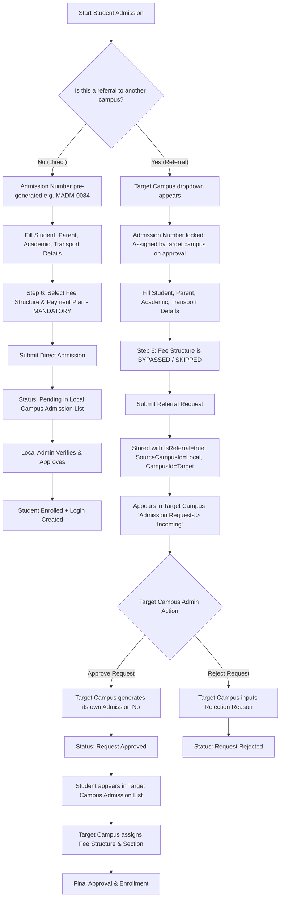

# Student Admission & Cross-Campus Referral Flow: Frontend Integration Guide

This document provides complete technical specifications for the Frontend team to integrate and manage the **Student Admission & Cross-Campus Referral** module.

---

## 1. Architectural Overview & Workflows

### 1.1 Direct Admission vs. Cross-Campus Referral Comparison



---

## 2. Form Behavior & Dynamic State Rules

When building or updating the Student Admission Form, the following state rules must be applied:

| UI Field / Section | Referral = "No" (Direct) | Referral = "Yes" (Referral) |
| :--- | :--- | :--- |
| **"Is this a referral to another campus?"** | Toggle / Radio: `No` | Toggle / Radio: `Yes` |
| **"Campus *"** | Read-only / pre-selected to active campus | Read-only: Reflects originating source campus |
| **"Target Campus \*"** | **Hidden** | **Visible & Required**: Dropdown showing all campuses **except** the current campus |
| **"Admission Number"** | Generated via `generate-number` API (e.g., `MADM-0084`) | Read-only disabled field with text: `Assigned by target campus on approval` |
| **Fee Structure Step (Step 6)** | **Required**: Fee structure, component selection, and installments must be chosen | **Bypassed / Skipped**: Fee structure is omitted (`FeeStructureId = null`, `PaymentPlan = null`) |
| **Review Step** | Shows assigned fee summary and local admission number | Shows `Target Campus` and `Admission Number: Pending Target Approval` |

---

## 3. Required Headers & Context

Every API call made by the frontend should supply the current active campus ID to ensure multi-campus tenancy isolation:

```http
Authorization: Bearer <jwt_token>
X-Campus-Id: <current_active_campus_id>
```

> [!NOTE]
> If `X-Campus-Id` is omitted, the backend will attempt to extract the `CampusId` claim from the user's JWT. Supplying the `X-Campus-Id` header explicitly ensures immediate response to the user's campus switcher in the header.

---

## 4. API Endpoints Reference

### 4.1 Number Generation / Live Preview

Used when referral toggle is **"No"** to show the pre-allocated admission number.

- **Endpoint**: `POST /api/v1/student-admissions/generate-number`
- **Query Params**:
  - `campusId` (int, required)
  - `boardId` (int, optional)
  - `academicYearId` (int, optional)
  - `isReferral` (bool, default `false`)
- **Behavior**:
  - When `isReferral=true`: returns `null` (no number consumed).
  - When `isReferral=false`: returns `{ "admissionNumber": "MADM-0084" }`.

---

### 4.2 Submit Admission / Referral

- **Endpoint**: `POST /api/v1/student-admissions`
- **Content-Type**: `multipart/form-data`

#### Form-Data Payload Fields:

| Field Name | Type | Required for Direct? | Required for Referral? | Notes |
| :--- | :--- | :--- | :--- | :--- |
| `IsReferral` | string (`"true"` / `"false"`) | Yes (`"false"`) | Yes (`"true"`) | Flag indicating referral |
| `CampusId` | number | Yes (Current Campus) | Yes (**Target Campus ID**) | Destination campus |
| `SourceCampusId` | number | No (or null) | Yes (**Originating Campus ID**) | Campus submitting request |
| `AdmissionNo` | string | Yes (Generated e.g. `MADM-0084`) | No (Send empty string `""` or omit) | Do **NOT** send `"null"` |
| `AdmissionDate` | ISO 8601 string | Yes | Yes | e.g. `2026-10-11T00:00:00` |
| `AdmissionType` | string | Yes | Yes | e.g. `"Regular"`, `"Management"` |
| `BoardId` | number | Yes | Yes | ID from Boards master |
| `AcademicYearId` | number | Yes | Yes | ID from AcademicYears master |
| `AcademicLevelId`| number | Yes | Yes | ID from AcademicLevels master |
| `GroupId` | number | Yes | Yes | ID from Groups master |
| `ProgramId` | number | Yes | Yes | ID from Programs master |
| `FirstName` | string | Yes | Yes | Student First Name |
| `LastName` | string | No | No | Student Last Name |
| `Gender` | string | Yes | Yes | `"Male"`, `"Female"`, `"Other"` |
| `DateOfBirth` | ISO 8601 string | Yes | Yes | e.g. `2005-08-15` |
| `BloodGroup` | string | No | No | e.g. `"O+"` |
| `StudentEmail` | string | No | No | Student email |
| `StudentMobileNumber`| string | No | No | Student phone |
| `StudentPhoto` | File (binary) | No | No | JPG/PNG file upload |
| `AadhaarNumber` | string | No | No | 12-digit Aadhaar |
| `FatherName` | string | No | No | Parent details |
| `FatherMobile` | string | No | No | Parent contact |
| `MotherName` | string | No | No | Parent details |
| `MotherMobile` | string | No | No | Parent contact |
| `AddressLine1` / `StreetVillage` | string | No | No | Address |
| `City` / `Mandal`| string | No | No | Town / City |
| `District` | string | No | No | District |
| `State` | string | No | No | State |
| `Pincode` | string | No | No | 6-digit Pincode |
| `FeeStructureId` | number | **Yes (Direct)** | **No (Referral - Omit)** | Bypassed for referral |
| `PaymentPlan` | string | **Yes (Direct)** | **No (Referral - Omit)** | Bypassed for referral |

#### Response (`201 Created`):
```json
{
  "admissionId": 621,
  "admissionNo": "",
  "campusId": 2,
  "campusName": "City Center Branch",
  "sourceCampusId": 1,
  "sourceCampusName": "Main Campus (HQ)",
  "isReferral": true,
  "status": "Pending",
  "firstName": "Rahul",
  "lastName": "Sharma",
  "createdAt": "2026-10-11T13:30:00Z"
}
```

---

### 4.3 Get Outgoing Requests ("My Campus Requests")

Used in the "Admission Requests" tab by the referring campus to track referral requests submitted to other campuses.

- **Endpoint**: `GET /api/v1/student-admissions/requests/outgoing`
- **Headers**: `X-Campus-Id: <current_campus_id>`
- **Response (`200 OK`)**: Array of admission items:

```json
[
  {
    "admissionId": 621,
    "admissionNo": "",
    "campusId": 2,
    "campusName": "City Center Branch",
    "sourceCampusId": 1,
    "sourceCampusName": "Main Campus (HQ)",
    "isReferral": true,
    "status": "Pending",
    "firstName": "Rahul",
    "lastName": "Sharma",
    "gender": "Male",
    "dateOfBirth": "2005-08-15T00:00:00",
    "studentMobileNumber": "9876543210",
    "createdAt": "2026-10-11T13:30:00Z",
    "remarks": "Referred due to student relocation"
  }
]
```

---

### 4.4 Get Incoming Requests ("Incoming Requests")

Used in the "Admission Requests" tab by the destination campus to view and take action on incoming referral requests.

- **Endpoint**: `GET /api/v1/student-admissions/requests/incoming`
- **Headers**: `X-Campus-Id: <current_campus_id>`
- **Response (`200 OK`)**: Array of incoming admission requests.

---

### 4.5 Approve Referral Request (Target Campus)

Triggered when the Target Campus Administrator clicks **"Approve Request"** in the Incoming Requests detail view.

- **Endpoint**: `POST /api/v1/student-admissions/{id}/approve-request`
- **Payload (`application/json`)**:
```json
{
  "remarks": "Approved by City Branch Dean"
}
```

#### What Backend Does on This Call:
1. Validates that the request belongs to the target campus.
2. Automatically generates the Target Campus's **`AdmissionNo`** (e.g. `CITY-2026-0042`) using the target campus's number series.
3. Updates `Status = "Request Approved"` and sets `AdmissionNo = <GeneratedNumber>`.
4. Creates an audit trail log entry.

#### Response (`200 OK`):
```json
{
  "message": "Request approved successfully."
}
```

> [!TIP]
> After calling `approve-request`, the student now has a valid target-campus admission number and will appear in the Target Campus's main **Student Admission List**. Target campus staff can then select the student to configure fee structures, assign sections, and finalize enrollment.

---

### 4.6 Reject Referral Request (Target Campus)

Triggered when the Target Campus Administrator clicks **"Reject Request"**.

- **Endpoint**: `POST /api/v1/student-admissions/{id}/reject-request`
- **Payload (`application/json`)**:
```json
{
  "rejectionReason": "Requested program batch is currently full",
  "remarks": "Please refer student to North Extension"
}
```

#### Response (`200 OK`):
```json
{
  "message": "Request rejected successfully."
}
```

---

## 5. Frontend Helper Functions & Implementation Code

### 5.1 Referral Payload Mapping (`admissionReferral.js`)

Ensure frontend form submissions use this exact logic before dispatching:

```javascript
/**
 * Maps the form state to referral fields.
 */
export const mapAdmissionReferral = (values, currentCampusId, isReferral, targetCampusId, campusOptions) => {
  const sourceId = Number(currentCampusId);
  if (!sourceId || sourceId <= 0) {
    throw new Error("Select the current campus before submitting the admission.");
  }

  // Direct Admission (Non-referral)
  if (!isReferral) {
    return {
      ...values,
      isReferral: false,
      campus: sourceId,
      sourceCampusId: null,
    };
  }

  // Cross-Campus Referral
  const targetId = Number(targetCampusId);
  if (!targetId || targetId === sourceId) {
    throw new Error("Select a target campus different from your current campus.");
  }

  return {
    ...values,
    isReferral: true,
    campus: targetId,         // Target Campus becomes primary CampusId
    sourceCampusId: sourceId, // Originating Campus becomes SourceCampusId
    admissionNo: "",          // Omit or leave empty for referral
  };
};

/**
 * Appends referral fields to FormData.
 */
export const appendReferralFields = (formData, values) => {
  formData.set("IsReferral", String(Boolean(values.isReferral)));
  if (values.isReferral) {
    formData.set("CampusId", String(values.campus));
    formData.set("SourceCampusId", String(values.sourceCampusId));
    formData.set("AdmissionNo", ""); // Empty string; never send literal string "null"
  }
};
```

---

## 6. Status Values & Badges

The frontend UI should render the following badge styles for admission request statuses:

| Status Value | Meaning | UI Badge Style |
| :--- | :--- | :--- |
| `Pending` | Referral request awaiting target campus action | Yellow / Warning badge (`cms-badge-warn`) |
| `Request Approved` | Referral approved by target campus; target admission number assigned | Green / Success badge (`cms-badge-active`) |
| `Request Rejected` | Referral rejected by target campus | Red / Danger badge (`cms-badge-danger`) |
| `Approved` | Final enrollment complete with section and fee assignment | Dark Green / Success badge |

---

## 7. Error Handling & Validation Rules

1. **Self-Referral Prevention**: The UI must not allow the user to select the current campus as the `Target Campus`.
2. **Missing Target Campus**: If `IsReferral` is toggled `Yes`, the "Target Campus" field must be marked with a required asterisk `*` and block step submission if unselected.
3. **Rejection Reason Mandatory**: When rejecting a request in the modal/dialog, the `rejectionReason` prompt or field is **mandatory**. If empty, the frontend must display: *"Rejection reason is required."* before hitting the API.
4. **Toast Feedback**:
   - On referral submit: *"Referral request submitted successfully to [Target Campus Name]."*
   - On referral approve: *"Admission request approved. Admission number assigned."*
   - On referral reject: *"Admission request rejected."*
