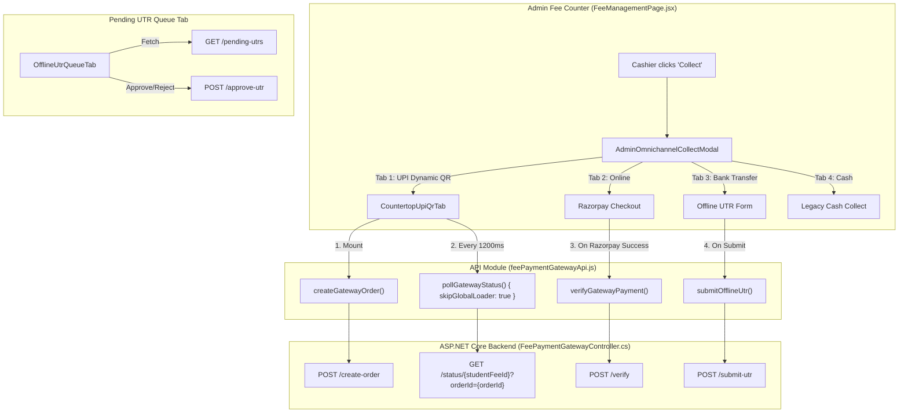

# Frontend API Integration Plan
## Omnichannel Payment Gateway & Admin Fee Collection

**Target Audience:** Frontend Development Team  
**Module:** Admin Fee Management (`Frontend/src/modules/admin/AdminFees/FeeManagementPage.jsx`)  
**Backend Base Route:** `/api/v1/fee-payments/gateway`  
**Authentication:** Bearer JWT (automatically injected by `apiClient`)  
**Status:** Ready for Integration  

---

## 1. Architectural Overview & Request Flow

The backend controller [`FeePaymentGatewayController.cs`](file:///c:/Users/ADMIN/Desktop/College-Management-System/Backend/src/CollegeManagement.API/Controllers/V1/FeePaymentGatewayController.cs) exposes 7 dedicated REST endpoints. 

All endpoints integrate with our existing `apiClient` (`Frontend/src/api/axios.js` / `Frontend/src/api/apiClient.js`), meaning:
1. **Bearer Token:** The logged-in admin/cashier JWT token is automatically injected in the `Authorization` header.
2. **Global Loader Bypass:** For high-frequency 1200ms polling, pass `{ skipGlobalLoader: true }` in the Axios config so the fullscreen page spinner is NOT triggered on every tick.
3. **Error Standardization:** Wrap responses in `getApiErrorMessage(error)` to display user-friendly backend validation messages.



---

## 2. API Endpoints Contract Specification

### 2.1 Create Gateway Order
- **URL:** `POST /api/v1/fee-payments/gateway/create-order`
- **Purpose:** Creates a Razorpay order, generates an internal transaction record, builds an NPCI UPI URI (`upi://pay?...`), and renders a high-res Base64 PNG QR code.
- **Request Headers:**
  ```http
  Content-Type: application/json
  Authorization: Bearer <JWT_TOKEN>
  ```
- **Request Payload:**
  ```json
  {
    "studentId": 1045,
    "studentFeeId": 204,
    "feeInstallmentIds": [501, 502],
    "amount": 15000.00,
    "paymentMethod": "UPI_QR"
  }
  ```
  *(Note: `feeInstallmentIds` can be `[]` if paying towards full outstanding balance).*
- **Success Response (`200 OK`):**
  ```json
  {
    "success": true,
    "orderId": "order_OG9238hsd98",
    "amount": 15000.00,
    "currency": "INR",
    "upiUri": "upi://pay?pa=pirnavcolleges@hdfcbank&pn=Pirnav%20Colleges&am=15000.00&cu=INR&tr=order_OG9238hsd98&tn=Fee%20Payment",
    "qrCodeBase64": "data:image/png;base64,iVBORw0KGgoAAAANSUhEUgAA...",
    "keyId": "rzp_test_your_key_id_here",
    "errorMessage": null
  }
  ```
- **Frontend Usage:**
  - Render `qrCodeBase64` directly into ``.
  - Pass `upiUri` to a "Copy UPI Link" clipboard button.
  - Store `orderId` in state to feed into the polling hook.

---

### 2.2 Status Polling (Reactive Check)
- **URL:** `GET /api/v1/fee-payments/gateway/status/{studentFeeId}?orderId={orderId}`
- **Frequency:** Every **1200ms** while modal is visible.
- **Config Option:** `{ skipGlobalLoader: true }` (prevents global spinner flicker).
- **Request Query:**
  - `studentFeeId` (route param): ID of the student fee record.
  - `orderId` (query param): The order ID returned from `create-order`.
- **Response when Awaiting Payment (`200 OK`):**
  ```json
  {
    "success": true,
    "orderId": "order_OG9238hsd98",
    "status": "Created",
    "isPaid": false,
    "amount": 15000.00,
    "receiptNumber": null,
    "transactionId": null,
    "failureReason": null
  }
  ```
- **Response when Payment Captured (`200 OK`):**
  ```json
  {
    "success": true,
    "orderId": "order_OG9238hsd98",
    "status": "Captured",
    "isPaid": true,
    "amount": 15000.00,
    "receiptNumber": "REC-2026-00891",
    "transactionId": "pay_OIGs892348",
    "failureReason": null
  }
  ```
- **Frontend Action on `isPaid: true`:**
  1. Stop polling timer.
  2. Play audio confirmation chime.
  3. Show green checkmark overlay for 1.2s.
  4. Trigger `onSaved()` callback to update parent ledger and display official receipt modal.

---

### 2.3 Verify Razorpay Checkout Signature
- **URL:** `POST /api/v1/fee-payments/gateway/verify`
- **Purpose:** Verifies Razorpay checkout HMAC-SHA256 signature and settles payment when using online cards/netbanking.
- **Request Payload:**
  ```json
  {
    "orderId": "order_OG9238hsd98",
    "razorpayPaymentId": "pay_OIGs892348",
    "razorpaySignature": "9ef8a23b9d0...",
    "studentFeeId": 204,
    "amount": 15000.00
  }
  ```
- **Success Response (`200 OK`):**
  ```json
  {
    "success": true,
    "receiptNumber": "REC-2026-00891",
    "amount": 15000.00
  }
  ```

---

### 2.4 Submit Offline Bank Transfer (UTR)
- **URL:** `POST /api/v1/fee-payments/gateway/submit-utr`
- **Purpose:** Submits direct bank transfer details (NEFT/RTGS/IMPS) for cashier verification.
- **Request Payload:**
  ```json
  {
    "studentId": 1045,
    "studentFeeId": 204,
    "amount": 15000.00,
    "utrNumber": "421809124589",
    "bankName": "HDFC Bank",
    "paymentDate": "2026-11-09",
    "remarks": "IMPS transfer reference"
  }
  ```
- **Success Response (`200 OK`):**
  ```json
  {
    "success": true,
    "message": "UTR submitted for verification."
  }
  ```

---

### 2.5 Query Pending UTRs Queue
- **URL:** `GET /api/v1/fee-payments/gateway/pending-utrs?campusId={campusId}&academicYearId={yearId}`
- **Purpose:** Populates the "Pending UTR Queue" subtab table.
- **Success Response (`200 OK`):**
  ```json
  [
    {
      "id": 89,
      "studentName": "Rahul Sharma",
      "admissionNo": "ADM-2026-0104",
      "group": "MPC",
      "section": "A",
      "amount": 15000.00,
      "utrNumber": "421809124589",
      "bankName": "HDFC Bank",
      "date": "2026-11-09T08:30:00Z",
      "status": "PendingVerification"
    }
  ]
  ```

---

### 2.6 Approve or Reject UTR Action
- **URL:** `POST /api/v1/fee-payments/gateway/approve-utr`
- **Request Payload:**
  ```json
  {
    "transactionId": 89,
    "action": "Approve",
    "reason": ""
  }
  ```
  *(For Rejection: `{ "transactionId": 89, "action": "Reject", "reason": "UTR not found in college statement" }`).*
- **Success Response (`200 OK`):**
  ```json
  {
    "success": true,
    "receiptNumber": "REC-2026-00892"
  }
  ```

---

### 2.7 Export Audit Ledger (CSV)
- **URL:** `GET /api/v1/fee-payments/gateway/export-ledger?campusId={campusId}&academicYearId={yearId}`
- **Config Option:** `{ responseType: "blob" }`
- **Response:** Raw CSV binary stream with UTF-8 BOM (`0xEF, 0xBB, 0xBF`), auto-naming `Fee_Payments_Ledger_YYYY-MM-DD.csv`.

---

## 3. Dedicated API Module Implementation

Create a new file: [`Frontend/src/api/feePaymentGatewayApi.js`](file:///c:/Users/ADMIN/Desktop/College-Management-System/Frontend/src/api/feePaymentGatewayApi.js)

```javascript
import apiClient, { getApiErrorMessage } from "./axios.js";

const BASE_URL = "/api/v1/fee-payments/gateway";

/**
 * 1. Create Gateway Order & Generate Dynamic NPCI UPI QR
 */
export async function createGatewayOrderApi({
  studentId,
  studentFeeId,
  feeInstallmentIds = [],
  amount,
  paymentMethod = "UPI_QR",
}) {
  try {
    const res = await apiClient.post(`${BASE_URL}/create-order`, {
      studentId: Number(studentId),
      studentFeeId: Number(studentFeeId),
      feeInstallmentIds: (feeInstallmentIds || []).map(Number),
      amount: Number(amount),
      paymentMethod,
    });
    return res.data;
  } catch (err) {
    throw new Error(getApiErrorMessage(err));
  }
}

/**
 * 2. Real-Time Status Polling (Silent Probe)
 * Uses skipGlobalLoader: true to prevent UI flicker.
 */
export async function pollGatewayStatusApi(studentFeeId, orderId, signal) {
  try {
    const res = await apiClient.get(
      `${BASE_URL}/status/${encodeURIComponent(studentFeeId)}`,
      {
        params: { orderId },
        skipGlobalLoader: true, // Prevents global page spinner
        signal,
      }
    );
    return res.data;
  } catch (err) {
    // If request was canceled by AbortController, ignore
    if (err.name === "CanceledError" || err.code === "ERR_CANCELED") {
      return null;
    }
    throw new Error(getApiErrorMessage(err));
  }
}

/**
 * 3. Verify Razorpay Online Checkout Payment
 */
export async function verifyGatewayPaymentApi({
  orderId,
  razorpayPaymentId,
  razorpaySignature,
  studentFeeId,
  amount,
}) {
  try {
    const res = await apiClient.post(`${BASE_URL}/verify`, {
      orderId,
      razorpayPaymentId,
      razorpaySignature,
      studentFeeId: Number(studentFeeId),
      amount: Number(amount),
    });
    return res.data;
  } catch (err) {
    throw new Error(getApiErrorMessage(err));
  }
}

/**
 * 4. Submit Offline Bank Transfer (UTR)
 */
export async function submitOfflineUtrApi({
  studentId,
  studentFeeId,
  amount,
  utrNumber,
  bankName,
  paymentDate,
  remarks,
}) {
  try {
    const res = await apiClient.post(`${BASE_URL}/submit-utr`, {
      studentId: Number(studentId),
      studentFeeId: Number(studentFeeId),
      amount: Number(amount),
      utrNumber: String(utrNumber).trim(),
      bankName: bankName?.trim() || null,
      paymentDate: paymentDate || null,
      remarks: remarks?.trim() || null,
    });
    return res.data;
  } catch (err) {
    throw new Error(getApiErrorMessage(err));
  }
}

/**
 * 5. Fetch Pending UTR Queue for Admin Verification
 */
export async function fetchPendingUtrsApi(campusId, academicYearId) {
  try {
    const res = await apiClient.get(`${BASE_URL}/pending-utrs`, {
      params: { campusId, academicYearId },
    });
    return res.data || [];
  } catch (err) {
    throw new Error(getApiErrorMessage(err));
  }
}

/**
 * 6. Approve or Reject Pending UTR Submission
 */
export async function approveOrRejectUtrApi(transactionId, action, reason = "") {
  try {
    const res = await apiClient.post(`${BASE_URL}/approve-utr`, {
      transactionId: Number(transactionId),
      action, // "Approve" or "Reject"
      reason: reason || null,
    });
    return res.data;
  } catch (err) {
    throw new Error(getApiErrorMessage(err));
  }
}

/**
 * 7. Download Payments Audit Ledger (UTF-8 BOM CSV)
 */
export async function exportPaymentsLedgerApi(campusId, academicYearId) {
  try {
    const res = await apiClient.get(`${BASE_URL}/export-ledger`, {
      params: { campusId, academicYearId },
      responseType: "blob",
    });

    const blob = new Blob([res.data], { type: "text/csv;charset=utf-8;" });
    const url = window.URL.createObjectURL(blob);
    const link = document.createElement("a");
    link.href = url;
    link.setAttribute(
      "download",
      `Fee_Payments_Ledger_${new Date().toISOString().slice(0, 10)}.csv`
    );
    document.body.appendChild(link);
    link.click();
    link.remove();
    window.URL.revokeObjectURL(url);
    return true;
  } catch (err) {
    throw new Error(getApiErrorMessage(err));
  }
}
```

---

## 4. Component Integration Instructions

### Step 1: Update Polling Hook (`usePaymentPolling.js`)
Use `pollGatewayStatusApi` with an `AbortController` to guarantee clean unmounting:

```javascript
import { useEffect, useRef, useState } from "react";
import { pollGatewayStatusApi } from "@/api/feePaymentGatewayApi.js";

export function usePaymentPolling({
  studentFeeId,
  orderId,
  enabled = false,
  intervalMs = 1200,
  timeoutSeconds = 600,
  onSuccess,
  onFailed,
}) {
  const [status, setStatus] = useState("IDLE");
  const [secondsLeft, setSecondsLeft] = useState(timeoutSeconds);
  const pollTimerRef = useRef(null);
  const countdownTimerRef = useRef(null);
  const abortControllerRef = useRef(null);

  const playSuccessChime = () => {
    try {
      const AudioCtx = window.AudioContext || window.webkitAudioContext;
      if (!AudioCtx) return;
      const audioCtx = new AudioCtx();
      const osc = audioCtx.createOscillator();
      const gain = audioCtx.createGain();
      osc.type = "sine";
      osc.frequency.setValueAtTime(587.33, audioCtx.currentTime); // D5
      osc.frequency.setValueAtTime(880, audioCtx.currentTime + 0.12); // A5
      gain.gain.setValueAtTime(0.15, audioCtx.currentTime);
      gain.gain.exponentialRampToValueAtTime(0.001, audioCtx.currentTime + 0.6);
      osc.connect(gain);
      gain.connect(audioCtx.destination);
      osc.start();
      osc.stop(audioCtx.currentTime + 0.6);
    } catch { /* Ignored */ }
  };

  useEffect(() => {
    if (!enabled || !orderId || !studentFeeId) {
      setStatus("IDLE");
      return;
    }

    setStatus("POLLING");
    setSecondsLeft(timeoutSeconds);

    countdownTimerRef.current = setInterval(() => {
      setSecondsLeft((prev) => {
        if (prev <= 1) {
          clearInterval(countdownTimerRef.current);
          clearInterval(pollTimerRef.current);
          setStatus("TIMEOUT");
          onFailed?.("Payment session timed out. Please refresh to generate a new QR.");
          return 0;
        }
        return prev - 1;
      });
    }, 1000);

    const checkSettlement = async () => {
      abortControllerRef.current?.abort();
      const controller = new AbortController();
      abortControllerRef.current = controller;

      try {
        const data = await pollGatewayStatusApi(studentFeeId, orderId, controller.signal);
        if (!data) return;

        if (data.isPaid || data.status === "Captured" || data.status === "Paid") {
          clearInterval(pollTimerRef.current);
          clearInterval(countdownTimerRef.current);
          setStatus("SUCCESS");
          playSuccessChime();
          onSuccess?.(data);
        } else if (data.status === "Failed") {
          clearInterval(pollTimerRef.current);
          clearInterval(countdownTimerRef.current);
          setStatus("ERROR");
          onFailed?.(data.failureReason || "Payment was declined by bank.");
        }
      } catch (err) {
        console.warn("Polling probe:", err.message);
      }
    };

    pollTimerRef.current = setInterval(checkSettlement, intervalMs);

    return () => {
      clearInterval(pollTimerRef.current);
      clearInterval(countdownTimerRef.current);
      abortControllerRef.current?.abort();
    };
  }, [enabled, orderId, studentFeeId, intervalMs, timeoutSeconds]);

  return { status, secondsLeft };
}
```

---

### Step 2: Integration in `FeeManagementPage.jsx`

In [`Frontend/src/modules/admin/AdminFees/FeeManagementPage.jsx`](file:///c:/Users/ADMIN/Desktop/College-Management-System/Frontend/src/modules/admin/AdminFees/FeeManagementPage.jsx):

1. **Import the API & Components:**
   ```javascript
   import { exportPaymentsLedgerApi } from "@/api/feePaymentGatewayApi.js";
   import { AdminOmnichannelCollectModal } from "./components/AdminOmnichannelCollectModal.jsx";
   import { OfflineUtrQueueTab } from "./components/OfflineUtrQueueTab.jsx";
   ```

2. **Add "Pending UTRs" to `LEDGER_TABS`:**
   ```javascript
   const LEDGER_TABS = [
     { id: "Fee Collection", label: "Fee Collection" },
     { id: "Student Fee Ledger", label: "Fee Accounts" },
     { id: "Payment History", label: "Payment History" },
     { id: "Pending UTRs", label: "Pending UTR Queue" }, // <-- New Tab
   ];
   ```

3. **Render the Export Button in the Toolbar:**
   ```jsx
   <button
     type="button"
     className="cms-btn cms-btn-outline"
     onClick={async () => {
       try {
         await exportPaymentsLedgerApi(selectedCampusValue, selectedAcademicYearId);
         setToast("Payments ledger exported successfully.");
       } catch (err) {
         setToast(err.message);
       }
     }}
   >
     <Download size={15} /> Export Ledger (CSV)
   </button>
   ```

4. **Replace Modal at line 5117:**
   ```jsx
   {selected && collecting ? (
     <AdminOmnichannelCollectModal
       account={selected}
       onClose={() => setCollecting(false)}
       onSaved={(saved) => {
         setCollecting(false);
         setToast(`Payment of ${formatCurrency(saved.amount)} recorded - receipt ${saved.receiptNo}`);
         setReceipt(normalizeReceipt(saved, selected));
       }}
     />
   ) : null}
   ```

---

## 5. Teammate API Integration Testing & Validation Checklist

Before submitting the frontend pull request, test each API call in Chrome DevTools Network Tab:

| Test Case | Expected Request | Expected Status | Validation Point |
|:---|:---|:---|:---|
| **1. Create Order** | `POST /create-order` | `200 OK` | Check that `qrCodeBase64` begins with `data:image/png;base64,` and `orderId` is non-empty. |
| **2. Silent Polling** | `GET /status/{id}?orderId=...` | `200 OK` | Observe that requests fire every 1200ms and **no global loading spinner** appears on the screen (`skipGlobalLoader: true`). |
| **3. Polling Cleanup** | Close modal while polling | Canceled / Stopped | Verify that polling immediately halts and no React state warning appears in the console. |
| **4. UTR Submission** | `POST /submit-utr` | `200 OK` | Submit a test UTR (e.g. `UTR9988776655`). Check that status is `200` with success message. |
| **5. UTR Queue Fetch** | Switch to "Pending UTR Queue" tab | `200 OK` | Verify `GET /pending-utrs` returns the submitted UTR and renders in the table. |
| **6. UTR Approval** | Click "Approve & Credit" | `200 OK` | Verify `POST /approve-utr` returns `{ success: true, receiptNumber: "..." }` and row disappears from pending queue. |
| **7. Export Ledger** | Click "Export Ledger (CSV)" | `200 OK` | File downloads as `.csv`, opens in Excel, and has correct UTF-8 BOM encoding. |
