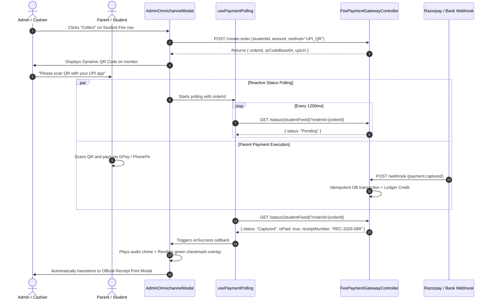

# Technical Specification & Implementation Guide
## Omnichannel Payment Gateway & Admin Fee Collection System

**Project:** College Management System  
**Module:** Admin Fee Management (`Frontend/src/modules/admin/AdminFees/`)  
**Target Audience:** Frontend Development Team  
**Status:** Approved for Implementation (v1.0)  
**Date:** November 2026  

---

## 1. Executive Summary & Objective

This document provides a comprehensive, production-ready implementation blueprint for modernizing the **Admin Fee Management System** into an **Omnichannel Payment Collection Engine**.

Currently, the cashier at the fee counter manually selects payment modes (Cash, Cheque, Bank Transfer) in a basic modal and records the entry. With this upgrade, when an Admin or Cashier clicks **"Collect"** on any student row in [`FeeManagementPage.jsx`](file:///c:/Users/ADMIN/Desktop/College-Management-System/Frontend/src/modules/admin/AdminFees/FeeManagementPage.jsx), they will be presented with a **Unified 4-Tab Omnichannel Payment Modal**:

1. **Countertop UPI Dynamic QR Code:** Generates an NPCI-compliant dynamic UPI QR on the counter screen. The parent scans it using any UPI app (GPay, PhonePe, Paytm). The modal auto-polls every **1200ms**, plays a confirmation chime when payment lands, and opens the official receipt.
2. **Razorpay Online / Card POS / NetBanking:** Triggers the standard Razorpay checkout modal or sends a direct payment link to the parent's WhatsApp/SMS.
3. **Offline Bank Transfer (NEFT/RTGS/IMPS UTR):** Allows cashiers to record direct bank transfers with a 12-digit UTR reference number.
4. **Cash Counter Receipt:** Traditional physical cash collection with denomination and voucher notes.

Additionally, you will implement:
- A new **"Pending UTR Queue"** tab in the Student Fee Ledger to approve or reject offline bank transfers.
- An **"Export Payments Ledger"** toolbar action to download an audit-ready UTF-8 BOM CSV/Excel file.

---

## 2. Omnichannel Architecture & Interaction Flow



---

## 3. Directory & File Structure

Create and organize files in the following exact directory structure:

```
Frontend/src/
├── api/
│   └── apiEndpoints.js                         <-- Step 1: Add Gateway Endpoints
└── modules/admin/AdminFees/
    ├── hooks/
    │   └── usePaymentPolling.js                 <-- Step 2: 1200ms Reactive Polling Hook
    ├── components/
    │   ├── CountertopUpiQrTab.jsx               <-- Step 3: Dynamic QR, Countdown & Audio
    │   ├── AdminOmnichannelCollectModal.jsx     <-- Step 4: Master 4-Tab Payment Modal
    │   └── OfflineUtrQueueTab.jsx               <-- Step 5: Admin UTR Verification Subtab
    ├── FeeManagementPage.jsx                    <-- Step 6: Integration & Wiring
    └── FeeManagementPage.css                    <-- Step 7: Styles using CMS design tokens
```

---

## 4. Backend REST API Contract

The backend provides the following endpoints under `/api/v1/fee-payments/gateway`:

### 4.1 Create Gateway Order
- **URL:** `POST /api/v1/fee-payments/gateway/create-order`
- **Request Body:**
  ```json
  {
    "studentId": 1045,
    "studentFeeId": 204,
    "feeInstallmentIds": [501, 502],
    "amount": 15000.00,
    "paymentMethod": "UPI_QR"
  }
  ```
- **Response (`200 OK`):**
  ```json
  {
    "success": true,
    "orderId": "order_OG9238hsd98",
    "amount": 15000.00,
    "currency": "INR",
    "upiUri": "upi://pay?pa=pirnavcolleges@hdfcbank&pn=Pirnav%20Colleges&am=15000.00&cu=INR&tr=order_OG9238hsd98",
    "qrCodeBase64": "data:image/png;base64,iVBORw0KGgoAAAANSUhEUgAA...",
    "keyId": "rzp_live_abc123"
  }
  ```

### 4.2 Check Order Settlement Status (Polling)
- **URL:** `GET /api/v1/fee-payments/gateway/status/{studentFeeId}?orderId={orderId}`
- **Response (`200 OK`):**
  ```json
  {
    "success": true,
    "orderId": "order_OG9238hsd98",
    "status": "Captured",
    "isPaid": true,
    "amount": 15000.00,
    "receiptNumber": "REC-2026-00452",
    "transactionId": "pay_OIGs892348"
  }
  ```

### 4.3 Submit Bank Transfer (Offline UTR)
- **URL:** `POST /api/v1/fee-payments/gateway/submit-utr`
- **Request Body:**
  ```json
  {
    "studentId": 1045,
    "studentFeeId": 204,
    "amount": 15000.00,
    "utrNumber": "421809124589",
    "bankName": "HDFC Bank",
    "paymentDate": "2026-11-09",
    "remarks": "Paid via IMPS online banking"
  }
  ```

### 4.4 Pending UTRs Queue
- **URL:** `GET /api/v1/fee-payments/gateway/pending-utrs?campusId={campusId}&academicYearId={yearId}`
- **Response (`200 OK`):**
  ```json
  [
    {
      "id": 89,
      "studentName": "Rahul Sharma",
      "admissionNo": "ADM-2026-0104",
      "group": "MPC",
      "section": "A",
      "amount": 15000.00,
      "utrNumber": "421809124589",
      "bankName": "HDFC Bank",
      "date": "2026-11-09T08:30:00Z",
      "status": "Pending"
    }
  ]
  ```

### 4.5 Approve / Reject UTR
- **URL:** `POST /api/v1/fee-payments/gateway/approve-utr`
- **Request Body:**
  ```json
  {
    "transactionId": 89,
    "action": "Approve",
    "reason": ""
  }
  ```

### 4.6 Export Audit Ledger (CSV)
- **URL:** `GET /api/v1/fee-payments/gateway/export-ledger?campusId={campusId}&academicYearId={yearId}`
- **Response:** Binary Stream (`text/csv; charset=utf-8`) with UTF-8 BOM (`0xEF, 0xBB, 0xBF`).

---

## 5. Complete Code Implementations

### Step 1: Update `Frontend/src/api/apiEndpoints.js`
Add `feeGateway` inside `apiEndpoints`:

```javascript
// Append inside export const apiEndpoints = { ... }
feeGateway: {
  createOrder: "/api/v1/fee-payments/gateway/create-order",
  verify: "/api/v1/fee-payments/gateway/verify",
  status: (studentFeeId, orderId) => 
    `/api/v1/fee-payments/gateway/status/${encodeURIComponent(studentFeeId)}?orderId=${encodeURIComponent(orderId)}`,
  submitUtr: "/api/v1/fee-payments/gateway/submit-utr",
  pendingUtrs: "/api/v1/fee-payments/gateway/pending-utrs",
  approveUtr: "/api/v1/fee-payments/gateway/approve-utr",
  exportLedger: "/api/v1/fee-payments/gateway/export-ledger",
  receiptPdf: (paymentId) => `/api/v1/fee-payments/gateway/receipt/${encodeURIComponent(paymentId)}/pdf`,
},
```

---

### Step 2: Create `Frontend/src/modules/admin/AdminFees/hooks/usePaymentPolling.js`
This hook encapsulates the 1200ms polling loop, timeout countdown, and confirmation chime:

```javascript
import { useEffect, useRef, useState } from "react";
import apiClient from "@/api/axios.js";
import { apiEndpoints } from "@/api/apiEndpoints.js";

/**
 * usePaymentPolling: Polls payment settlement status every 1200ms.
 * Safely cleans up on component unmount to prevent React memory leaks.
 */
export function usePaymentPolling({
  studentFeeId,
  orderId,
  enabled = false,
  intervalMs = 1200,
  timeoutSeconds = 600,
  onSuccess,
  onFailed,
}) {
  const [status, setStatus] = useState("IDLE"); // IDLE | POLLING | SUCCESS | TIMEOUT | ERROR
  const [secondsLeft, setSecondsLeft] = useState(timeoutSeconds);
  const pollTimerRef = useRef(null);
  const countdownTimerRef = useRef(null);

  // Play pleasant two-tone confirmation chime
  const playSuccessChime = () => {
    try {
      const AudioCtx = window.AudioContext || window.webkitAudioContext;
      if (!AudioCtx) return;
      const audioCtx = new AudioCtx();
      const osc = audioCtx.createOscillator();
      const gain = audioCtx.createGain();
      osc.type = "sine";
      osc.frequency.setValueAtTime(587.33, audioCtx.currentTime); // D5
      osc.frequency.setValueAtTime(880, audioCtx.currentTime + 0.12); // A5
      gain.gain.setValueAtTime(0.15, audioCtx.currentTime);
      gain.gain.exponentialRampToValueAtTime(0.001, audioCtx.currentTime + 0.6);
      osc.connect(gain);
      gain.connect(audioCtx.destination);
      osc.start();
      osc.stop(audioCtx.currentTime + 0.6);
    } catch {
      // Browser autoplay restriction handled gracefully
    }
  };

  useEffect(() => {
    if (!enabled || !orderId || !studentFeeId) {
      setStatus("IDLE");
      return;
    }

    setStatus("POLLING");
    setSecondsLeft(timeoutSeconds);

    countdownTimerRef.current = setInterval(() => {
      setSecondsLeft((prev) => {
        if (prev <= 1) {
          clearInterval(countdownTimerRef.current);
          clearInterval(pollTimerRef.current);
          setStatus("TIMEOUT");
          onFailed?.("Payment session timed out. Please refresh to generate a new QR.");
          return 0;
        }
        return prev - 1;
      });
    }, 1000);

    const checkSettlement = async () => {
      try {
        const response = await apiClient.get(apiEndpoints.feeGateway.status(studentFeeId, orderId));
        const data = response.data?.data || response.data;

        if (data?.isPaid || data?.status === "Captured" || data?.status === "Paid") {
          clearInterval(pollTimerRef.current);
          clearInterval(countdownTimerRef.current);
          setStatus("SUCCESS");
          playSuccessChime();
          onSuccess?.(data);
        } else if (data?.status === "Failed") {
          clearInterval(pollTimerRef.current);
          clearInterval(countdownTimerRef.current);
          setStatus("ERROR");
          onFailed?.(data?.failureReason || "Payment was declined by customer's bank.");
        }
      } catch (err) {
        // Tolerates transient network issues
        console.warn("Payment status probe:", err.message);
      }
    };

    pollTimerRef.current = setInterval(checkSettlement, intervalMs);

    return () => {
      clearInterval(pollTimerRef.current);
      clearInterval(countdownTimerRef.current);
    };
  }, [enabled, orderId, studentFeeId, intervalMs, timeoutSeconds]);

  return { status, secondsLeft };
}
```

---

### Step 3: Create `Frontend/src/modules/admin/AdminFees/components/CountertopUpiQrTab.jsx`
Displays the dynamic QR code on the cashier's monitor with live timer and status overlays:

```jsx
import React from "react";
import { CheckCircle2, Copy, Loader2, QrCode, RefreshCw } from "lucide-react";
import { formatCurrency } from "@/data/feeManagementData.js";

export function CountertopUpiQrTab({
  qrData,
  loading,
  error,
  pollingStatus,
  secondsLeft,
  amount,
  onRefresh,
}) {
  const formatTime = (seconds) => {
    const mins = Math.floor(seconds / 60);
    const secs = seconds % 60;
    return `${mins}:${secs < 10 ? "0" : ""}${secs}`;
  };

  const copyUpiUri = () => {
    if (qrData?.upiUri) {
      navigator.clipboard.writeText(qrData.upiUri);
      alert("UPI Payment String copied to clipboard!");
    }
  };

  if (loading) {
    return (
      <div className="cms-omni-loading-box">
        <Loader2 className="cms-spin-slow" size={40} />
        <p>Generating dynamic NPCI UPI QR code for <strong>{formatCurrency(amount)}</strong>...</p>
      </div>
    );
  }

  if (error) {
    return (
      <div className="cms-omni-error-box">
        <p className="cms-error">{error}</p>
        <button className="cms-btn cms-btn-outline" onClick={onRefresh}>
          <RefreshCw size={16} /> Retry QR Generation
        </button>
      </div>
    );
  }

  return (
    <div className="cms-omni-qr-container">
      <div className="cms-omni-qr-card">
        <div className="cms-omni-qr-header">
          <span className="cms-omni-vpa-badge">SCAN & PAY WITH ANY UPI APP</span>
          <div className="cms-omni-app-logos">
            <span className="cms-app-pill">GPay</span>
            <span className="cms-app-pill">PhonePe</span>
            <span className="cms-app-pill">Paytm</span>
            <span className="cms-app-pill">BHIM</span>
          </div>
        </div>

        {/* Dynamic Base64 QR Image */}
        <div className="cms-omni-qr-wrapper">
          {qrData?.qrCodeBase64 ? (
            
          ) : (
            <div className="cms-omni-qr-placeholder">
              <QrCode size={120} />
            </div>
          )}

          {pollingStatus === "SUCCESS" && (
            <div className="cms-omni-qr-overlay success">
              <CheckCircle2 size={64} className="cms-success-icon" />
              <h3>Payment Received!</h3>
              <p>Settled instantly</p>
            </div>
          )}
        </div>

        {/* Live Amount Lock */}
        <div className="cms-omni-qr-amount">
          <span>Total Payable Amount</span>
          <h2>{formatCurrency(amount)}</h2>
        </div>

        {/* Countdown & Status Bar */}
        <div className="cms-omni-timer-bar">
          <div className="cms-omni-live-indicator">
            <span className="cms-ping-dot" />
            <span>Awaiting scan from customer</span>
          </div>
          <span className="cms-omni-countdown">Expires in: <strong>{formatTime(secondsLeft)}</strong></span>
        </div>

        {/* Quick Utility Actions */}
        <div className="cms-omni-qr-actions">
          <button type="button" className="cms-btn cms-btn-xs cms-btn-ghost" onClick={copyUpiUri}>
            <Copy size={13} /> Copy UPI URI
          </button>
          <button type="button" className="cms-btn cms-btn-xs cms-btn-ghost" onClick={onRefresh}>
            <RefreshCw size={13} /> Refresh QR
          </button>
        </div>
      </div>
    </div>
  );
}
```

---

### Step 4: Create `Frontend/src/modules/admin/AdminFees/components/AdminOmnichannelCollectModal.jsx`
The master 4-tab payment modal replacing legacy modal:

```jsx
import React, { useState, useEffect } from "react";
import { Modal } from "@/shared/components/Ui.jsx";
import {
  CreditCard,
  QrCode,
  Building,
  Banknote,
  ExternalLink,
} from "lucide-react";
import apiClient, { getApiErrorMessage } from "@/api/axios.js";
import { apiEndpoints } from "@/api/apiEndpoints.js";
import { formatCurrency, formatDate, todayISO } from "@/data/feeManagementData.js";
import { usePaymentPolling } from "../hooks/usePaymentPolling.js";
import { CountertopUpiQrTab } from "./CountertopUpiQrTab.jsx";

const COLLECTION_MODES = [
  { id: "UPI_QR", label: "UPI Dynamic QR", icon: QrCode, badge: "Countertop Auto" },
  { id: "RAZORPAY", label: "Cards / NetBanking", icon: CreditCard, badge: "Online" },
  { id: "BANK_TRANSFER", label: "Offline UTR Entry", icon: Building, badge: "Bank Transfer" },
  { id: "CASH", label: "Cash Receipt", icon: Banknote, badge: "Physical" },
];

export function AdminOmnichannelCollectModal({ account, onClose, onSaved }) {
  const pending = (account.installments || []).filter(
    (item) => String(item.status || "").toLowerCase() !== "paid" && Number(item.balance || 0) > 0
  );
  const installmentIdFor = (item) => item?.feeInstallmentId || item?.installmentId || item?.id || null;
  const firstPendingId = pending.length ? installmentIdFor(pending[0]) : null;

  // Form States
  const [activeTab, setActiveTab] = useState("UPI_QR");
  const [target, setTarget] = useState(firstPendingId ? "schedules" : "full");
  const [selectedInstallmentIds, setSelectedInstallmentIds] = useState(
    firstPendingId ? [String(firstPendingId)] : []
  );
  const selectedPending = pending.filter((item) =>
    selectedInstallmentIds.includes(String(installmentIdFor(item)))
  );
  const selectedScheduleTotal = selectedPending.reduce((sum, item) => sum + Number(item.balance || 0), 0);

  const [amount, setAmount] = useState(String(firstPendingId ? selectedScheduleTotal : account.balance));
  const [date, setDate] = useState(todayISO());
  const [discount, setDiscount] = useState("");
  const [fine, setFine] = useState("");
  const [note, setNote] = useState("");
  const [error, setError] = useState("");
  const [saving, setSaving] = useState(false);

  // Bank Transfer (UTR) Fields
  const [utrNumber, setUtrNumber] = useState("");
  const [bankName, setBankName] = useState("");

  // Gateway Order & QR States
  const [qrLoading, setQrLoading] = useState(false);
  const [qrError, setQrError] = useState("");
  const [orderData, setOrderData] = useState(null);

  // Generate Dynamic QR Order
  const createGatewayOrder = async () => {
    const numericAmount = Number(amount || 0);
    if (!Number.isFinite(numericAmount) || numericAmount <= 0) return;

    setQrLoading(true);
    setQrError("");
    try {
      const response = await apiClient.post(apiEndpoints.feeGateway.createOrder, {
        studentId: Number(account.studentId),
        studentFeeId: Number(account.assignmentId || account.studentFeeAssignmentId),
        feeInstallmentIds: target === "full" ? [] : selectedInstallmentIds.map(Number),
        amount: numericAmount,
        paymentMethod: activeTab,
      });

      const data = response.data?.data || response.data;
      setOrderData(data);
    } catch (err) {
      setQrError(getApiErrorMessage(err));
    } finally {
      setQrLoading(false);
    }
  };

  useEffect(() => {
    if (activeTab === "UPI_QR") {
      createGatewayOrder();
    }
  }, [activeTab, amount]);

  // Reactive Polling
  const { status: pollingStatus, secondsLeft } = usePaymentPolling({
    studentFeeId: account.assignmentId || account.studentFeeAssignmentId,
    orderId: orderData?.orderId,
    enabled: activeTab === "UPI_QR" && Boolean(orderData?.orderId),
    onSuccess: (payment) => {
      onSaved({
        amount: payment.amount || Number(amount),
        receiptNo: payment.receiptNumber || `REC-${Date.now().toString().slice(-6)}`,
        method: "UPI QR (Countertop)",
        reference: payment.transactionId || orderData?.orderId,
        date: new Date().toISOString(),
      });
    },
    onFailed: (msg) => setError(msg),
  });

  // Razorpay Inline Trigger
  const handleRazorpayOnline = () => {
    if (!window.Razorpay) {
      const script = document.createElement("script");
      script.src = "https://checkout.razorpay.com/v1/checkout.js";
      script.onload = () => triggerRazorpayCheckout();
      document.body.appendChild(script);
    } else {
      triggerRazorpayCheckout();
    }
  };

  const triggerRazorpayCheckout = () => {
    if (!orderData?.orderId) {
      createGatewayOrder().then(() => triggerRazorpayCheckout());
      return;
    }
    const options = {
      key: orderData.keyId,
      amount: Number(amount) * 100,
      currency: "INR",
      name: "Pirnav Educational Group",
      description: `Fee Payment for ${account.studentName}`,
      order_id: orderData.orderId,
      handler: async (response) => {
        try {
          setSaving(true);
          const verifyRes = await apiClient.post(apiEndpoints.feeGateway.verify, {
            orderId: orderData.orderId,
            razorpayPaymentId: response.razorpay_payment_id,
            razorpaySignature: response.razorpay_signature,
            studentFeeId: account.assignmentId || account.studentFeeAssignmentId,
            amount: Number(amount),
          });
          const result = verifyRes.data?.data || verifyRes.data;
          onSaved({
            amount: Number(amount),
            receiptNo: result.receiptNumber,
            method: "Razorpay Online",
            reference: response.razorpay_payment_id,
            date: new Date().toISOString(),
          });
        } catch (err) {
          setError(getApiErrorMessage(err));
        } finally {
          setSaving(false);
        }
      },
      prefill: {
        name: account.studentName,
      },
      theme: { color: "#2563eb" },
    };
    const rzp = new window.Razorpay(options);
    rzp.open();
  };

  // Manual & Offline UTR Submission
  const handleManualOrOfflineSave = async () => {
    const numericAmount = Number(amount || 0);
    if (!Number.isFinite(numericAmount) || numericAmount <= 0) return setError("Enter a valid amount");

    if (activeTab === "BANK_TRANSFER" && (!utrNumber.trim() || utrNumber.trim().length < 6)) {
      return setError("Please enter a valid 12-digit UTR / Bank Reference number");
    }

    setSaving(true);
    setError("");
    try {
      if (activeTab === "BANK_TRANSFER") {
        await apiClient.post(apiEndpoints.feeGateway.submitUtr, {
          studentId: Number(account.studentId),
          studentFeeId: Number(account.assignmentId || account.studentFeeAssignmentId),
          amount: numericAmount,
          utrNumber: utrNumber.trim(),
          bankName: bankName.trim(),
          paymentDate: date,
          remarks: note,
        });
        alert("Bank Transfer (UTR) submitted successfully for Admin Verification!");
        onClose();
      } else {
        // Physical Cash Collection
        const response = await apiClient.post(apiEndpoints.fee.collect, {
          studentId: Number(account.studentId),
          studentFeeId: Number(account.assignmentId || account.studentFeeAssignmentId),
          feeInstallmentIds: target === "full" ? [] : selectedInstallmentIds.map(Number),
          amount: numericAmount,
          paymentDate: date ? new Date(date).toISOString() : null,
          paymentMode: "Cash",
          receiptNumber: "",
          discount: Number(discount || 0),
          fine: Number(fine || 0),
          transactionReference: "CASH-COUNTER",
          note,
        });
        const saved = response.data?.data || response.data;
        onSaved({
          amount: numericAmount,
          receiptNo: saved.receiptNo || saved.receiptNumber || `REC-${Date.now().toString().slice(-6)}`,
          method: "Cash",
          reference: "CASH-COUNTER",
          date: date || todayISO(),
        });
      }
    } catch (err) {
      setError(getApiErrorMessage(err));
    } finally {
      setSaving(false);
    }
  };

  return (
    <Modal
      title="Omnichannel Fee Collection"
      onClose={onClose}
      width="820px"
      footer={
        <>
          <button className="cms-btn cms-btn-ghost" onClick={onClose}>Cancel</button>
          {activeTab === "RAZORPAY" && (
            <button className="cms-btn cms-btn-primary" onClick={handleRazorpayOnline} disabled={saving}>
              <ExternalLink size={15} /> Launch Razorpay POS / Checkout
            </button>
          )}
          {(activeTab === "CASH" || activeTab === "BANK_TRANSFER") && (
            <button className="cms-btn cms-btn-primary" onClick={handleManualOrOfflineSave} disabled={saving}>
              {saving ? "Recording..." : activeTab === "BANK_TRANSFER" ? "Submit UTR for Verification" : "Record Cash Collection"}
            </button>
          )}
        </>
      }
    >
      <div className="cms-omni-modal-body">
        {/* Student Context Card */}
        <div className="cms-fee-context">
          <div className="cms-fee-context-item"><span>Student</span><strong>{account.studentName}</strong></div>
          <div className="cms-fee-context-item"><span>Admission No</span><strong>{account.admissionNo}</strong></div>
          <div className="cms-fee-context-item"><span>Course</span><strong>{account.group} - {account.section}</strong></div>
          <div className="cms-fee-context-item"><span>Outstanding Balance</span><strong>{formatCurrency(account.balance)}</strong></div>
        </div>

        {/* Schedule Selector & Amount Row */}
        <div className="cms-form-grid cols-2" style={{ marginTop: "12px", marginBottom: "16px" }}>
          <div className="cms-field">
            <label>Fee Schedule Target</label>
            <select
              value={target}
              onChange={(e) => {
                setTarget(e.target.value);
                if (e.target.value === "full") {
                  setSelectedInstallmentIds([]);
                  setAmount(String(account.balance));
                } else if (firstPendingId) {
                  setSelectedInstallmentIds([String(firstPendingId)]);
                  setAmount(String(selectedScheduleTotal || account.balance));
                }
              }}
            >
              <option value="full">Pay Full Balance ({formatCurrency(account.balance)})</option>
              {pending.map((p) => (
                <option key={installmentIdFor(p)} value={installmentIdFor(p)}>
                  Schedule #{p.no} - {formatCurrency(p.balance)} due {formatDate(p.dueDate)}
                </option>
              ))}
            </select>
          </div>
          <div className="cms-field">
            <label>Amount to Collect (₹) <span className="req">*</span></label>
            <input
              type="number"
              value={amount}
              onChange={(e) => setAmount(e.target.value)}
              disabled={target === "full"}
            />
          </div>
        </div>

        {/* Omnichannel Mode Selector Cards */}
        <div className="cms-omni-mode-selector">
          {COLLECTION_MODES.map((mode) => {
            const Icon = mode.icon;
            const isSelected = activeTab === mode.id;
            return (
              <button
                key={mode.id}
                type="button"
                className={`cms-omni-mode-card ${isSelected ? "is-active" : ""}`}
                onClick={() => setActiveTab(mode.id)}
              >
                <Icon size={20} className="cms-omni-mode-icon" />
                <div className="cms-omni-mode-meta">
                  <span className="cms-omni-mode-title">{mode.label}</span>
                  <span className="cms-omni-mode-sub">{mode.badge}</span>
                </div>
              </button>
            );
          })}
        </div>

        {/* Dynamic Mode Tab Content */}
        <div className="cms-omni-tab-body">
          {activeTab === "UPI_QR" && (
            <CountertopUpiQrTab
              qrData={orderData}
              loading={qrLoading}
              error={qrError}
              pollingStatus={pollingStatus}
              secondsLeft={secondsLeft}
              amount={Number(amount)}
              onRefresh={createGatewayOrder}
            />
          )}

          {activeTab === "RAZORPAY" && (
            <div className="cms-omni-card-info">
              <h4>Credit / Debit Card / NetBanking Collection</h4>
              <p>Launch the Razorpay POS terminal directly or send an instant link to the parent's phone.</p>
              <div className="cms-field full" style={{ marginTop: "12px" }}>
                <label>Parent WhatsApp / Mobile Number (Optional)</label>
                <input placeholder="+91 98765 43210" />
              </div>
            </div>
          )}

          {activeTab === "BANK_TRANSFER" && (
            <div className="cms-form-grid cols-2" style={{ marginTop: "12px" }}>
              <div className="cms-field">
                <label>12-Digit Bank UTR / Reference No <span className="req">*</span></label>
                <input
                  value={utrNumber}
                  onChange={(e) => setUtrNumber(e.target.value)}
                  placeholder="e.g. 421809124589"
                  maxLength={20}
                />
              </div>
              <div className="cms-field">
                <label>Payer Bank Name</label>
                <input
                  value={bankName}
                  onChange={(e) => setBankName(e.target.value)}
                  placeholder="e.g. HDFC Bank, SBI, ICICI"
                />
              </div>
              <div className="cms-field">
                <label>Transfer Date</label>
                <input type="date" value={date} onChange={(e) => setDate(e.target.value)} />
              </div>
              <div className="cms-field">
                <label>Transaction Notes</label>
                <input value={note} onChange={(e) => setNote(e.target.value)} placeholder="NEFT/RTGS transaction details" />
              </div>
            </div>
          )}

          {activeTab === "CASH" && (
            <div className="cms-form-grid cols-3" style={{ marginTop: "12px" }}>
              <div className="cms-field">
                <label>Payment Date</label>
                <input type="date" value={date} onChange={(e) => setDate(e.target.value)} />
              </div>
              <div className="cms-field">
                <label>Discount (₹)</label>
                <input type="number" value={discount} onChange={(e) => setDiscount(e.target.value)} />
              </div>
              <div className="cms-field">
                <label>Fine (₹)</label>
                <input type="number" value={fine} onChange={(e) => setFine(e.target.value)} />
              </div>
              <div className="cms-field full">
                <label>Cashier Notes / Voucher Number</label>
                <input value={note} onChange={(e) => setNote(e.target.value)} placeholder="Physical cash voucher reference" />
              </div>
            </div>
          )}
        </div>

        {error && <p className="cms-error" style={{ marginTop: "12px" }}>{error}</p>}
      </div>
    </Modal>
  );
}
```

---

### Step 5: Create `Frontend/src/modules/admin/AdminFees/components/OfflineUtrQueueTab.jsx`
The administrative approval queue for offline bank transfers:

```jsx
import React, { useState, useEffect } from "react";
import { Check, X, RefreshCw, AlertCircle } from "lucide-react";
import apiClient, { getApiErrorMessage } from "@/api/axios.js";
import { apiEndpoints } from "@/api/apiEndpoints.js";
import { formatCurrency, formatDate } from "@/data/feeManagementData.js";

export function OfflineUtrQueueTab({ campusId, academicYearId }) {
  const [items, setItems] = useState([]);
  const [loading, setLoading] = useState(false);
  const [error, setError] = useState("");
  const [search, setSearch] = useState("");
  const [processingId, setProcessingId] = useState(null);

  const fetchPendingUtrs = async () => {
    setLoading(true);
    setError("");
    try {
      const res = await apiClient.get(apiEndpoints.feeGateway.pendingUtrs, {
        params: { campusId, academicYearId }
      });
      setItems(res.data?.data || res.data || []);
    } catch (err) {
      setError(getApiErrorMessage(err));
    } finally {
      setLoading(false);
    }
  };

  useEffect(() => {
    fetchPendingUtrs();
  }, [campusId, academicYearId]);

  const handleAction = async (transactionId, action) => {
    const reason = action === "Reject" ? prompt("Please enter reason for rejection:") : "";
    if (action === "Reject" && !reason) return;

    setProcessingId(transactionId);
    try {
      await apiClient.post(apiEndpoints.feeGateway.approveUtr, {
        transactionId,
        action,
        reason,
      });
      alert(`UTR ${action === "Approve" ? "Approved & Credited" : "Rejected"} successfully!`);
      fetchPendingUtrs();
    } catch (err) {
      alert(getApiErrorMessage(err));
    } finally {
      setProcessingId(null);
    }
  };

  const filtered = items.filter((row) => {
    const q = search.trim().toLowerCase();
    return !q || row.studentName?.toLowerCase().includes(q) || row.utrNumber?.toLowerCase().includes(q);
  });

  return (
    <div className="cms-card">
      <div className="cms-card-head" style={{ display: "flex", justifyContent: "space-between", alignItems: "center" }}>
        <div>
          <h2>Offline Bank Transfer (UTR) Verification Queue</h2>
          <span className="cms-badge cms-badge-warning">{filtered.length} Pending Approval</span>
        </div>
        <div style={{ display: "flex", gap: "8px" }}>
          <input
            placeholder="Search by student or UTR..."
            value={search}
            onChange={(e) => setSearch(e.target.value)}
            className="cms-search-input"
          />
          <button className="cms-btn cms-btn-outline" onClick={fetchPendingUtrs} disabled={loading}>
            <RefreshCw size={15} />
          </button>
        </div>
      </div>

      {loading ? (
        <p style={{ padding: "24px", textAlign: "center" }}>Loading pending UTR submissions...</p>
      ) : error ? (
        <p className="cms-error" style={{ margin: "16px" }}>{error}</p>
      ) : filtered.length === 0 ? (
        <div className="cms-empty-state">
          <AlertCircle size={36} />
          <p>No pending offline UTR payments waiting for review.</p>
        </div>
      ) : (
        <div className="cms-table-wrapper">
          <table className="cms-table">
            <thead>
              <tr>
                <th>Date</th>
                <th>Student</th>
                <th>Course / Section</th>
                <th>Amount</th>
                <th>UTR / Ref Number</th>
                <th>Bank Name</th>
                <th>Actions</th>
              </tr>
            </thead>
            <tbody>
              {filtered.map((row) => (
                <tr key={row.id}>
                  <td>{formatDate(row.date)}</td>
                  <td>
                    <strong>{row.studentName}</strong>
                    <div style={{ fontSize: "11px", color: "var(--cms-muted)" }}>{row.admissionNo}</div>
                  </td>
                  <td>{row.group} - {row.section}</td>
                  <td><strong>{formatCurrency(row.amount)}</strong></td>
                  <td><code className="cms-code-badge">{row.utrNumber}</code></td>
                  <td>{row.bankName || "NEFT/IMPS"}</td>
                  <td>
                    <div style={{ display: "flex", gap: "6px" }}>
                      <button
                        className="cms-btn cms-btn-xs cms-btn-success"
                        disabled={processingId === row.id}
                        onClick={() => handleAction(row.id, "Approve")}
                      >
                        <Check size={13} /> Approve & Credit
                      </button>
                      <button
                        className="cms-btn cms-btn-xs cms-btn-danger"
                        disabled={processingId === row.id}
                        onClick={() => handleAction(row.id, "Reject")}
                      >
                        <X size={13} /> Reject
                      </button>
                    </div>
                  </td>
                </tr>
              ))}
            </tbody>
          </table>
        </div>
      )}
    </div>
  );
}
```

---

### Step 6: Integration in `FeeManagementPage.jsx`

In [`Frontend/src/modules/admin/AdminFees/FeeManagementPage.jsx`](file:///c:/Users/ADMIN/Desktop/College-Management-System/Frontend/src/modules/admin/AdminFees/FeeManagementPage.jsx):

#### 1. Import New Components (Top of File):
```javascript
import { AdminOmnichannelCollectModal } from "./components/AdminOmnichannelCollectModal.jsx";
import { OfflineUtrQueueTab } from "./components/OfflineUtrQueueTab.jsx";
import { Download } from "lucide-react";
```

#### 2. Update `LEDGER_TABS` (Around line 52):
```javascript
const LEDGER_TABS = [
  { id: "Fee Collection", label: "Fee Collection" },
  { id: "Student Fee Ledger", label: "Fee Accounts" },
  { id: "Payment History", label: "Payment History" },
  { id: "Pending UTRs", label: "Pending UTR Queue" }, // <-- Added
];
```

#### 3. Add Export Ledger Handler:
```javascript
const handleExportLedger = async () => {
  try {
    const res = await apiClient.get(apiEndpoints.feeGateway.exportLedger, {
      responseType: "blob",
      params: { campusId: selectedCampusValue, academicYearId: selectedAcademicYearId },
    });
    const blob = new Blob([res.data], { type: "text/csv;charset=utf-8;" });
    const url = window.URL.createObjectURL(blob);
    const link = document.createElement("a");
    link.href = url;
    link.setAttribute("download", `Payments_Ledger_${new Date().toISOString().slice(0, 10)}.csv`);
    document.body.appendChild(link);
    link.click();
    link.remove();
  } catch (err) {
    setToast(getApiErrorMessage(err));
  }
};
```

#### 4. Replace Modal at line 5117:
```jsx
{/* Replace CollectPaymentModal with AdminOmnichannelCollectModal */}
{selected && collecting ? (
  <AdminOmnichannelCollectModal
    account={selected}
    onClose={() => setCollecting(false)}
    onSaved={(saved) => {
      setCollecting(false);
      setToast(`Payment of ${formatCurrency(saved.amount)} recorded - receipt ${saved.receiptNo}`);
      setReceipt(normalizeReceipt(saved, selected));
    }}
  />
) : null}
```

#### 5. Render UTR Queue Subtab:
Inside `StudentFeeLedgerSection`:
```jsx
{ledgerTab === "Pending UTRs" ? (
  <OfflineUtrQueueTab
    campusId={selectedCampusValue}
    academicYearId={selectedAcademicYearId}
  />
) : null}
```

---

### Step 7: Styles (`Frontend/src/modules/admin/AdminFees/FeeManagementPage.css`)
Append these CSS classes to [`FeeManagementPage.css`](file:///c:/Users/ADMIN/Desktop/College-Management-System/Frontend/src/modules/admin/AdminFees/FeeManagementPage.css):

```css
/* ============================================================
   Omnichannel Payment Gateway Modal & Countertop QR Styles
   ============================================================ */

.cms-omni-mode-selector {
  display: grid;
  grid-template-columns: repeat(4, 1fr);
  gap: 10px;
  margin-bottom: 16px;
}

.cms-omni-mode-card {
  display: flex;
  align-items: center;
  gap: 10px;
  padding: 10px 12px;
  border: 1px solid var(--cms-border);
  border-radius: 10px;
  background: var(--cms-surface);
  cursor: pointer;
  text-align: left;
  transition: all 0.15s ease;
}

.cms-omni-mode-card:hover {
  border-color: var(--cms-primary);
  background: var(--cms-primary-soft);
}

.cms-omni-mode-card.is-active {
  border-color: var(--cms-primary);
  background: var(--cms-primary-soft);
  box-shadow: 0 0 0 2px var(--cms-primary);
}

.cms-omni-mode-icon {
  color: var(--cms-primary);
  flex-shrink: 0;
}

.cms-omni-mode-meta {
  display: flex;
  flex-direction: column;
}

.cms-omni-mode-title {
  font-size: 13px;
  font-weight: 600;
  color: var(--cms-text);
}

.cms-omni-mode-sub {
  font-size: 11px;
  color: var(--cms-muted);
}

/* Countertop Dynamic QR Card */
.cms-omni-qr-container {
  display: flex;
  justify-content: center;
  padding: 12px 0;
}

.cms-omni-qr-card {
  display: flex;
  flex-direction: column;
  align-items: center;
  padding: 20px;
  background: #ffffff;
  border: 1px solid var(--cms-border);
  border-radius: 16px;
  box-shadow: 0 4px 16px rgba(0, 0, 0, 0.08);
  max-width: 360px;
  width: 100%;
}

.cms-omni-vpa-badge {
  font-size: 11px;
  font-weight: 700;
  letter-spacing: 0.5px;
  color: #1e40af;
  background: #dbeafe;
  padding: 4px 10px;
  border-radius: 999px;
}

.cms-omni-app-logos {
  display: flex;
  gap: 6px;
  margin: 10px 0 14px 0;
}

.cms-app-pill {
  font-size: 10.5px;
  font-weight: 600;
  padding: 2px 8px;
  border-radius: 6px;
  background: #f1f5f9;
  color: #475569;
}

.cms-omni-qr-wrapper {
  position: relative;
  padding: 8px;
  background: #ffffff;
  border: 2px dashed #cbd5e1;
  border-radius: 12px;
}

.cms-omni-qr-image {
  width: 220px;
  height: 220px;
  display: block;
}

.cms-omni-qr-overlay.success {
  position: absolute;
  inset: 0;
  background: rgba(255, 255, 255, 0.95);
  display: flex;
  flex-direction: column;
  align-items: center;
  justify-content: center;
  border-radius: 10px;
}

.cms-success-icon {
  color: #16a34a;
  margin-bottom: 8px;
}

.cms-omni-qr-amount {
  text-align: center;
  margin: 14px 0 8px 0;
}

.cms-omni-qr-amount span {
  font-size: 12px;
  color: var(--cms-muted);
}

.cms-omni-qr-amount h2 {
  font-size: 24px;
  font-weight: 800;
  color: #0f172a;
  margin: 2px 0 0 0;
}

.cms-omni-timer-bar {
  display: flex;
  justify-content: space-between;
  align-items: center;
  width: 100%;
  font-size: 11.5px;
  padding: 8px 12px;
  background: #f8fafc;
  border-radius: 8px;
  margin-top: 8px;
}

.cms-omni-live-indicator {
  display: flex;
  align-items: center;
  gap: 6px;
  color: #0284c7;
  font-weight: 600;
}

.cms-ping-dot {
  width: 8px;
  height: 8px;
  background: #0284c7;
  border-radius: 50%;
  animation: cms-ping 1.2s infinite;
}

@keyframes cms-ping {
  0% { transform: scale(0.9); opacity: 1; }
  50% { transform: scale(1.3); opacity: 0.4; }
  100% { transform: scale(0.9); opacity: 1; }
}

.cms-code-badge {
  font-family: monospace;
  font-weight: 600;
  background: #f1f5f9;
  padding: 2px 6px;
  border-radius: 4px;
}
```

---

## 6. QA Verification & Testing Checklist

The developer should verify the following 7 test scenarios before submitting the PR:

1. **[ ] Dynamic QR Code Rendering:** In *Fee Collection*, click *Collect* on an outstanding account. The modal defaults to *UPI Dynamic QR*, displaying a high-res QR code with the exact balance amount locked in.
2. **[ ] Sub-1.5s Reactive Polling:** Check DevTools Network tab. A probe request hits `/api/v1/fee-payments/gateway/status/{id}` every 1200ms without freezing the UI or spiking CPU usage.
3. **[ ] Audio Chime & Transition:** When the backend webhook settles the test payment, the modal plays an audio chime, shows the green checkmark overlay for 1.2s, closes automatically, and opens the official Receipt modal.
4. **[ ] Offline UTR Submission:** Fill out a 12-digit UTR in *Offline UTR Entry* tab and click Submit. Confirm it appears in the *Pending UTR Queue* tab.
5. **[ ] Cashier UTR Approval:** Click *Approve & Credit* in the UTR queue tab. Confirm the student's outstanding balance drops and status updates.
6. **[ ] Excel/CSV Ledger Export:** Click *Export Payments Ledger* on the toolbar and confirm that the downloaded `.csv` opens in Microsoft Excel without character encoding issues (UTF-8 BOM).
7. **[ ] Memory Safety:** Close the modal while polling is active. Verify in console that no React warning (`Can't perform a React state update on an unmounted component`) is thrown.
