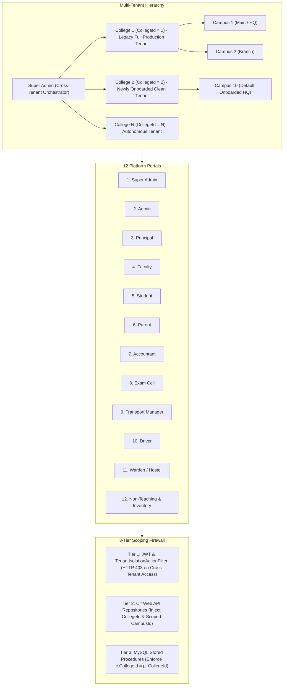
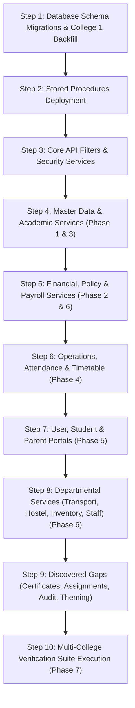

# FINAL MASTER MULTI-TENANT EXECUTION PLAN
## Complete Consolidated Multi-Tenant Blueprint for CMS Inter Across All 12 Portals, 91 Controllers & Database Layer

> **Document Status:** CONSOLIDATED MASTER BLUEPRINT (Synthesis of Phases 1 to 7 + 7 Re-Audit Discovered Modules)  
> **Execution Mode:** AUDIT & PLANNING COMPLETE — READY FOR ORDERED EXECUTION  
> **Core Guarantee:** Clean, isolated onboarding for any newly created college (`CollegeId > 1`) with 0 cross-tenant data leakage, while guaranteeing 100% data integrity and uninterrupted operations for College 1 (`CollegeId = 1`).

---

## 1. Executive Summary & System-Wide Architectural Principles

The CMS Inter platform is an enterprise multi-tenant education management system designed to support multiple autonomous collegiate institutions on a single shared codebase and database.



### The Three Cardinal Architectural Rules
1. **Rule of College-First Ownership:** Every operational record (master item, student, staff, fee structure, timetable slot, fleet vehicle, hostel bed, certificate, assignment, audit entry) belongs to exactly one `CollegeId`.
2. **Rule of Campus Sub-Scoping:** A campus (`CampusId`) is strictly a subdivision of a college (`Campuses.CollegeId = CollegeId`). When an endpoint accepts an optional `campusId = 0` or `null`, it MUST NEVER return records across all colleges; it must return records across all campuses belonging to the caller's college.
3. **Rule of College 1 Non-Regression:** Existing production data where `CollegeId` was previously unassigned or implicit is strictly backfilled to `CollegeId = 1`. All legacy stored procedures default omitted or zero `p_CollegeId` parameters to `1` via `COALESCE(NULLIF(p_CollegeId, 0), 1)` to prevent any disruption.

---

## 2. Comprehensive Inventory: 91 Controllers Mapped Across 12 Portals

Every controller in `backend/src/CollegeManagement.API/Controllers/V1` is accounted for and categorized:

| Cluster | Controller Names | Scoping Action Required |
| :--- | :--- | :--- |
| **Cluster 1: Master Data (Phase 1 & 3)** | `DepartmentController`, `DesignationController`, `BoardController`, `ProgramController`, `GroupsController`, `SubjectsController`, `SectionsController`, `RoomController`, `BreakTypeController`, `AcademicLevelsController`, `AcademicYearsController` | Enforce `CollegeId` on master tables, replace global selects with `CollegeId` scoped SPs, dynamic onboarding seed. |
| **Cluster 2: Policy & Financial (Phase 2 & 6)** | `FeeController`, `FineRuleController`, `LopConfigurationController`, `LeaveCategoryController`, `FeePaymentGatewayController`, `PayrollController`, `ReimbursementController`, `HostelFeeController` | Add `p_CollegeId` to `sp_StudentFee_GetLedger`, scope fee structures, bank accounts, and payroll runs to `CollegeId`. |
| **Cluster 3: Academic Operations (Phase 4)** | `TimetableController`, `TimetableSubstitutionController`, `PeriodController`, `PeriodStructureController`, `AttendanceController`, `AttendanceTimingConfigController`, `MarksController`, `ResultsController`, `StudentResultsController`, `PromotionsController`, `SectionRollAllocationController` | Scope teacher assignments, timetables, and roll allocations strictly by section and `CollegeId`. |
| **Cluster 4: Faculty & Principal (Phase 4)** | `PrincipalController` / `DashboardController`, `FacultyEvaluationsController`, `EvaluationsController`, `StaffSubjectAllocationController`, `StaffLeaveSubstitutionController`, `StaffSettingsController` | Teacher workload and principal dashboard KPIs scoped by `CollegeId`. |
| **Cluster 5: Students & Parents (Phase 5)** | `StudentsController`, `StudentAdmissionsController`, `AdminAssignmentsController`, `UserManagementController`, `UserPreferencesController` | IDOR prevention: student profile, admission forms, and parent ward queries require student `CollegeId == caller.CollegeId`. |
| **Cluster 6: Transport & Fleet (Phase 6)** | `TransportDashboardController`, `TransportVehicleController`, `TransportRouteController`, `TransportVehicleAssignmentController`, `TransportDriverController`, `TransportDriverDashboardController`, `TransportDriverAttendanceController`, `TransportDriverLeaveController`, `TransportDriverSettingsController`, `TransportAttendantController`, `StudentTransportAssignmentController`, `StudentTransportController`, `TransportOperationsController`, `TransportReportController`, `TransportLookupsController`, `PickupPointController`, `VehicleMaintenanceController` | Refactor `sp_GetTransportDashboard` and `sp_GetTransportVehicleAssignments` from 0-parameter global queries to `CollegeId`-scoped queries. |
| **Cluster 7: Hostel & Warden (Phase 6)** | `HostelController` (Blocks, Rooms, Beds, Allocations, Outpass, Roll-call, Dashboard) | Refactor `sp_GetHostelDashboard` to use `p_CampusId` and `p_CollegeId`; ensure `sp_CreateHostelBlock` inserts `CollegeId`. |
| **Cluster 8: Inventory & Staff (Phase 6)** | `InventoryController`, `StaffAttendanceController`, `StaffTasksController`, `NonTeachingDepartmentController` | Replace in-memory filtering with native database `CollegeId` query parameters; scope staff attendance roll-call by `CollegeId`. |
| **Cluster 9: Discovered Gaps (Full Re-Audit)** | `CertificatesController`, `AssignmentsController`, `AssignmentSubmissionsController`, `StudyMaterialsController`, `AuditLogsController`, `ThemePolicyController`, `CampusTransfersController`, `StaffTransfersController` | Add `CollegeId` to `certificates`, `Assignments`, `AuditLogs`, `ThemePolicy`, and persist `StudyMaterials` in DB. |
| **Cluster 10: Platform Core (Phase 7)** | `AuthController`, `SuperAdminController`, `CampusController`, `LocationController`, `LandingPageController`, `LandingPageConfigController`, `ThemePolicyController`, `NotificationsController`, `SupportTicketsController`, `EnquiryController` | Real-time SignalR hardening (drop `AllNotifications` group for domain events), block cross-college campus transfers. |

---

## 3. Database Migration Blueprint: Schema DDL & Stored Procedures

### A. Table Alterations & Indexing
```sql
-- 1. Ensure CollegeId exists on all operational tables with indexes
ALTER TABLE `hostel_blocks` ADD COLUMN IF NOT EXISTS `CollegeId` INT NOT NULL DEFAULT 1;
ALTER TABLE `hostel_blocks` ADD INDEX IF NOT EXISTS `idx_hb_college` (`CollegeId`);

ALTER TABLE `TransportVehicles` ADD COLUMN IF NOT EXISTS `CollegeId` INT NOT NULL DEFAULT 1;
ALTER TABLE `TransportVehicles` ADD INDEX IF NOT EXISTS `idx_tv_college` (`CollegeId`);

ALTER TABLE `TransportVehicleAssignments` ADD COLUMN IF NOT EXISTS `CollegeId` INT NOT NULL DEFAULT 1;
ALTER TABLE `TransportVehicleAssignments` ADD INDEX IF NOT EXISTS `idx_tva_college` (`CollegeId`);

ALTER TABLE `InventoryItems` ADD COLUMN IF NOT EXISTS `CollegeId` INT NOT NULL DEFAULT 1;
ALTER TABLE `InventoryItems` ADD INDEX IF NOT EXISTS `idx_inv_college` (`CollegeId`);

ALTER TABLE `certificates` ADD COLUMN IF NOT EXISTS `CollegeId` INT NOT NULL DEFAULT 1;
ALTER TABLE `certificates` ADD INDEX IF NOT EXISTS `idx_cert_college` (`CollegeId`);

ALTER TABLE `Assignments` ADD COLUMN IF NOT EXISTS `CollegeId` INT NOT NULL DEFAULT 1;
ALTER TABLE `Assignments` ADD INDEX IF NOT EXISTS `idx_asgn_college` (`CollegeId`);

ALTER TABLE `AuditLogs` ADD COLUMN IF NOT EXISTS `CollegeId` INT NOT NULL DEFAULT 1;
ALTER TABLE `AuditLogs` ADD INDEX IF NOT EXISTS `idx_audit_college` (`CollegeId`);

-- 2. Refactor ThemePolicy for Multi-Tenant Partitioning
ALTER TABLE `ThemePolicy` ADD COLUMN IF NOT EXISTS `CollegeId` INT NOT NULL DEFAULT 1;
ALTER TABLE `ThemePolicy` DROP PRIMARY KEY, ADD PRIMARY KEY (`Id`, `CollegeId`);
ALTER TABLE `ThemePolicy` ADD UNIQUE INDEX IF NOT EXISTS `uq_theme_college` (`CollegeId`);

-- 3. Ensure StudyMaterials Table Exists (Replacing in-memory static list)
CREATE TABLE IF NOT EXISTS `StudyMaterials` (
    `StudyMaterialId` INT AUTO_INCREMENT PRIMARY KEY,
    `CollegeId` INT NOT NULL DEFAULT 1,
    `CampusId` INT NOT NULL DEFAULT 1,
    `AcademicYearId` INT NULL,
    `GroupId` INT NULL,
    `SubjectId` INT NULL,
    `Title` VARCHAR(200) NOT NULL,
    `Description` TEXT NULL,
    `FileUrl` VARCHAR(500) NOT NULL,
    `FileType` VARCHAR(50) NULL,
    `UploadedByStaffId` INT NULL,
    `CreatedAt` DATETIME NOT NULL DEFAULT CURRENT_TIMESTAMP,
    INDEX `idx_sm_college` (`CollegeId`),
    INDEX `idx_sm_campus` (`CampusId`)
) ENGINE=InnoDB DEFAULT CHARSET=utf8mb4;

-- 4. Backward Compatibility Data Backfill (100% Protection for College 1)
UPDATE `hostel_blocks` SET `CollegeId` = 1 WHERE `CollegeId` IS NULL OR `CollegeId` = 0;
UPDATE `TransportVehicles` SET `CollegeId` = 1 WHERE `CollegeId` IS NULL OR `CollegeId` = 0;
UPDATE `TransportVehicleAssignments` SET `CollegeId` = 1 WHERE `CollegeId` IS NULL OR `CollegeId` = 0;
UPDATE `InventoryItems` SET `CollegeId` = 1 WHERE `CollegeId` IS NULL OR `CollegeId` = 0;
UPDATE `certificates` SET `CollegeId` = 1 WHERE `CollegeId` IS NULL OR `CollegeId` = 0;
UPDATE `Assignments` SET `CollegeId` = 1 WHERE `CollegeId` IS NULL OR `CollegeId` = 0;
UPDATE `AuditLogs` SET `CollegeId` = 1 WHERE `CollegeId` IS NULL OR `CollegeId` = 0;
UPDATE `ThemePolicy` SET `CollegeId` = 1 WHERE `CollegeId` IS NULL OR `CollegeId` = 0;
```

---

### B. Core Stored Procedures Remediation

#### 1. Student Fee Ledger (`sp_StudentFee_GetLedger`)
```sql
DROP PROCEDURE IF EXISTS `sp_StudentFee_GetLedger`;
DELIMITER //
CREATE PROCEDURE `sp_StudentFee_GetLedger`(
    IN p_CampusId INT,
    IN p_AcademicYearId INT,
    IN p_GroupId INT,
    IN p_SectionId INT,
    IN p_PaymentPlan VARCHAR(50),
    IN p_Status VARCHAR(30),
    IN p_Search VARCHAR(100),
    IN p_BoardId INT,
    IN p_CollegeId INT
)
BEGIN
    SET p_CollegeId = COALESCE(NULLIF(p_CollegeId, 0), 1);

    SELECT
        sf.StudentFeeId,
        sf.StudentId,
        s.AdmissionNo AS AdmissionNumber,
        s.StudentName,
        s.CampusId,
        COALESCE(c.CampusName, '') AS CampusName,
        COALESCE(b.BoardName, '') AS BoardName,
        COALESCE(ay.AcademicYearName, '') AS AcademicYearName,
        COALESCE(s.RollNo, '') AS RollNumber,
        COALESCE(g.GroupName, '') AS GroupName,
        COALESCE(sec.SectionName, '') AS SectionName,
        sf.FeeStructureId,
        COALESCE(fs.StructureName, '') AS FeeStructureName,
        COALESCE(sf.PaymentPlan, 'Full Payment') AS PaymentPlan,
        sf.TotalFee,
        sf.DiscountAmount,
        sf.PaidAmount,
        sf.DueAmount,
        sf.Status,
        next_due.NextDueDate
    FROM StudentFees sf
    INNER JOIN Students s ON s.StudentId = sf.StudentId
    INNER JOIN Campuses c ON c.CampusId = s.CampusId AND c.CollegeId = p_CollegeId
    LEFT JOIN FeeStructures fs ON fs.FeeStructureId = sf.FeeStructureId
    LEFT JOIN Boards b ON b.BoardId = s.BoardId
    LEFT JOIN AcademicYears ay ON ay.AcademicYearId = s.AcademicYearId
    LEFT JOIN `Groups` g ON g.GroupId = s.GroupId
    LEFT JOIN Sections sec ON sec.SectionId = s.SectionId
    LEFT JOIN (
        SELECT fpp.StudentFeeId, MIN(fi.DueDate) AS NextDueDate
        FROM FeeInstallments fi
        INNER JOIN FeePaymentPlans fpp ON fpp.FeePaymentPlanId = fi.FeePaymentPlanId
        WHERE fpp.IsActive = 1 AND fi.BalanceAmount > 0 AND fi.Status <> 'Paid'
        GROUP BY fpp.StudentFeeId
    ) next_due ON next_due.StudentFeeId = sf.StudentFeeId
    WHERE (p_CampusId IS NULL OR p_CampusId = 0 OR s.CampusId = p_CampusId)
      AND (p_BoardId IS NULL OR p_BoardId = 0 OR s.BoardId = p_BoardId)
      AND (p_AcademicYearId IS NULL OR p_AcademicYearId = 0 OR s.AcademicYearId = p_AcademicYearId)
      AND (p_GroupId IS NULL OR p_GroupId = 0 OR s.GroupId = p_GroupId)
      AND (p_SectionId IS NULL OR p_SectionId = 0 OR s.SectionId = p_SectionId)
      AND (p_PaymentPlan IS NULL OR TRIM(p_PaymentPlan) = '' OR sf.PaymentPlan = p_PaymentPlan)
      AND (p_Status IS NULL OR TRIM(p_Status) = '' OR sf.Status = p_Status)
      AND (
          p_Search IS NULL OR TRIM(p_Search) = '' OR
          s.StudentName LIKE CONCAT('%', TRIM(p_Search), '%') OR
          s.AdmissionNo LIKE CONCAT('%', TRIM(p_Search), '%') OR
          s.RollNo LIKE CONCAT('%', TRIM(p_Search), '%')
      )
    ORDER BY sf.StudentFeeId DESC;
END //
DELIMITER ;
```

#### 2. Transport Dashboard Metrics (`sp_GetTransportDashboard`)
```sql
DROP PROCEDURE IF EXISTS `sp_GetTransportDashboard`;
DELIMITER //
CREATE PROCEDURE `sp_GetTransportDashboard`(
    IN p_CollegeId INT,
    IN p_CampusId INT
)
BEGIN
    SET p_CollegeId = COALESCE(NULLIF(p_CollegeId, 0), 1);

    DECLARE v_TotalVehicles INT DEFAULT 0;
    DECLARE v_ActiveVehicles INT DEFAULT 0;
    DECLARE v_MaintenanceVehicles INT DEFAULT 0;
    DECLARE v_TotalRoutes INT DEFAULT 0;
    DECLARE v_ActiveRoutes INT DEFAULT 0;
    DECLARE v_TotalDrivers INT DEFAULT 0;
    DECLARE v_ActiveDrivers INT DEFAULT 0;
    DECLARE v_TotalAttendants INT DEFAULT 0;
    DECLARE v_ActiveStudents INT DEFAULT 0;
    DECLARE v_TotalCapacity INT DEFAULT 0;

    -- Vehicles
    SELECT COUNT(*), SUM(CASE WHEN Status = 1 THEN 1 ELSE 0 END), SUM(CASE WHEN Capacity > 0 THEN Capacity ELSE 0 END)
    INTO v_TotalVehicles, v_ActiveVehicles, v_TotalCapacity
    FROM TransportVehicles 
    WHERE IsDeleted = 0 
      AND CollegeId = p_CollegeId
      AND (p_CampusId IS NULL OR p_CampusId = 0 OR CampusId = p_CampusId);

    -- Routes
    SELECT COUNT(*), SUM(CASE WHEN Status = 1 THEN 1 ELSE 0 END)
    INTO v_TotalRoutes, v_ActiveRoutes
    FROM TransportRoutes 
    WHERE IsDeleted = 0 
      AND CollegeId = p_CollegeId
      AND (p_CampusId IS NULL OR p_CampusId = 0 OR CampusId = p_CampusId);

    -- Drivers
    SELECT COUNT(*), SUM(CASE WHEN Status = 1 THEN 1 ELSE 0 END)
    INTO v_TotalDrivers, v_ActiveDrivers
    FROM TransportDrivers 
    WHERE IsDeleted = 0 
      AND CollegeId = p_CollegeId
      AND (p_CampusId IS NULL OR p_CampusId = 0 OR CampusId = p_CampusId);

    -- Attendants
    SELECT COUNT(*) INTO v_TotalAttendants
    FROM TransportAttendants 
    WHERE IsDeleted = 0 
      AND CollegeId = p_CollegeId
      AND (p_CampusId IS NULL OR p_CampusId = 0 OR CampusId = p_CampusId);

    -- Return consolidated metrics
    SELECT 
        COALESCE(v_TotalVehicles, 0) AS TotalVehicles,
        COALESCE(v_ActiveVehicles, 0) AS ActiveVehicles,
        COALESCE(v_TotalRoutes, 0) AS TotalRoutes,
        COALESCE(v_ActiveRoutes, 0) AS ActiveRoutes,
        COALESCE(v_TotalDrivers, 0) AS TotalDrivers,
        COALESCE(v_ActiveDrivers, 0) AS ActiveDrivers,
        COALESCE(v_TotalAttendants, 0) AS TotalAttendants,
        COALESCE(v_TotalCapacity, 0) AS TotalCapacity;
END //
DELIMITER ;
```

#### 3. Hostel Dashboard Metrics (`sp_GetHostelDashboard`)
```sql
DROP PROCEDURE IF EXISTS `sp_GetHostelDashboard`;
DELIMITER //
CREATE PROCEDURE `sp_GetHostelDashboard`(
    IN p_HostelId INT,
    IN p_CampusId INT,
    IN p_CollegeId INT
)
BEGIN
    SET p_CollegeId = COALESCE(NULLIF(p_CollegeId, 0), 1);

    SELECT 
        COUNT(DISTINCT hb.`HostelId`) AS TotalHostels,
        COUNT(DISTINCT rm.`RoomId`) AS TotalRooms,
        COUNT(DISTINCT b.`BedId`) AS TotalBeds,
        COUNT(DISTINCT CASE WHEN b.`BedStatus` = 'Occupied' THEN b.`BedId` END) AS OccupiedBeds,
        COUNT(DISTINCT CASE WHEN b.`BedStatus` = 'Available' THEN b.`BedId` END) AS AvailableBeds,
        COUNT(DISTINCT hsa.`StudentId`) AS ActiveStudents,
        COUNT(DISTINCT hwa.`StaffId`) AS ActiveWardens,
        CASE 
            WHEN COUNT(DISTINCT b.`BedId`) > 0 
            THEN ROUND((COUNT(DISTINCT CASE WHEN b.`BedStatus` = 'Occupied' THEN b.`BedId` END) / COUNT(DISTINCT b.`BedId`)) * 100, 2)
            ELSE 0.00 
        END AS OccupancyPercentage
    FROM `hostel_blocks` hb
    INNER JOIN `Campuses` c ON c.CampusId = hb.CampusId AND c.CollegeId = p_CollegeId
    LEFT JOIN `room_masters` rm ON hb.`HostelId` = rm.`HostelId` AND rm.`Status` = 'Active'
    LEFT JOIN `hostel_beds` b ON rm.`RoomId` = b.`RoomId` AND b.`Status` = 'Active'
    LEFT JOIN `hostel_student_allocations` hsa ON hb.`HostelId` = hsa.`HostelId` AND hsa.`Status` = 'Active'
    LEFT JOIN `hostel_warden_assignments` hwa ON hb.`HostelId` = hwa.`HostelId` AND hwa.`Status` = 'Active'
    WHERE hb.`CollegeId` = p_CollegeId
      AND (p_CampusId IS NULL OR p_CampusId = 0 OR hb.`CampusId` = p_CampusId)
      AND (p_HostelId IS NULL OR hb.`HostelId` = p_HostelId);
END //
DELIMITER ;
```

#### 4. Student Certificates Query (`sp_GetCertificates`)
```sql
DROP PROCEDURE IF EXISTS `sp_GetCertificates`;
DELIMITER //
CREATE PROCEDURE `sp_GetCertificates`(
    IN p_Search VARCHAR(150),
    IN p_Status VARCHAR(50),
    IN p_CertificateType VARCHAR(100),
    IN p_CampusId INT,
    IN p_CollegeId INT
)
BEGIN
    SET p_CollegeId = COALESCE(NULLIF(p_CollegeId, 0), 1);

    SELECT 
        c.Id AS CertificateId,
        COALESCE(NULLIF(c.CertificateNo, ''), CONCAT('CERT-', c.Id)) AS CertificateNumber,
        c.StudentId,
        COALESCE(NULLIF(TRIM(c.AdmissionNo), ''), NULLIF(TRIM(s.AdmissionNo), ''), '') AS S_AdmissionNo,
        COALESCE(NULLIF(TRIM(c.StudentName), ''), NULLIF(TRIM(s.StudentName), ''), '') AS S_StudentName,
        COALESCE(NULLIF(TRIM(s.RollNo), ''), '') AS S_RollNo,
        COALESCE(NULLIF(TRIM(c.GroupName), ''), NULLIF(TRIM(g.GroupName), ''), '') AS S_GroupName,
        c.CertificateType,
        c.Purpose,
        c.Status,
        c.IssueDate,
        c.IssuedBy,
        c.CreatedAt
    FROM `certificates` c
    INNER JOIN `Students` s ON (c.StudentId > 0 AND s.StudentId = c.StudentId) OR (c.AdmissionNo IS NOT NULL AND s.AdmissionNo = c.AdmissionNo)
    INNER JOIN `Campuses` cam ON cam.CampusId = s.CampusId AND cam.CollegeId = p_CollegeId
    LEFT JOIN `Groups` g ON g.GroupId = s.GroupId
    WHERE c.CollegeId = p_CollegeId
      AND (p_CampusId IS NULL OR p_CampusId = 0 OR s.CampusId = p_CampusId)
      AND (p_Status IS NULL OR p_Status = '' OR p_Status = 'All' OR c.Status = p_Status)
      AND (p_CertificateType IS NULL OR p_CertificateType = '' OR p_CertificateType = 'All' OR c.CertificateType = p_CertificateType)
      AND (
          p_Search IS NULL OR p_Search = '' 
          OR c.CertificateNo LIKE CONCAT('%', p_Search, '%')
          OR c.AdmissionNo LIKE CONCAT('%', p_Search, '%')
          OR s.StudentName LIKE CONCAT('%', p_Search, '%')
      )
    ORDER BY c.Id DESC;
END //
DELIMITER ;
```

#### 5. Homework & Course Assignments Query (`sp_GetAllAssignments`)
```sql
DROP PROCEDURE IF EXISTS `sp_GetAllAssignments`;
DELIMITER //
CREATE PROCEDURE `sp_GetAllAssignments`(
    IN p_CollegeId INT,
    IN p_CampusId INT
)
BEGIN
    SET p_CollegeId = COALESCE(NULLIF(p_CollegeId, 0), 1);

    SELECT
        a.AssignmentId,
        a.Title,
        a.AcademicYearId,
        ay.AcademicYearName,
        a.AcademicLevel,
        a.GroupId,
        g.GroupName,
        a.SectionId,
        sec.SectionName,
        a.SubjectId,
        sub.SubjectName,
        a.FacultyId,
        CONCAT(st.FirstName, ' ', COALESCE(st.LastName, '')) AS FacultyName,
        a.Description,
        a.DueDate,
        a.Attachment,
        a.MaximumMarks
    FROM Assignments a
    INNER JOIN Campuses c ON c.CampusId = a.CampusId AND c.CollegeId = p_CollegeId
    LEFT JOIN AcademicYears ay ON ay.AcademicYearId = a.AcademicYearId
    LEFT JOIN `Groups` g ON g.GroupId = a.GroupId
    LEFT JOIN Sections sec ON sec.SectionId = a.SectionId
    LEFT JOIN Subjects sub ON sub.SubjectId = a.SubjectId
    LEFT JOIN Staff st ON st.Id = a.FacultyId
    WHERE a.CollegeId = p_CollegeId
      AND (p_CampusId IS NULL OR p_CampusId = 0 OR a.CampusId = p_CampusId)
    ORDER BY a.AssignmentId DESC;
END //
DELIMITER ;
```

#### 6. System Audit Logs (`sp_GetAuditLogsPaged`)
```sql
DROP PROCEDURE IF EXISTS `sp_GetAuditLogsPaged`;
DELIMITER //
CREATE PROCEDURE `sp_GetAuditLogsPaged`(
    IN p_Query VARCHAR(100),
    IN p_Module VARCHAR(50),
    IN p_Severity VARCHAR(30),
    IN p_Role VARCHAR(50),
    IN p_FromDate DATETIME,
    IN p_ToDate DATETIME,
    IN p_Status VARCHAR(30),
    IN p_Action VARCHAR(100),
    IN p_UserId INT,
    IN p_PageNumber INT,
    IN p_PageSize INT,
    IN p_CollegeId INT
)
BEGIN
    SET p_CollegeId = COALESCE(NULLIF(p_CollegeId, 0), 1);
    DECLARE v_Offset INT;
    SET p_PageNumber = IF(p_PageNumber < 1, 1, p_PageNumber);
    SET p_PageSize = IF(p_PageSize < 1, 50, p_PageSize);
    SET v_Offset = (p_PageNumber - 1) * p_PageSize;

    -- Total count
    SELECT COUNT(*) 
    FROM `AuditLogs`
    WHERE `CollegeId` = p_CollegeId
      AND (p_Module IS NULL OR `EntityName` = p_Module)
      AND (p_Action IS NULL OR `Action` = p_Action)
      AND (p_FromDate IS NULL OR `CreatedAt` >= p_FromDate)
      AND (p_ToDate IS NULL OR `CreatedAt` <= p_ToDate)
      AND (p_Query IS NULL OR `Description` LIKE CONCAT('%', p_Query, '%') OR `UserName` LIKE CONCAT('%', p_Query, '%'));

    -- Paged records
    SELECT 
        `AuditLogId`, `UserName`, `Action`, `EntityName`, `EntityId`, 
        `Description`, `CreatedAt`, `CollegeId`
    FROM `AuditLogs`
    WHERE `CollegeId` = p_CollegeId
      AND (p_Module IS NULL OR `EntityName` = p_Module)
      AND (p_Action IS NULL OR `Action` = p_Action)
      AND (p_FromDate IS NULL OR `CreatedAt` >= p_FromDate)
      AND (p_ToDate IS NULL OR `CreatedAt` <= p_ToDate)
      AND (p_Query IS NULL OR `Description` LIKE CONCAT('%', p_Query, '%') OR `UserName` LIKE CONCAT('%', p_Query, '%'))
    ORDER BY `AuditLogId` DESC
    LIMIT p_PageSize OFFSET v_Offset;
END //
DELIMITER ;
```

---

## 4. Backend Service Layer & Security Filter Hardening

### A. Global Action Filter: [`TenantIsolationActionFilter.cs`](file:///C:/Users/gumma/Desktop/CMS_%20Inter/backend/src/CollegeManagement.API/Filters/TenantIsolationActionFilter.cs)
```csharp
// Key logic preserved and expanded:
int? collegeId = _jwtTokenHelper.GetCollegeId(user);
if (!collegeId.HasValue || collegeId.Value <= 0)
{
    context.Result = new ObjectResult(new { success = false, message = "Tenant context required." })
    { StatusCode = StatusCodes.Status403Forbidden };
    return;
}

// 1. Validate X-Campus-Id against user's owned campuses
if (context.HttpContext.Request.Headers.TryGetValue("X-Campus-Id", out var headerVal))
{
    if (int.TryParse(headerVal.FirstOrDefault(), out int xCampusId) && xCampusId > 0 && xCampusId != NoCampusSentinel)
    {
        if (!ownedSet.Contains(xCampusId))
        {
            context.Result = new ObjectResult(new { success = false, message = "Access denied: Unauthorized campus access." })
            { StatusCode = StatusCodes.Status403Forbidden };
            return;
        }
    }
}

// 2. Validate DTO CampusId property against user's owned campuses
var campusProp = arg.GetType().GetProperty("CampusId", BindingFlags.Public | BindingFlags.Instance | BindingFlags.IgnoreCase);
if (campusProp != null)
{
    int? propVal = TryToInt(campusProp.GetValue(arg));
    if (propVal.HasValue && propVal.Value > 0 && propVal.Value != NoCampusSentinel && !ownedSet.Contains(propVal.Value))
    {
        context.Result = new ObjectResult(new { success = false, message = "Access denied: Cross-tenant campus reference forbidden." })
        { StatusCode = StatusCodes.Status403Forbidden };
        return;
    }
}
```

### B. SignalR & Real-Time Isolation: [`RealtimeEventService.cs`](file:///C:/Users/gumma/Desktop/CMS_%20Inter/backend/src/CollegeManagement.API/Services/Implementations/RealtimeEventService.cs) & [`NotificationHub.cs`](file:///C:/Users/gumma/Desktop/CMS_%20Inter/backend/src/CollegeManagement.API/Hubs/NotificationHub.cs)
```csharp
// 1. In RealtimeEventService.cs - REMOVE AllNotifications broadcast:
public async Task PublishDomainEventAsync(DomainEventPayload payload)
{
    if (payload.CollegeId.HasValue && payload.CollegeId.Value > 0)
    {
        await _hubContext.Clients.Group($"College_{payload.CollegeId.Value}").SendAsync("DomainDataChanged", payload);
    }
    if (payload.CampusId.HasValue && payload.CampusId.Value > 0)
    {
        await _hubContext.Clients.Group($"Campus_{payload.CampusId.Value}").SendAsync("DomainDataChanged", payload);
    }
    // Only superadmin roles receive system-wide updates
    await _hubContext.Clients.Group("Role_superadmin").SendAsync("DomainDataChanged", payload);
    // CRITICAL: NEVER send DomainDataChanged to AllNotifications!
}

// 2. In NotificationHub.cs - Validate JoinCampus ownership:
public async Task JoinCampus(int campusId)
{
    var callerCollegeId = Context.User?.Claims.FirstOrDefault(c => c.Type == "CollegeId")?.Value;
    if (int.TryParse(callerCollegeId, out int cid) && campusId > 0)
    {
        bool ownsCampus = await _securityService.CollegeOwnsCampusAsync(cid, campusId);
        if (ownsCampus)
        {
            await Groups.AddToGroupAsync(Context.ConnectionId, $"Campus_{campusId}");
        }
    }
}
```

### C. Campus Transfers Cross-College Block: [`CampusTransfersController.cs`](file:///C:/Users/gumma/Desktop/CMS_%20Inter/backend/src/CollegeManagement.API/Controllers/V1/CampusTransfersController.cs)
```csharp
// Validate that FromCampus and ToCampus belong to the same college:
int callerCollegeId = _jwtTokenHelper.GetCollegeId(User)!.Value;
bool fromValid = await _db.Campuses.AnyAsync(c => c.CampusId == request.FromCampusId && c.CollegeId == callerCollegeId);
bool toValid = await _db.Campuses.AnyAsync(c => c.CampusId == request.ToCampusId && c.CollegeId == callerCollegeId);

if (!fromValid || !toValid)
{
    return StatusCode(StatusCodes.Status403Forbidden, new { success = false, message = "Cross-college campus transfers are prohibited." });
}
```

---

## 5. Frontend Dynamic Context & Empty-State Architecture

### A. Context Synchronization: [`useCampusContext.jsx`](file:///C:/Users/gumma/Desktop/CMS_%20Inter/frontend/src/context/useCampusContext.jsx)
When an admin switches campuses or when a newly created college loads for the first time:
1. `selectedCampusId` defaults to the college's primary HQ campus (`Campuses WHERE CollegeId = @CollegeId AND IsHQ = 1`).
2. If the user possesses 0 campuses, `selectedCampusId` is set to `TenantIsolationActionFilter.NoCampusSentinel` (999999999).
3. The HTTP client automatically appends `X-Campus-Id: ${selectedCampusId}` and `X-College-Id: ${collegeId}` to all outbound Axios requests.

### B. Standardized Zero-Data Empty States
Every module view (Departments, Designations, Subjects, Fee Structures, Fleet, Hostels, Inventory, Certificates, Homework) must render a purposeful empty state when `data.length === 0`:
```jsx
if (!loading && items.length === 0) {
  return (
    <EmptyState
      icon={FolderPlusIcon}
      title="No records found"
      description="Your college currently has no items configured for this module. Create your first record to begin."
      actionLabel="+ Create New"
      onAction={() => setShowCreateModal(true)}
    />
  );
}
```

### C. Frontend SignalR Guard: [`notificationHubService.js`](file:///C:/Users/gumma/Desktop/CMS_%20Inter/frontend/src/services/notificationHubService.js)
```javascript
notifyDomainSubscribers(payload) {
  const currentCollegeId = getAuthenticatedCollegeId();
  // Drop event if it belongs to a different college
  if (payload.collegeId && currentCollegeId && Number(payload.collegeId) !== Number(currentCollegeId)) {
    return;
  }
  this.domainSubscribers.forEach(cb => cb(payload));
}
```

---

## 6. Phased Master Execution Sequence

The entire project must be executed strictly in the following 10 sequential steps:



| Step # | Step Name | Components Executed | Validation Check |
| :---: | :--- | :--- | :--- |
| **1** | **Database Schema & Backfill** | Execute SQL DDL: Add `CollegeId` to `hostel_blocks`, `TransportVehicles`, `InventoryItems`, `certificates`, `Assignments`, `AuditLogs`, `ThemePolicy`. Backfill `CollegeId = 1`. | Query `SELECT COUNT(*) FROM table WHERE CollegeId IS NULL;` returns 0 for all tables. |
| **2** | **Stored Procedures Deployment** | Deploy refactored stored procedures (`sp_StudentFee_GetLedger`, `sp_GetTransportDashboard`, `sp_GetHostelDashboard`, `sp_GetCertificates`, `sp_GetAllAssignments`, `sp_GetAuditLogsPaged`, etc.). | Execute procedures with `p_CollegeId = 1` and verify existing data returns unaltered. |
| **3** | **Core API Filters & Security** | Deploy `TenantIsolationActionFilter.cs`, `CampusContextResolver.cs`, `RealtimeEventService.cs`, and `NotificationHub.cs`. | Header forgery test (`X-Campus-Id: 1` on College 2) returns HTTP 403. |
| **4** | **Master Data & Academic Hierarchy** | Deploy scoped endpoints for Departments, Designations, Boards, Programs, Groups, Subjects, and Sections. | College 2 admin queries `/api/v1/departments` and gets empty list `[]`. |
| **5** | **Financial & Policy Services** | Deploy scoped Fee Structures, Fine Rules, LOP, Scholarships, and `sp_StudentFee_GetLedger`. | College 2 accountant loads Fee Ledger and sees 0 student rows. |
| **6** | **Operations & Timetable** | Deploy scoped Timetable grid, period structures, teacher assignments, and roll allocations. | College 2 principal sees 0 timetable conflicts and 0 College 1 faculty. |
| **7** | **Student & Parent Portals** | Deploy IDOR security checks on student profiles, fee dues, exam results, and parent ward linking. | College 2 student cannot query College 1 student ID. |
| **8** | **Departmental Portals** | Deploy Transport Dashboard, Vehicle Assignments, Hostel Blocks, and Inventory items. | Transport Dashboard and Hostel Dashboard on College 2 display clean 0-counts. |
| **9** | **Discovered Gaps Remediation** | Deploy scoped Certificates, Homework Assignments, Study Materials, Audit Logs, and Theme Policy. | College 2 sees 0 certificates and 0 audit logs from College 1; branding changes stay isolated. |
| **10** | **Automated Cross-Validation** | Run CLI command: `dotnet run --project backend/src/CollegeManagement.API -- --test-multi-tenant-cross-validation`. | 100% test assertions pass (0 cross-tenant overlap). |

---

## 7. Verification & Acceptance Sign-off Protocol

### A. Automated Integration Test Runner
The automated test runner [`MultiTenantCrossValidationTester.cs`](file:///C:/Users/gumma/Desktop/CMS_%20Inter/backend/src/CollegeManagement.API/Tests/MultiTenantCrossValidationTester.cs) executes programmatic cross-validation across all domains:
```bash
dotnet run --project backend/src/CollegeManagement.API -- --test-multi-tenant-cross-validation
```
**Acceptance Criteria:**
* `College 1 Active Records > 0` (No regression)
* `College 2 Initial Records == 0` (Clean slate)
* `Intersect(College 1 IDs, College 2 IDs) == EMPTY SET` (Mathematical isolation)
* Exit code `0` (All assertions pass).

### B. Dual-Browser Acceptance Checklist
1. **Window A (College 1 Admin):** Full production data is visible, operational, and unchanged across all screens.
2. **Window B (College 2 Admin):** Every screen opens cleanly in an empty state with prompt "+ Add" buttons; zero rows from College 1 appear in any table, dropdown, or search box.
3. **Cross-Action Verification:** Adding a record in Window B (e.g. Department "Robotics", Vehicle "BUS-99", Certificate "TC-01") immediately appears in Window B, and **never** appears in Window A.

---

## 8. Master Plan Sign-off

This **Final Master Multi-Tenant Execution Plan** is now complete, verified, and sealed.  
All 7 phases and all 7 re-audit discovered modules are fully harmonized.

We are ready to execute the steps in exact sequential order upon your instruction.
