# Phase 3 Implementation Plan: Admin Portal — Frontend Empty-State, Context Synchronization & Board Affiliation Handling

> [!IMPORTANT]
> **Audit & Planning Phase Only**: No source code or database migrations are executed in this turn. This document serves as the formal specification for Phase 3. Implementation will begin only after all 7 phases are audited, planned, and approved into the Final Master Execution Plan.

---

## 1. Executive Summary & Problem Scope

When a new college is onboarded via the Super Admin portal, it is initialized with:
1. A new record in `Colleges` (e.g. `CollegeId = 2`).
2. An automatically created primary campus (e.g. `Main Campus`, `CampusCode = CODE-MAIN`).
3. An administrator account with the `Admin` role.

However, in the current production frontend implementation:
- **Board Affiliation Deadlock**: The auto-created campus has **zero** records in `CampusBoards`. In [AcademicContext.jsx](file:///c:/Users/gumma/Desktop/CMS_%20Inter/Frontend/src/context/AcademicContext.jsx#L147-L151), a tenant check `if (isTenantCollege) return [];` returns an empty array `[]` when a campus has no affiliated boards. This forces `boards = []`, setting `selectedBoard = null` and `selectedAcademicYear = null`. The top header dropdowns become permanently disabled ("No Board", "No Active Academic Year"), deadlocking all downstream modules (Admissions, Sections, Timetables, Fee Structures, and Attendance).
- **Campus Context Leak**: In [CampusContext.jsx](file:///c:/Users/gumma/Desktop/CMS_%20Inter/Frontend/src/context/CampusContext.jsx#L134-L140), fallback code `const finalData = scopedData.length > 0 ? scopedData : data;` falls back to the full unscoped dataset (College 1's campuses) whenever a new college has no campuses returned yet. Furthermore, `sp_GetCampuses` and `sp_GetActiveHeaderCampuses` lack `p_CollegeId` parameterization in MySQL.
- **Missing `X-College-Id` Header**: While [apiClient.js](file:///c:/Users/gumma/Desktop/CMS_%20Inter/Frontend/src/api/apiClient.js#L204-L215) injects `X-Campus-Id` and `X-Client-IP`, it does **not** inject `X-College-Id`, forcing backend controllers to rely solely on JWT token claims or URL queries.
- **Circular Dependency in Campus Configuration**: [CampusConfigurationPage.jsx](file:///c:/Users/gumma/Desktop/CMS_%20Inter/Frontend/src/components/pages/CampusConfigurationPage.jsx#L53-L59) reads `boards: contextBoards` (which is campus-filtered) instead of `allBoards`. When a campus has no boards, `contextBoards` is empty, preventing the administrator from selecting and affiliating master boards.
- **Empty-State Degradation**: Screens must render clean, actionable zero-state interfaces rather than infinite loading skeletons or disabled deadlocks.

---

## 2. Deep Audit: Files, Stored Procedures & Database Tables

### 2.1 Frontend Contexts & Interceptors

| Component / File | Exact Location | Current Issue / Vulnerability | Required Remediation |
| :--- | :--- | :--- | :--- |
| **`AcademicContext.jsx`** | [AcademicContext.jsx](file:///c:/Users/gumma/Desktop/CMS_%20Inter/Frontend/src/context/AcademicContext.jsx#L147-L151) | Lines 147–151: When campus has no affiliated boards, `if (isTenantCollege) return [];` deadlocks the navbar dropdown. | When campus has no affiliated board restrictions, return `allBoards` (which is scoped to available boards for the college). |
| **`CampusContext.jsx`** | [CampusContext.jsx](file:///c:/Users/gumma/Desktop/CMS_%20Inter/Frontend/src/context/CampusContext.jsx#L134-L140) | Line 140: Fallback `scopedData.length > 0 ? scopedData : data` leaks College 1 campuses if College 2 has no campuses. Line 137 allows `cColId === 0`. | Remove `? scopedData : data` fallback. Enforce strict `cColId === userCollegeId`. |
| **`apiClient.js`** | [apiClient.js](file:///c:/Users/gumma/Desktop/CMS_%20Inter/Frontend/src/api/apiClient.js#L204-L215) | Only injects `X-Campus-Id` and `X-Client-IP`. Does not inject `X-College-Id`. | In request interceptor, inject `config.headers["X-College-Id"] = String(u.collegeId);` for all authenticated requests. |
| **`authStorage.js`** | [authStorage.js](file:///c:/Users/gumma/Desktop/CMS_%20Inter/Frontend/src/modules/auth/authStorage.js#L101-L105) | Lines 101–105 silently upgrade mock/demo tokens to `BACKEND_ADMIN_JWT` (College 1 admin). Lines 163–177 hardcode parent 859. | Scope token handling strictly; prevent silent upgrade of new college admin sessions to College 1 JWT. |
| **`DashboardLayout.jsx`** | [DashboardLayout.jsx](file:///c:/Users/gumma/Desktop/CMS_%20Inter/Frontend/src/components/layout/DashboardLayout.jsx#L749-L764) | Uses unscoped `cms_admin_profile` and `cms_admin_photo` keys for College 1, with special-case `Number(u.collegeId) > 1` checks. | Standardize all localStorage profile keys to `cms_admin_profile_c${collegeId}` across all colleges. |

---

### 2.2 Backend Stored Procedures & Controllers

| Stored Procedure / Controller | Database Script / Source File | Current State | Required Modification |
| :--- | :--- | :--- | :--- |
| **`sp_GetCampuses`** | [sp_GetCampuses.sql](file:///c:/Users/gumma/Desktop/CMS_%20Inter/Backend/src/CollegeManagement.API/Database/Scripts/StoredProcedures/CampusModule/sp_GetCampuses.sql#L5-L9) | Takes `(p_Search, p_IsActive, p_BoardId)`. No `p_CollegeId`. Queries all campuses globally. | Add `IN p_CollegeId INT`. Filter `WHERE (p_CollegeId IS NULL OR c.CollegeId = p_CollegeId)`. |
| **`sp_GetActiveHeaderCampuses`** | [sp_GetActiveHeaderCampuses.sql](file:///c:/Users/gumma/Desktop/CMS_%20Inter/Backend/src/CollegeManagement.API/Database/Scripts/StoredProcedures/CampusModule/sp_GetActiveHeaderCampuses.sql#L5-L10) | Takes 0 parameters. Returns all active campuses globally. | Add `IN p_CollegeId INT`. Filter `WHERE c.IsActive = 1 AND (p_CollegeId IS NULL OR c.CollegeId = p_CollegeId)`. |
| **`sp_CreateCampus`** | [sp_CreateCampus.sql](file:///c:/Users/gumma/Desktop/CMS_%20Inter/Backend/src/CollegeManagement.API/Database/Scripts/StoredProcedures/CampusModule/sp_CreateCampus.sql#L5-L14) | Takes name, code, address, phone, email, isHQ, isActive, boardIds. Does NOT accept `CollegeId`. | Add `IN p_CollegeId INT`. Insert `p_CollegeId` into `Campuses (CollegeId, ...)`. |
| **`SuperAdminRepository.cs`** | [SuperAdminRepository.cs](file:///c:/Users/gumma/Desktop/CMS_%20Inter/Backend/src/CollegeManagement.API/Repositories/Implementations/SuperAdminRepository.cs#L137-L154) | Inserts Campus and NumberSeriesConfigurations, but does NOT affiliate any default board into `CampusBoards`. | Seed initial default `CampusBoards` linking Main Campus with standard education boards (or the board selected during college setup). |
| **`CampusController.cs`** | [CampusController.cs](file:///c:/Users/gumma/Desktop/CMS_%20Inter/Backend/src/CollegeManagement.API/Controllers/V1/CampusController.cs#L106-L112) | Fetches all campuses from DB, then filters in C# memory via `GetOwnedCampusIdsAsync`. | Pass `GetScopedCollegeId()` directly to `_campusService.GetAllCampusesAsync(..., collegeId)`. |

---

### 2.3 Core Admin Screens Empty-State Audit

| Screen Name | File Path | Empty Data Behavior | Required Action / UX Fix |
| :--- | :--- | :--- | :--- |
| **Dashboard** | [DashboardPage.jsx](file:///c:/Users/gumma/Desktop/CMS_%20Inter/Frontend/src/modules/admin/AdminDashboard/DashboardPage.jsx#L240-L260) | Has `ZeroStateCard` and `EmptyState`. Shows "No data available" when counts are 0. | Add first-time setup checklist banner when 0 boards/years/students exist. |
| **Campus Configuration** | [CampusConfigurationPage.jsx](file:///c:/Users/gumma/Desktop/CMS_%20Inter/Frontend/src/components/pages/CampusConfigurationPage.jsx#L53-L59) | Uses `contextBoards` which is `[]`, falling back to hardcoded `FALLBACK_BOARDS`. | Switch to `allBoards` from `useAcademicContext()`. Allow associating any available master board. |
| **Board & Academic Year** | [BoardAcademicYearManagementPage.jsx](file:///c:/Users/gumma/Desktop/CMS_%20Inter/Frontend/src/modules/admin/AdminBoards/BoardAcademicYearManagementPage.jsx#L496-L509) | Loads boards via `apiEndpoints.boards.list`. Needs board selection before creating Academic Year. | Ensure newly created college admin sees standard boards or custom boards. Empty table shows "+ Create Board" and "+ Create Academic Year". |
| **Admissions** | [AdmissionPage.jsx](file:///c:/Users/gumma/Desktop/CMS_%20Inter/Frontend/src/components/pages/AdmissionPage.jsx#L3171-L3216) | Table displays "No admissions found." Form blocks if Board/Year are null. | Display prompt to select Board & Year if navbar selection is empty. |
| **Staff Management** | [StaffManagementPage.jsx](file:///c:/Users/gumma/Desktop/CMS_%20Inter/Frontend/src/modules/admin/AdminFaculty/StaffManagementPage.jsx#L5290) | Displays "No staff records found." | Clean table zero-state with "+ Add Staff Member" CTA. |
| **Sections & Classrooms** | [SectionManagementPage.jsx](file:///c:/Users/gumma/Desktop/CMS_%20Inter/Frontend/src/modules/admin/AdminSections/SectionManagementPage.jsx#L2607-L3190) | Displays "No rooms found" and "No sections found". | Displays clear actionable empty state with "+ Add Room" and "+ Create Section". |
| **Timetable** | [TimetablePage.jsx](file:///c:/Users/gumma/Desktop/CMS_%20Inter/Frontend/src/modules/admin/AdminTimetable/TimetablePage.jsx#L3158) | Displays "No generated timetable available." | Display "+ Generate Timetable" CTA, with validation warning if Sections are missing. |
| **Fee Management** | [FeeManagementPage.jsx](file:///c:/Users/gumma/Desktop/CMS_%20Inter/Frontend/src/modules/admin/AdminFees/FeeManagementPage.jsx#L2643-L3244) | Displays "No fee accounts match current search and filters." | Clean empty states for Fee Types, Structures, and Student Ledgers. |

---

## 3. The Board Affiliation Deadlock: Mechanism & Permanent Resolution

```mermaid
flowchart TD
    subgraph CURRENT_DEADLOCK["Current Deadlock Workflow"]
        A1["Super Admin creates New College"] --> A2["Main Campus created with 0 rows in CampusBoards"]
        A2 --> A3["Admin logs in; isTenantCollege = true"]
        A3 --> A4["AcademicContext: selectedCampus has 0 affiliated boards"]
        A4 --> A5["AcademicContext returns: boards = []"]
        A5 --> A6["selectedBoard = null, selectedAcademicYear = null"]
        A6 --> A7["Header Navbar Board & Year Dropdowns DISABLED ('No Board')"]
        A7 --> A8["All downstream modules deadlocked (Admissions, Sections, Timetable, Fees)"]
    end

    subgraph RESOLVED_WORKFLOW["Remediated Architectural Workflow"]
        B1["Super Admin creates New College"] --> B2["Main Campus created & automatically linked to standard boards in CampusBoards"]
        B2 --> B3["Admin logs in; apiClient sends X-College-Id"]
        B3 --> B4["AcademicContext checks campus affiliated boards"]
        B4 --> B5{"Has restrictions?"}
        B5 -- "Yes" --> B6["Use affiliated boards"]
        B5 -- "No (Initial Setup)" --> B7["Fall back to allBoards (Shared + College-owned)"]
        B6 --> B8["Navbar selects active Board & Academic Year"]
        B7 --> B8
        B8 --> B9["All screens operational; empty-states show '+ Create' CTAs"]
    end
```



### Detailed Resolution Steps:
1. **Frontend Fallback in `AcademicContext.jsx`**:
   Replace lines 147–151:
   ```javascript
   // If campus does not have any board restrictions defined yet
   if (!affiliated.length && !boardIds.length && !boardNames.length) {
     return allBoards; // Safe because allBoards is scoped to the tenant college + shared boards
   }
   ```
2. **Campus Configuration Selection Fix**:
   In [CampusConfigurationPage.jsx](file:///c:/Users/gumma/Desktop/CMS_%20Inter/Frontend/src/components/pages/CampusConfigurationPage.jsx#L53):
   ```javascript
   // BEFORE:
   const { boards: contextBoards } = useAcademicContext();
   
   // AFTER:
   const { allBoards } = useAcademicContext();
   const availableBoards = useMemo(() => {
     return allBoards?.length ? allBoards : FALLBACK_BOARDS;
   }, [allBoards]);
   ```
3. **Database Seed in `SuperAdminRepository.cs`**:
   When creating a new college, immediately associate its Main Campus with standard boards in `CampusBoards`:
   ```sql
   INSERT INTO CampusBoards (CampusId, BoardId, IsActive, CreatedAt)
   SELECT @CampusId, b.BoardId, 1, UTC_TIMESTAMP()
   FROM Boards b
   WHERE (b.CollegeId IS NULL OR b.CollegeId = @CollegeId) AND b.IsActive = 1
   LIMIT 2;
   ```

---

## 4. First-Time Setup Checklist / Onboarding UX

To ensure a new college administrator is guided seamlessly from an empty state to full operation:

```
+---------------------------------------------------------------------------------------------------+
|  [Checklist Icon] Welcome to your new CMS Portal! Complete initial setup to get started:        |
|                                                                                                   |
|  [Step 1] Verify Campus Details      --> /dashboard/settings/campus-configuration   [Completed]   |
|  [Step 2] Affiliate Education Board  --> /dashboard/board-academic-year             [Action Needed]|
|  [Step 3] Set Up Departments & Staff --> /dashboard/departments, /dashboard/staff/add            |
|  [Step 4] Create Groups & Sections   --> /dashboard/courses/add, /dashboard/sections             |
|  [Step 5] Begin Student Admissions   --> /dashboard/admission?view=new                           |
+---------------------------------------------------------------------------------------------------+
```

- When total student count is 0 and total staff count is 0, this banner is displayed above the KPI cards on `DashboardPage.jsx`.
- Each step features a direct link to the corresponding screen, automatically marking completed steps with green checks.

---

## 5. Verification Checklist for Phase 3

- [ ] **Campus Scoping**: Logging in as College 2 Admin displays *only* College 2 campuses in the top navbar. College 1 campuses never appear, even if College 2 has only 1 campus.
- [ ] **Board Dropdown Initialization**: When College 2 Admin logs in, the Board selector is enabled with the college's available boards. No "No Board" deadlock.
- [ ] **Academic Year Dropdown Initialization**: Academic Year selector populates for the selected board without error.
- [ ] **Request Headers**: Network tab confirms `X-College-Id` and `X-Campus-Id` are sent on every API request.
- [ ] **Admissions Screen**: Opens cleanly without crashing. Fields populate from selected navbar context.
- [ ] **Zero-State Validation**: Dashboard, Admissions, Staff, Sections, Timetables, and Fee Structures display clean empty states with "+ Add" or "+ Create" buttons when records count is 0.
- [ ] **Zero Impact on College 1**: Existing College 1 admin and student data remain completely intact.

---

> [!NOTE]
> **Next Step**: Once you review and approve this Phase 3 Implementation Plan, reply with permission to proceed to **Phase 4: Principal & Faculty Portals — Teacher Assignments, Attendance & Timetable Scoping**.
