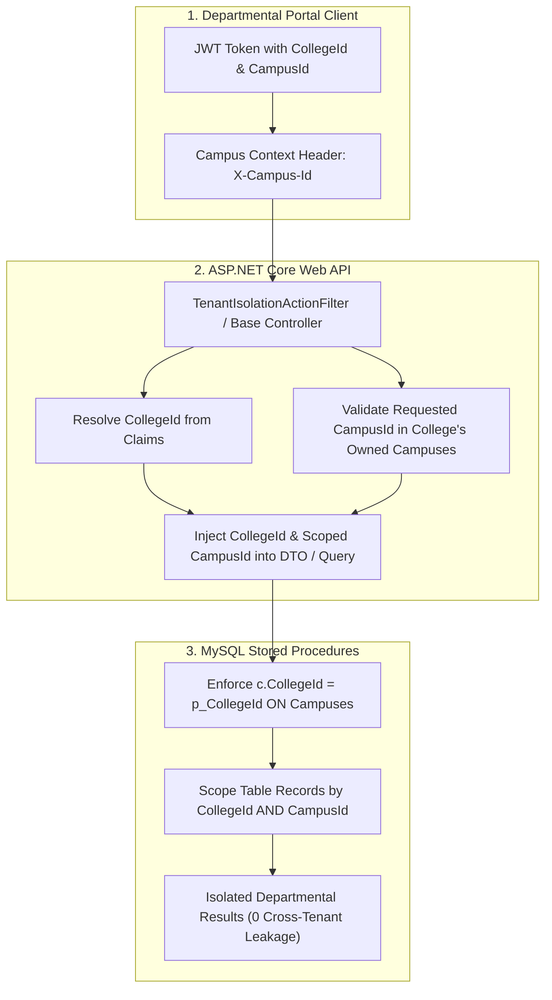

# PHASE 6: DEPARTMENTAL PORTALS IMPLEMENTATION PLAN
## Comprehensive Multi-Tenant Isolation for Accountant, Exam Cell, Transport, Driver, Warden/Hostel, Inventory & Non-Teaching Staff Portals

> **Implementation Mode:** AUDIT & PLANNING ONLY (No code modifications or database migrations are executed during this phase).  
> **Target Environment:** Multi-Tenant Core with College-First Scoping (`CollegeId`), Campus Context Enforcement (`CampusId`), and 100% Backward Compatibility for College 1 (`CollegeId = 1`).

---

## 1. Executive Summary & Objectives

The CMS Inter platform incorporates specialized departmental portals designed for specific operational roles:
1. **Accountant Portal** (`/accountant/*`) — Fee collection, student fee ledgers, payment receipts, concessions, and dues tracking.
2. **Exam Cell Portal** (`/exam-cell/*`) — Examination schedules, room allocations, invigilation duty assignments, hall tickets, marks entry, and exam settings.
3. **Transport Manager & Driver Portals** (`/transport/*`, `/driver/*`) — Fleet vehicle management, route planning, driver assignments, vehicle maintenance, and live trip tracking.
4. **Warden / Hostel Portal** (`/hostel/*`, `/warden/*`) — Hostel block administration, room/bed allocations, student outpass/leave requests, and roll-call attendance.
5. **Inventory Portal** (`/inventory/*`) — Item master catalog, stock categories, supplier procurement, purchase orders, and stock transaction ledgers.
6. **Non-Teaching Staff Portal** (`/staff/*`, `/non-teaching/*`) — Task assignment tracking, staff attendance regularizations, and leave management.

### Critical Vulnerabilities Discovered During Audit
* **Accountant:** `sp_StudentFee_GetLedger` has no `p_CollegeId` parameter. If `p_CampusId` is omitted or 0, it leaks fee ledger records across all colleges.
* **Exam Cell:** `sp_GetExaminationSettings` line 83 contains `SET v_CampusId = COALESCE(NULLIF(p_CampusId, 0), 1);` which hardcodes fallback to Campus 1 (College 1). Furthermore, `sp_GetExaminations` accepts `p_CampusId` but completely omits it from its `WHERE` clause, returning exams across all colleges.
* **Transport:** `sp_GetTransportDashboard` takes 0 parameters and computes global counts (`FROM TransportVehicles WHERE IsDeleted = 0`), broadcasting College 1 fleet metrics to every new college. `sp_GetTransportVehicleAssignments` completely omits campus and college filters.
* **Hostel:** `sp_GetHostelDashboard` accepts `p_CampusId` but ignores it in its `WHERE` clause (`WHERE (p_HostelId IS NULL OR hb.HostelId = p_HostelId)`), aggregating all beds, rooms, and students globally. `sp_CreateHostelBlock` accepts `p_CampusId` but fails to insert it into `hostel_blocks`.
* **Inventory:** `InventoryController.cs` currently uses an inefficient in-memory post-filtering workaround that pulls all rows across the database into application memory.
* **Staff Attendance:** `sp_LoadStaffAttendance` omits `CollegeId`, exposing staff from all institutions if `p_CampusId <= 0`.

---

## 2. Multi-Tenant Architectural Enforcement Pattern

To guarantee clean onboarding for newly created colleges (`CollegeId > 1`) and safeguard existing data for `CollegeId = 1`, all departmental services must conform to the standard 3-tier scoping hierarchy:



---

## 3. Domain 1: Accountant Portal Scoping

### A. Audit Findings
* **Frontend Components:**
  * [`AccountantDashboard.jsx`](file:///C:/Users/gumma/Desktop/CMS_%20Inter/frontend/src/pages/accountant/AccountantDashboard.jsx)
  * [`AccountantFeeManagement.jsx`](file:///C:/Users/gumma/Desktop/CMS_%20Inter/frontend/src/pages/accountant/AccountantFeeManagement.jsx)
  * [`AccountantPayments.jsx`](file:///C:/Users/gumma/Desktop/CMS_%20Inter/frontend/src/pages/accountant/AccountantPayments.jsx)
  * [`accountantService.js`](file:///C:/Users/gumma/Desktop/CMS_%20Inter/frontend/src/services/accountantService.js)
* **Backend Controllers & Repositories:**
  * [`FeeController.cs`](file:///C:/Users/gumma/Desktop/CMS_%20Inter/backend/src/CollegeManagement.API/Controllers/V1/FeeController.cs)
  * [`FeeRepository.cs`](file:///C:/Users/gumma/Desktop/CMS_%20Inter/backend/src/CollegeManagement.API/Repositories/Implementations/FeeRepository.cs)
* **Database Procedures:**
  * `sp_StudentFee_GetLedger` in [`01_Unified_Fee_Management_Stored_Procedures.sql`](file:///C:/Users/gumma/Desktop/CMS_%20Inter/backend/src/CollegeManagement.API/Database/Scripts/StoredProcedures/FeeModule/01_Unified_Fee_Management_Stored_Procedures.sql) (Line 2065)
  * `sp_GetStudentFeeLedger` (Line 2110)

### B. Identified Flaw
`sp_StudentFee_GetLedger` uses:
```sql
WHERE (p_CampusId IS NULL OR p_CampusId = 0 OR s.CampusId = p_CampusId)
```
If an accountant queries the ledger without selecting a specific campus (`campusId = 0`), records from all colleges are returned.

### C. Implementation Specification
1. **Update Stored Procedure `sp_StudentFee_GetLedger`:**
   * Add parameter: `IN p_CollegeId INT`.
   * Enforce tenant filter:
     ```sql
     INNER JOIN Campuses c ON c.CampusId = s.CampusId AND c.CollegeId = p_CollegeId
     WHERE (p_CampusId IS NULL OR p_CampusId = 0 OR s.CampusId = p_CampusId)
     ```
2. **Update Stored Procedure `sp_GetStudentFeeLedger`:**
   * Forward `p_CollegeId` to `sp_StudentFee_GetLedger`.
3. **Update `FeeRepository.cs` & `FeeController.cs`:**
   * Extract `collegeId` via `_jwtTokenHelper.GetCollegeId(User)`.
   * Pass `p_CollegeId = collegeId.Value` into Dapper parameters for all fee queries.

---

## 4. Domain 2: Exam Cell Portal Scoping

### A. Audit Findings
* **Frontend Components:**
  * [`ExamManagement.jsx`](file:///C:/Users/gumma/Desktop/CMS_%20Inter/frontend/src/pages/exam-cell/ExamManagement.jsx)
  * [`ExamSchedules.jsx`](file:///C:/Users/gumma/Desktop/CMS_%20Inter/frontend/src/pages/exam-cell/ExamSchedules.jsx)
  * [`HallTicketGeneration.jsx`](file:///C:/Users/gumma/Desktop/CMS_%20Inter/frontend/src/pages/exam-cell/HallTicketGeneration.jsx)
  * [`ExamSettings.jsx`](file:///C:/Users/gumma/Desktop/CMS_%20Inter/frontend/src/pages/exam-cell/ExamSettings.jsx)
* **Backend Controllers & Repositories:**
  * [`ExaminationController.cs`](file:///C:/Users/gumma/Desktop/CMS_%20Inter/backend/src/CollegeManagement.API/Controllers/V1/ExaminationController.cs)
  * [`ExaminationRepository.cs`](file:///C:/Users/gumma/Desktop/CMS_%20Inter/backend/src/CollegeManagement.API/Repositories/Implementations/ExaminationRepository.cs)
* **Database Procedures:**
  * `sp_GetExaminationSettings` in [`23_Exam_Cell_Consolidated_SPs.sql`](file:///C:/Users/gumma/Desktop/CMS_%20Inter/backend/src/CollegeManagement.API/Database/Updated_Module_SPs/23_Exam_Cell_Consolidated_SPs.sql) (Line 83)
  * `sp_GetExaminations` in [`All_Campus_Integration_Updates.sql`](file:///C:/Users/gumma/Desktop/CMS_%20Inter/backend/src/CollegeManagement.API/Database/All_Campus_Integration_Updates.sql) (Line 6141)

### B. Identified Flaws
1. In `sp_GetExaminationSettings`:
   ```sql
   DECLARE v_CampusId INT;
   SET v_CampusId = COALESCE(NULLIF(p_CampusId, 0), 1); -- HARDCODED TO CAMPUS 1!
   ```
2. In `sp_GetExaminations`:
   `IN p_CampusId INT` is passed as a parameter, but the `WHERE` clause does not include `e.CampusId = p_CampusId`!

### C. Implementation Specification
1. **Update Stored Procedure `sp_GetExaminationSettings`:**
   * Signature: `IN p_CampusId INT, IN p_CollegeId INT`
   * Logic:
     ```sql
     DECLARE v_CampusId INT;
     IF p_CampusId IS NOT NULL AND p_CampusId > 0 THEN
         SET v_CampusId = p_CampusId;
     ELSE
         SELECT CampusId INTO v_CampusId FROM Campuses 
         WHERE CollegeId = p_CollegeId AND IsActive = 1 ORDER BY IsHQ DESC, CampusId ASC LIMIT 1;
     END IF;
     ```
2. **Update Stored Procedure `sp_GetExaminations`:**
   * Signature: Add `IN p_CollegeId INT`.
   * Join `Campuses c ON c.CampusId = e.CampusId AND c.CollegeId = p_CollegeId`.
   * `WHERE` Clause:
     ```sql
     AND (p_CampusId IS NULL OR p_CampusId = 0 OR e.CampusId = p_CampusId)
     ```
3. **Backend Scoping in `ExaminationController.cs`:**
   * Guarantee `collegeId` is extracted and passed to `_repository.GetExaminationsAsync(...)` and `_repository.GetSettingsAsync(...)`.

---

## 5. Domain 3: Transport Manager & Driver Portals Scoping

### A. Audit Findings
* **Frontend Components:**
  * [`TransportDashboard.jsx`](file:///C:/Users/gumma/Desktop/CMS_%20Inter/frontend/src/pages/transport/TransportDashboard.jsx)
  * [`VehicleManagement.jsx`](file:///C:/Users/gumma/Desktop/CMS_%20Inter/frontend/src/pages/transport/VehicleManagement.jsx)
  * [`DriverDashboard.jsx`](file:///C:/Users/gumma/Desktop/CMS_%20Inter/frontend/src/pages/driver/DriverDashboard.jsx)
* **Backend Controllers:**
  * [`TransportDashboardController.cs`](file:///C:/Users/gumma/Desktop/CMS_%20Inter/backend/src/CollegeManagement.API/Controllers/V1/TransportDashboardController.cs)
  * [`TransportVehicleController.cs`](file:///C:/Users/gumma/Desktop/CMS_%20Inter/backend/src/CollegeManagement.API/Controllers/V1/TransportVehicleController.cs)
  * [`TransportVehicleAssignmentController.cs`](file:///C:/Users/gumma/Desktop/CMS_%20Inter/backend/src/CollegeManagement.API/Controllers/V1/TransportVehicleAssignmentController.cs)
  * [`TransportDriverDashboardController.cs`](file:///C:/Users/gumma/Desktop/CMS_%20Inter/backend/src/CollegeManagement.API/Controllers/V1/TransportDriverDashboardController.cs)
* **Database Procedures:**
  * `sp_GetTransportDashboard` in [`Transport_Management_Schema_And_Procedures.sql`](file:///C:/Users/gumma/Desktop/CMS_%20Inter/backend/src/CollegeManagement.API/Database/Migrations_Archive/Transport_Management_Schema_And_Procedures.sql) (Line 1893)
  * `sp_GetTransportVehicleAssignments` in [`29_Fee_And_Transport_MultiTenancy_Isolation.sql`](file:///C:/Users/gumma/Desktop/CMS_%20Inter/backend/src/CollegeManagement.API/Database/Updated_Module_SPs/29_Fee_And_Transport_MultiTenancy_Isolation.sql) (Line 285)

### B. Identified Flaws
1. `sp_GetTransportDashboard` takes 0 parameters:
   ```sql
   CREATE PROCEDURE `sp_GetTransportDashboard`()
   ...
   SELECT COUNT(*) INTO v_TotalVehicles FROM TransportVehicles WHERE IsDeleted = 0;
   ```
2. `sp_GetTransportVehicleAssignments` completely ignores `CollegeId` and `CampusId`:
   ```sql
   CREATE PROCEDURE sp_GetTransportVehicleAssignments(
       IN p_RouteId BIGINT, IN p_VehicleId BIGINT, IN p_DriverId BIGINT, 
       IN p_Status TINYINT(1), IN p_Search VARCHAR(100)
   )
   ```

### C. Implementation Specification
1. **Refactor `sp_GetTransportDashboard`:**
   * Signature: `CREATE PROCEDURE sp_GetTransportDashboard(IN p_CollegeId INT, IN p_CampusId INT)`
   * Filter every metric query by `CollegeId`:
     ```sql
     SELECT COUNT(*), SUM(CASE WHEN Status = 1 THEN 1 ELSE 0 END), SUM(CASE WHEN Capacity > 0 THEN Capacity ELSE 0 END)
     INTO v_TotalVehicles, v_ActiveVehicles, v_TotalCapacity
     FROM TransportVehicles 
     WHERE IsDeleted = 0 
       AND CollegeId = p_CollegeId
       AND (p_CampusId IS NULL OR p_CampusId = 0 OR CampusId = p_CampusId);
     ```
2. **Refactor `sp_GetTransportVehicleAssignments`:**
   * Signature: Add `IN p_CampusId INT, IN p_CollegeId INT`.
   * Enforce `a.CollegeId = p_CollegeId AND (p_CampusId IS NULL OR p_CampusId = 0 OR a.CampusId = p_CampusId)`.
3. **Update `TransportDashboardController.cs`:**
   * Inject `IJwtTokenHelper`.
   * Extract `int collegeId = _jwtTokenHelper.GetCollegeId(User)`.
   * Pass `collegeId` and optional `campusId` to `_service.GetDashboardAsync(collegeId, campusId)`.

---

## 6. Domain 4: Warden / Hostel Portal Scoping

### A. Audit Findings
* **Frontend Components:**
  * [`HostelDashboard.jsx`](file:///C:/Users/gumma/Desktop/CMS_%20Inter/frontend/src/pages/hostel/HostelDashboard.jsx)
  * [`HostelBlocks.jsx`](file:///C:/Users/gumma/Desktop/CMS_%20Inter/frontend/src/pages/hostel/HostelBlocks.jsx)
  * [`HostelRooms.jsx`](file:///C:/Users/gumma/Desktop/CMS_%20Inter/frontend/src/pages/hostel/HostelRooms.jsx)
  * [`HostelAllocations.jsx`](file:///C:/Users/gumma/Desktop/CMS_%20Inter/frontend/src/pages/hostel/HostelAllocations.jsx)
* **Backend Controller:**
  * [`HostelController.cs`](file:///C:/Users/gumma/Desktop/CMS_%20Inter/backend/src/CollegeManagement.API/Controllers/V1/HostelController.cs)
* **Database Procedures:**
  * `sp_GetHostelDashboard` in [`07_HostelManagement_SPs.sql`](file:///C:/Users/gumma/Desktop/CMS_%20Inter/backend/src/CollegeManagement.API/Database/Updated_Module_SPs/07_HostelManagement_SPs.sql) (Line 1176)
  * `sp_GetHostelBlocks` (Line 90)
  * `sp_CreateHostelBlock` (Line 120)

### B. Identified Flaws
1. In `sp_GetHostelDashboard`, `p_CampusId` is declared but completely omitted in the `WHERE` clause:
   ```sql
   WHERE (p_HostelId IS NULL OR hb.`HostelId` = p_HostelId) -- Ignores p_CampusId!
   ```
2. In `sp_CreateHostelBlock`, `p_CampusId` is received but NOT inserted into `hostel_blocks`!
3. In `sp_GetHostelBlocks`, there is no `CollegeId` verification on `hostel_blocks`.

### C. Implementation Specification
1. **Schema Update on `hostel_blocks`:**
   * Ensure `CollegeId INT NOT NULL DEFAULT 1` exists with an index `idx_hb_college (CollegeId)`.
2. **Refactor `sp_CreateHostelBlock`:**
   * Insert `CollegeId` and `CampusId` into `hostel_blocks`:
     ```sql
     INSERT INTO `hostel_blocks` (`CollegeId`, `CampusId`, `HostelName`, ...)
     VALUES (p_CollegeId, p_CampusId, p_HostelName, ...);
     ```
3. **Refactor `sp_GetHostelDashboard` & `sp_GetHostelBlocks`:**
   * Signature: Add `IN p_CollegeId INT`.
   * Enforce:
     ```sql
     WHERE hb.CollegeId = p_CollegeId 
       AND (p_CampusId IS NULL OR p_CampusId = 0 OR hb.CampusId = p_CampusId)
       AND (p_HostelId IS NULL OR hb.HostelId = p_HostelId)
     ```
4. **Update `HostelController.cs`:**
   * Extract `collegeId` and ensure all endpoints pass `collegeId` and scoped `campusId`.

---

## 7. Domain 5: Inventory Portal Scoping

### A. Audit Findings
* **Frontend Components:**
  * [`InventoryDashboard.jsx`](file:///C:/Users/gumma/Desktop/CMS_%20Inter/frontend/src/pages/inventory/InventoryDashboard.jsx)
  * [`InventoryItems.jsx`](file:///C:/Users/gumma/Desktop/CMS_%20Inter/frontend/src/pages/inventory/InventoryItems.jsx)
  * [`PurchaseOrders.jsx`](file:///C:/Users/gumma/Desktop/CMS_%20Inter/frontend/src/pages/inventory/PurchaseOrders.jsx)
* **Backend Controller:**
  * [`InventoryController.cs`](file:///C:/Users/gumma/Desktop/CMS_%20Inter/backend/src/CollegeManagement.API/Controllers/V1/InventoryController.cs)
* **Database Procedures:**
  * `01_InventoryManagement_Complete_Schema_And_SPs.sql` & `17_InventoryManagement_Crud_SPs.sql`

### B. Identified Flaws
`InventoryController.cs` currently executes queries across all items and filters them in memory:
```csharp
var allItems = (await _service.GetItemsAsync(new ItemFilterRequest()))
    .Where(i => ownedItems.Contains(i.ItemId)).ToList();
```
This is computationally wasteful and fails if any new endpoint is introduced without an in-memory interceptor.

### C. Implementation Specification
1. **Database-Level Tenant Enforcement:**
   * Ensure `CollegeId` column exists on:
     * `InventoryItems`
     * `InventoryCategories`
     * `InventorySuppliers`
     * `InventoryPurchaseOrders`
     * `InventoryTransactions`
2. **Update Stored Procedures:**
   * `sp_GetInventoryItems(p_CollegeId, p_CampusId, p_CategoryId, ...)`
   * `sp_GetInventoryCategories(p_CollegeId)`
   * `sp_GetInventorySuppliers(p_CollegeId)`
   * `sp_GetInventoryDashboard(p_CollegeId, p_CampusId)`
3. **Refactor `InventoryController.cs`:**
   * Remove helper `GetOwnedIdsAsync` in-memory filtering.
   * Pass `tenantCollegeId` directly to `_service` and database stored procedures.
   * On creation of items, categories, or purchase orders, assign `CollegeId = tenantCollegeId`.

---

## 8. Domain 6: Non-Teaching Staff Portal Scoping

### A. Audit Findings
* **Frontend Components:**
  * [`StaffDashboard.jsx`](file:///C:/Users/gumma/Desktop/CMS_%20Inter/frontend/src/pages/staff/StaffDashboard.jsx)
  * [`StaffTasks.jsx`](file:///C:/Users/gumma/Desktop/CMS_%20Inter/frontend/src/pages/staff/StaffTasks.jsx)
  * [`StaffAttendanceManagement.jsx`](file:///C:/Users/gumma/Desktop/CMS_%20Inter/frontend/src/pages/staff/StaffAttendanceManagement.jsx)
* **Backend Controllers:**
  * [`StaffTasksController.cs`](file:///C:/Users/gumma/Desktop/CMS_%20Inter/backend/src/CollegeManagement.API/Controllers/V1/StaffTasksController.cs)
  * [`StaffAttendanceController.cs`](file:///C:/Users/gumma/Desktop/CMS_%20Inter/backend/src/CollegeManagement.API/Controllers/V1/StaffAttendanceController.cs)
* **Database Procedures:**
  * `sp_LoadStaffAttendance` in [`07_StaffAttendance_SPs.sql`](file:///C:/Users/gumma/Desktop/CMS_%20Inter/backend/src/CollegeManagement.API/Database/Updated_Module_SPs/07_StaffAttendance_SPs.sql) (Line 16)

### B. Identified Flaw
In `sp_LoadStaffAttendance`:
```sql
WHERE s.IsDeleted = 0
  AND (s.Status = 'Active' OR s.Status IS NULL)
  AND (p_CampusId IS NULL OR p_CampusId <= 0 OR s.CampusId = p_CampusId)
```
If `p_CampusId <= 0`, it returns staff members across all institutions.

### C. Implementation Specification
1. **Update `sp_LoadStaffAttendance`:**
   * Signature: Add `IN p_CollegeId INT`.
   * Enforce:
     ```sql
     INNER JOIN Campuses c ON c.CampusId = s.CampusId AND c.CollegeId = p_CollegeId
     WHERE s.IsDeleted = 0
       AND (p_CampusId IS NULL OR p_CampusId <= 0 OR s.CampusId = p_CampusId)
     ```
2. **Update `StaffAttendanceRepository.cs`:**
   * Extract `collegeId` and pass to `sp_LoadStaffAttendance` and `sp_StaffMonthlyReportGrid`.
3. **Scoping in `StaffTasksController.cs`:**
   * Enforce that task creation records `CollegeId = caller.CollegeId` and assigned staff members belong to the caller's college.

---

## 9. Zero-Risk Backward Compatibility Guarantee for College 1

To preserve 100% data integrity and uninterrupted operations for College 1 (`CollegeId = 1`):
1. **COALESCE Defaults:** For existing records where `CollegeId` was initially NULL, database migrations will execute:
   ```sql
   UPDATE `hostel_blocks` SET `CollegeId` = 1 WHERE `CollegeId` IS NULL OR `CollegeId` = 0;
   UPDATE `TransportVehicles` SET `CollegeId` = 1 WHERE `CollegeId` IS NULL OR `CollegeId` = 0;
   UPDATE `InventoryItems` SET `CollegeId` = 1 WHERE `CollegeId` IS NULL OR `CollegeId` = 0;
   ```
2. **Nullable Parameter Fallback:** In stored procedures, if `p_CollegeId` is passed as NULL or `<= 0` (e.g. from legacy calls), default to `1`:
   ```sql
   SET p_CollegeId = COALESCE(NULLIF(p_CollegeId, 0), 1);
   ```
3. **No Campus Sentinel Handling:** If a newly created college has not yet configured a hostel, fleet vehicle, or inventory item, the endpoints return empty arrays (`{ success: true, data: [] }`) with clean empty-state UI rather than crashing or leaking College 1 data.

---

## 10. Phase 6 Verification Test Protocol

| Test ID | Departmental Module | Scenario Tested | Expected Result | Status |
| :--- | :--- | :--- | :--- | :--- |
| **T6.1** | Accountant | College 2 accountant queries fee ledger with `campusId = 0` | Returns 0 records; College 1 student fees are NOT visible | Planned |
| **T6.2** | Exam Cell | College 2 exam officer loads exam settings with `campusId = 0` | Resolves College 2's campus; does NOT default to Campus 1 | Planned |
| **T6.3** | Exam Cell | College 2 exam officer lists examinations | Returns only College 2 exams; College 1 exams hidden | Planned |
| **T6.4** | Transport | College 2 transport manager loads dashboard | Fleet, driver, and trip metrics show 0; no College 1 fleet | Planned |
| **T6.5** | Transport | College 2 queries vehicle assignments | Returns only College 2 assignments | Planned |
| **T6.6** | Warden / Hostel | College 2 warden opens hostel dashboard | Hostel, room, bed counts show 0; College 1 blocks hidden | Planned |
| **T6.7** | Warden / Hostel | College 2 creates a new hostel block | Stamped with `CollegeId = 2` and linked campus | Planned |
| **T6.8** | Inventory | College 2 views inventory items and catalog | Returns empty catalog; College 1 items are NOT pulled | Planned |
| **T6.9** | Non-Teaching | College 2 loads staff attendance grid | Only College 2 staff appear; College 1 staff hidden | Planned |
| **T6.10** | College 1 Regression | College 1 accountant, exam officer, transport manager, and warden load their dashboards | 100% of College 1 data, metrics, and assignments remain intact | Planned |

---

## 11. Transition to Phase 7

With the completion of the Phase 6 audit and implementation plan, all 6 departmental domains have concrete stored procedure definitions, C# controller adjustments, and tenant guarantees mapped out.

The next phase is **Phase 7: Multi-College Verification Test Protocol (College 1 vs College 2 Cross-Validation)**, which establishes the complete end-to-end verification harness across all 12 portals before synthesizing the final master execution plan.
