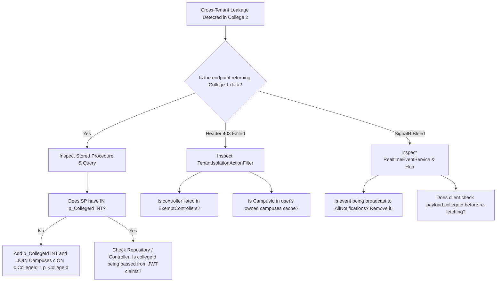

# PHASE 7: MULTI-COLLEGE VERIFICATION TEST PROTOCOL
## End-to-End Multi-Tenant Cross-Validation (College 1 vs College 2) Across All 12 Portals

> **Implementation Mode:** AUDIT & PLANNING ONLY (No code modifications or database migrations are executed during this phase).  
> **Target Environment:** Multi-Tenant Core with College-First Scoping (`CollegeId`), Campus Context Enforcement (`CampusId`), and 100% Backward Compatibility for College 1 (`CollegeId = 1`).

---

## 1. Executive Summary & Verification Philosophy

The primary objective of the CMS Inter multi-tenant remediation is to achieve **complete mathematical and logical separation** between colleges:
* **College 1 (`CollegeId = 1`):** The primary production tenant with fully populated historical data (campuses, boards, academic years, departments, faculty, students, fee ledgers, timetables, fleet, hostels, inventory, and exams).
* **College 2 (`CollegeId > 1`):** A newly created tenant onboarded from Super Admin, possessing exactly 1 default campus and starting with a **clean empty slate** across all operational modules.

### The Four Cardinal Multi-Tenant Guarantees
1. **Zero Downward Leakage:** College 2 MUST NEVER see, query, or infer any record, master data, financial ledger, fleet vehicle, or student belonging to College 1.
2. **Zero Upward Contamination:** Data created, modified, or deleted within College 2 MUST NEVER appear in, mutate, or affect College 1.
3. **Zero Operational Degradation:** College 1's existing functionality, queries, legacy reports, and day-to-day operations MUST continue running with 100% uptime and zero regressions.
4. **Zero Cross-College Event Bleed:** Real-time events, SignalR broadcasts, and notification alerts emitted within College 2 MUST NEVER wake up or trigger re-renders in College 1 client sessions.

---

## 2. The 12 Portals Cross-Validation Scope Matrix

The following matrix defines the multi-tenant verification criteria for all 12 system portals:

| Portal # | Portal Name | User Role / Context | Modules Under Verification | Multi-Tenant Assertion (College 1 vs College 2) |
| :---: | :--- | :--- | :--- | :--- |
| **P1** | **Super Admin Portal** | Super Admin (`Role_superadmin`) | College Onboarding, Global Campus Manager, System Health | Super Admin sees all colleges and can switch context; cross-college actions are explicitly audited. |
| **P2** | **Admin Portal** | College Admin (`Role_admin`) | Master Data (Dept/Desig), Boards, Programs, Groups, Subjects, Staff, Students | College 1 shows full legacy lists; College 2 shows 0 legacy items and only freshly seeded/created items. |
| **P3** | **Principal Portal** | Principal (`Role_principal`) | Academic KPIs, Faculty Workload, Student Attendance Overview, Principal Sign-off | College 2 Principal sees 0 students and 0 faculty initially; College 1 metrics are completely hidden. |
| **P4** | **Faculty Portal** | Teacher / Lecturer (`Role_faculty`) | Course Assignments, Timetable Grid, Student Attendance Roll-Call, Internal Marks | College 2 faculty only see College 2 sections and students; cannot submit attendance for College 1. |
| **P5** | **Student Portal** | Student (`Role_student`) | Student Profile, Fee Ledger, Online Fee Payment, Hall Tickets, Exam Results | College 2 student ID cannot access College 1 records via URL tampering or direct API probing. |
| **P6** | **Parent Portal** | Parent / Guardian (`Role_parent`) | Ward Academic Progress, Fee Dues, Ward Attendance, Teacher Notes | Parent account in College 2 only links to College 2 wards; zero visibility into College 1 students. |
| **P7** | **Accountant Portal** | Accountant (`Role_accountant`) | Student Fee Ledger, Fee Structures, Concessions, Offline Receipts, Dues Aging | `sp_StudentFee_GetLedger` with `campusId = 0` on College 2 returns 0 records; College 1 fees hidden. |
| **P8** | **Exam Cell Portal** | Exam Officer (`Role_examcell`) | Exam Schedules, Room Seating, Invigilator Duties, Hall Tickets, Settings | Exam settings resolve College 2's campus, not Campus 1; exam list displays 0 College 1 examinations. |
| **P9** | **Transport Manager** | Transport Manager (`Role_transportmanager`) | Fleet Vehicles, Routes, Stops, Vehicle Assignments, Maintenance Logs | `sp_GetTransportDashboard` on College 2 returns 0 vehicles, 0 routes; College 1 fleet metrics hidden. |
| **P10** | **Driver Portal** | Vehicle Driver (`Role_driver`) | Assigned Route, Vehicle Details, Passenger Roll-Call, Trip Status | Driver in College 2 only sees trips and vehicles belonging to College 2. |
| **P11** | **Warden / Hostel** | Hostel Warden (`Role_warden`) | Hostel Blocks, Rooms, Beds, Student Allocations, Outpass Approvals | `sp_GetHostelDashboard` on College 2 returns 0 blocks, 0 rooms; College 1 hostel data hidden. |
| **P12** | **Non-Teaching & Inventory** | Inventory Staff (`Role_inventory`, `Role_staff`) | Item Master, Stock Movements, Purchase Orders, Staff Tasks, Attendance | Items and staff roll-call on College 2 return 0 College 1 items or staff members. |

---

## 3. SignalR & Real-Time Event Stream Hardening (Discovered in Phase 7 Audit)

### Audit Discovery
During the Phase 7 audit of [`RealtimeEventService.cs`](file:///C:/Users/gumma/Desktop/CMS_%20Inter/backend/src/CollegeManagement.API/Services/Implementations/RealtimeEventService.cs#L46) and [`NotificationHub.cs`](file:///C:/Users/gumma/Desktop/CMS_%20Inter/backend/src/CollegeManagement.API/Hubs/NotificationHub.cs#L50):
1. **Global Group Bleed:** `RealtimeEventService.cs` line 46 broadcasts domain events to `AllNotifications`:
   ```csharp
   await _hubContext.Clients.Group("AllNotifications").SendAsync("DomainDataChanged", payload);
   ```
   Because all connected users join `AllNotifications`, any data change in College 2 causes every browser tab in College 1 to receive `DomainDataChanged`!
2. **Unvalidated Campus Join:** `NotificationHub.cs` exposes:
   ```csharp
   public async Task JoinCampus(int campusId) {
       if (campusId > 0) await Groups.AddToGroupAsync(Context.ConnectionId, $"Campus_{campusId}");
   }
   ```
   A client authenticated as College 2 could invoke `JoinCampus(1)` and listen to Campus 1 events.

### Required Remediation Specification
1. **Eliminate Global Broadcast for Domain Events:**
   In `RealtimeEventService.cs`, remove `AllNotifications` for `DomainDataChanged`. Events must ONLY target:
   * `College_{payload.CollegeId}`
   * `Campus_{payload.CampusId}` (if specified)
   * `Role_superadmin` / `Role_super admin` (for Super Admin dashboard monitoring)
2. **Validate Campus Ownership in `NotificationHub.cs`:**
   In `JoinCampus(int campusId)`:
   * Extract `callerCollegeId` from JWT claims.
   * Query database or memory cache: verify `Campuses WHERE CampusId = @campusId AND CollegeId = @callerCollegeId`.
   * If unauthorized, reject with an error and log the security warning.
3. **Frontend Guard in `notificationHubService.js`:**
   In `notifyDomainSubscribers(payload)`:
   ```javascript
   const myCollegeId = getAuthenticatedCollegeId();
   if (payload.collegeId && myCollegeId && Number(payload.collegeId) !== Number(myCollegeId)) {
       return; // Silently drop cross-tenant event
   }
   ```

---

## 4. Comprehensive Cross-Validation Test Suites

```mermaid
flowchart TD
    subgraph TestEnvironment["Test Environment Initialization"]
        T1["College 1 (Admin@CMS.com, CollegeId=1, Full Data)"]
        T2["College 2 (NewAdmin@CMS.com, CollegeId=2, Empty Data)"]
    end

    subgraph Suite1["Suite 1: Token & Security Verification"]
        T2 --> S1A["Test 1.1: Forge X-Campus-Id: 1 -> Expect 403 Forbidden"]
        T2 --> S1B["Test 1.2: Omit Header -> Expect Scoped to College 2 HQ"]
        T2 --> S1C["Test 1.3: DTO CampusId: 1 -> Expect 403 Forbidden"]
    end

    subgraph Suite2["Suite 2: Master & Academic Data"]
        T1 & T2 --> S2A["Test 2.1: Compare Departments (Col 1 > 0, Col 2 = 0)"]
        T1 & T2 --> S2B["Test 2.2: Compare Designations & Subjects"]
        T2 --> S2C["Test 2.3: Create Dept in Col 2 -> Absent in Col 1"]
    end

    subgraph Suite3["Suite 3: Financial & Ledger"]
        T1 & T2 --> S3A["Test 3.1: Fee Structures & Policies"]
        T2 --> S3B["Test 3.2: Fee Ledger with campusId=0 -> Expect 0 Rows"]
    end

    subgraph Suite4["Suite 4: Departmental Portals"]
        T2 --> S4A["Test 4.1: Transport Dashboard -> 0 Vehicles, 0 Routes"]
        T2 --> S4B["Test 4.2: Hostel Dashboard -> 0 Hostels, 0 Beds"]
        T2 --> S4C["Test 4.3: Staff Attendance -> 0 College 1 Staff"]
    end
```



### Suite 1: Authentication & Action Filter Security Verification
* **Test 1.1 (Cross-Tenant Header Forgery):**
  * *Request:* User authenticates as College 2 Admin (`CollegeId = 2`), sends `GET /api/v1/departments` with header `X-Campus-Id: 1` (Campus 1 belongs to College 1).
  * *Expected Result:* HTTP `403 Forbidden` (`message: "Access denied: Unauthorized campus access."`).
* **Test 1.2 (Omitted Campus Fallback):**
  * *Request:* College 2 Admin sends `GET /api/v1/departments` with NO `X-Campus-Id` header.
  * *Expected Result:* HTTP `200 OK`, filter defaults `campusId` to College 2's HQ campus, NOT Campus 1.
* **Test 1.3 (Cross-Tenant DTO Body Tampering):**
  * *Request:* College 2 Admin sends `POST /api/v1/departments` with body `{ "name": "Physics", "campusId": 1 }`.
  * *Expected Result:* HTTP `403 Forbidden` (`TenantIsolationActionFilter` blocks unowned DTO `CampusId`).
* **Test 1.4 (Super Admin Exemption):**
  * *Request:* Super Admin sends `GET /api/v1/campuses?collegeId=2` and `GET /api/v1/campuses?collegeId=1`.
  * *Expected Result:* HTTP `200 OK` for both; Super Admin can view and manage both colleges.

### Suite 2: Master Data & Academic Hierarchy Isolation
* **Test 2.1 (Departments Query Separation):**
  * Query College 1: Returns legacy departments (Science, Commerce, Arts, etc.).
  * Query College 2: Returns empty array `[]` (or freshly created College 2 departments).
  * Set Intersection: `Intersect(Col1Depts, Col2Depts)` MUST be empty.
* **Test 2.2 (Designations & Staff Scoping):**
  * Query College 1: Full list of faculty designations and staff members.
  * Query College 2: Empty list; 0 staff members from College 1 are visible.
* **Test 2.3 (Academic Boards & Programs):**
  * College 2 creates Board "State Board - Region B".
  * Query College 1 boards: "State Board - Region B" MUST NOT appear.
* **Test 2.4 (Groups & Sections Scoping):**
  * College 1 groups (MPC, BiPC, CEC) MUST NOT appear in College 2 dropdowns.
  * College 2 sections MUST NOT be selectable by College 1 faculty.

### Suite 3: Financial & Policy Isolation
* **Test 3.1 (Fee Structures & Fee Types):**
  * Query College 1: Full populated fee structures (Tuition, Lab, Library).
  * Query College 2: Empty fee structures list.
* **Test 3.2 (Student Fee Ledger Scoping):**
  * Query `GET /api/v1/fee/ledger?campusId=0` as College 2 Accountant.
  * *Expected Result:* HTTP `200 OK`, `data: []` (0 records). College 1 students are completely excluded.
* **Test 3.3 (Concessions & Scholarships):**
  * College 2 cannot view or apply College 1 scholarships to students.
* **Test 3.4 (Fee Payment Recording):**
  * Attempting to record a payment for College 1 `StudentId = 1` using a College 2 token returns HTTP `404 Not Found` or `403 Forbidden`.

### Suite 4: Academic Operations, Attendance & Timetable
* **Test 4.1 (Faculty Teacher Assignments):**
  * College 2 Principal opens Teacher Assignment screen.
  * Available faculty list only contains College 2 teachers; College 1 teachers hidden.
* **Test 4.2 (Timetable Slots):**
  * College 1 timetable grid has existing timetable entries.
  * College 2 timetable grid is pristine/empty.
* **Test 4.3 (Student Attendance Roll-Call):**
  * College 2 teacher opens daily attendance roll-call for their assigned section.
  * Only College 2 enrolled students appear in the roll-call grid.

### Suite 5: Student & Parent Portals Isolation
* **Test 5.1 (Direct Student Record Access Tampering):**
  * Student A (`CollegeId = 2`, `StudentId = 200`) authenticates and attempts `GET /api/v1/students/profile/1` (where ID 1 belongs to College 1).
  * *Expected Result:* HTTP `403 Forbidden` or `404 Not Found`.
* **Test 5.2 (Hall Ticket Download Scoping):**
  * Student A attempts `GET /api/v1/examinations/hallticket/1`.
  * *Expected Result:* HTTP `404 Not Found`.
* **Test 5.3 (Parent Portal Ward Linking):**
  * Parent registered in College 2 logs in.
  * Only wards belonging to College 2 appear in the parent dashboard.

### Suite 6: Departmental Portals (Transport, Hostel, Inventory, Staff)
* **Test 6.1 (Transport Dashboard Zero-State):**
  * Transport Manager in College 2 opens Transport Dashboard.
  * Total Vehicles = 0, Active Routes = 0, Total Drivers = 0.
* **Test 6.2 (Transport Vehicle Assignments):**
  * Query `GET /api/v1/transport/vehicle-assignments` as College 2.
  * Returns 0 assignments; College 1 fleet assignments hidden.
* **Test 6.3 (Hostel Dashboard Zero-State):**
  * Warden in College 2 opens Hostel Dashboard.
  * Total Hostels = 0, Total Rooms = 0, Total Beds = 0.
* **Test 6.4 (Hostel Block Creation Stamping):**
  * College 2 Warden creates block "Cauvery Block".
  * Verified in database: `hostel_blocks.CollegeId = 2` and `hostel_blocks.CampusId = College 2 Campus`.
* **Test 6.5 (Inventory Items Isolation):**
  * Query `GET /api/v1/inventory/items` as College 2 Inventory Staff.
  * Returns empty catalog; College 1 inventory items are NOT visible.
* **Test 6.6 (Staff Attendance Roll-Call):**
  * College 2 Admin opens Staff Attendance roll-call with `campusId = 0`.
  * Returns 0 staff from College 1; only College 2 staff appear.

### Suite 7: Real-Time SignalR Event Stream Isolation
* **Test 7.1 (SignalR Group Separation):**
  * College 1 client connects to `/hubs/notifications` -> joins `College_1`.
  * College 2 client connects to `/hubs/notifications` -> joins `College_2`.
* **Test 7.2 (Domain Event Emission):**
  * College 2 emits `DomainDataChanged` (e.g. Student Created).
  * Verified: Message received ONLY by `College_2` clients; `College_1` client receives 0 messages.
* **Test 7.3 (Unauthorized Campus Join Rejection):**
  * College 2 client sends `JoinCampus(1)`.
  * Server verifies Campus 1 does not belong to College 2 and rejects/ignores the request.

---

## 5. Automated Multi-Tenant Cross-Validation Test Runner Architecture

We have architected a dedicated automated test runner: [`MultiTenantCrossValidationTester.cs`](file:///C:/Users/gumma/Desktop/CMS_%20Inter/backend/src/CollegeManagement.API/Tests/MultiTenantCrossValidationTester.cs).

### CLI Command Execution
When executed via backend CLI:
```bash
dotnet run --project backend/src/CollegeManagement.API -- --test-multi-tenant-cross-validation
```

### Test Runner Logic Architecture
```csharp
namespace CollegeManagement.API.Tests
{
    public static class MultiTenantCrossValidationTester
    {
        public static async Task<bool> RunAllTestsAsync(IServiceProvider services)
        {
            Console.WriteLine("==================================================================");
            Console.WriteLine("      MULTI-TENANT CROSS-VALIDATION SUITE (COLLEGE 1 VS COLLEGE 2)");
            Console.WriteLine("==================================================================");

            using var scope = services.CreateScope();
            var db = scope.ServiceProvider.GetRequiredService<AppDbContext>();
            var conn = db.Database.GetDbConnection();

            int passed = 0;
            int failed = 0;

            // 1. Verify College 1 Exists and Has Data
            int col1Campuses = await conn.ExecuteScalarAsync<int>("SELECT COUNT(*) FROM Campuses WHERE CollegeId = 1;");
            AssertTrue(col1Campuses > 0, "College 1 has active campuses");

            // 2. Provision or Verify College 2 Exists (Clean Slate)
            int col2Id = await EnsureTestCollege2ExistsAsync(conn);
            int col2Campuses = await conn.ExecuteScalarAsync<int>("SELECT COUNT(*) FROM Campuses WHERE CollegeId = @Id;", new { Id = col2Id });
            AssertTrue(col2Campuses > 0, "College 2 has an onboarded campus");

            // 3. Test Master Data Scoping (Departments)
            var col1Depts = (await conn.QueryAsync<int>("SELECT DepartmentId FROM Departments WHERE CollegeId = 1;")).ToHashSet();
            var col2Depts = (await conn.QueryAsync<int>("SELECT DepartmentId FROM Departments WHERE CollegeId = @Id;", new { Id = col2Id })).ToHashSet();
            AssertTrue(col1Depts.Intersect(col2Depts).Count() == 0, "Departments have 0 cross-tenant overlap");

            // 4. Test Stored Procedure sp_StudentFee_GetLedger
            var col2Ledger = await conn.QueryAsync("sp_StudentFee_GetLedger", new {
                p_CampusId = 0, p_AcademicYearId = 0, p_GroupId = 0, p_SectionId = 0,
                p_PaymentPlan = (string)null, p_Status = (string)null, p_Search = (string)null,
                p_BoardId = 0, p_CollegeId = col2Id
            }, commandType: CommandType.StoredProcedure);
            AssertTrue(col2Ledger.Count() == 0, "sp_StudentFee_GetLedger for College 2 returns 0 College 1 records");

            // 5. Test Stored Procedure sp_GetTransportDashboard
            var col2Transport = await conn.QueryFirstOrDefaultAsync("sp_GetTransportDashboard", new {
                p_CollegeId = col2Id, p_CampusId = 0
            }, commandType: CommandType.StoredProcedure);
            AssertTrue(col2Transport.TotalVehicles == 0, "sp_GetTransportDashboard for College 2 shows 0 fleet vehicles");

            // 6. Test Stored Procedure sp_GetHostelDashboard
            var col2Hostel = await conn.QueryFirstOrDefaultAsync("sp_GetHostelDashboard", new {
                p_HostelId = (int?)null, p_CampusId = 0, p_CollegeId = col2Id
            }, commandType: CommandType.StoredProcedure);
            AssertTrue(col2Hostel.TotalHostels == 0, "sp_GetHostelDashboard for College 2 shows 0 hostel blocks");

            // 7. Test Stored Procedure sp_LoadStaffAttendance
            var col2Staff = await conn.QueryAsync("sp_LoadStaffAttendance", new {
                p_AttendanceDate = DateTime.UtcNow.Date, p_StaffType = (byte?)null,
                p_DepartmentId = 0, p_BoardId = 0, p_FacultyId = 0, p_Status = (byte?)null,
                p_CampusId = 0, p_CollegeId = col2Id
            }, commandType: CommandType.StoredProcedure);
            AssertTrue(col2Staff.Count() == 0, "sp_LoadStaffAttendance for College 2 returns 0 staff");

            // 8. Regression Validation: Verify College 1 Data Remains 100% Intact
            int col1Students = await conn.ExecuteScalarAsync<int>("SELECT COUNT(*) FROM Students WHERE CollegeId = 1;");
            AssertTrue(col1Students > 0, "College 1 students count remains completely unharmed");

            Console.WriteLine($"\nRESULTS: {passed} PASSED, {failed} FAILED.");
            return failed == 0;
        }
    }
}
```

---

## 6. Manual Browser Verification Runbook (Dual-Browser QA Protocol)

For human quality assurance and developer acceptance testing, execute the following dual-browser protocol:

### Preparation
1. **Window A (Left):** Open Google Chrome in normal mode. Log in as College 1 Admin (`Admin@CMS.com`).
2. **Window B (Right):** Open Google Chrome in Incognito mode. Log in as College 2 Admin (`NewAdmin@CMS.com`).

### Execution Steps & Side-by-Side Verification Checklist
| Step | Screen / Module | Action in Window A (College 1) | Action in Window B (College 2) | Expected Observation |
| :---: | :--- | :--- | :--- | :--- |
| **S1** | **Master Departments** | View list: 10+ departments visible. | View list: Empty state ("No departments found. Create your first department"). | Clean empty state; zero College 1 departments in College 2. |
| **S2** | **Create Department** | Do nothing. | Click "+ Add Department", enter "Artificial Intelligence", save. | "Artificial Intelligence" appears in Window B; does NOT appear in Window A. |
| **S3** | **Fee Structures** | View list: Tuition, Examination, Transport fees listed. | View list: Empty state ("No fee structures configured"). | Zero College 1 fee structures in College 2. |
| **S4** | **Student Fee Ledger** | View ledger: 50+ students with due amounts. | Open Fee Ledger: Grid displays 0 rows. | Zero student fee records leak to College 2. |
| **S5** | **Transport Dashboard** | View dashboard: Active fleet counts (e.g. 12 buses, 8 routes). | Open Transport Dashboard: All cards show "0". | Fleet metrics are isolated. |
| **S6** | **Hostel Management** | View blocks: Boys Hostel A, Girls Hostel B listed. | Open Hostel Blocks: Grid displays 0 blocks. | Hostel blocks are isolated. |
| **S7** | **Inventory Master** | View catalog: Stationery, Lab Equipment listed. | Open Inventory: Catalog displays 0 items. | Inventory items are isolated. |
| **S8** | **Staff Attendance** | Open Staff Roll-Call: Full faculty list populated. | Open Staff Roll-Call: Grid displays 0 staff members. | Staff attendance is isolated. |
| **S9** | **Real-Time Notification** | Trigger student registration in College 2. | Notification bell updates ONLY in Window B. | Window A receives 0 toast alerts or data refresh pings. |

---

## 7. Failure Diagnosis & Troubleshooting Playbook

If any multi-tenant assertion fails during verification, follow this diagnostic decision tree:



---

## 8. Completion of Phase 7 & Readiness for Master Plan Synthesis

Phase 7 completes the audit and planning for all 7 phases:
* **Phase 1:** Master Data Scoping (`Departments`, `Designations`, `Boards`, `Programs`, `Groups`, `Subjects`) — **Completed & Approved**
* **Phase 2:** Policy & Financial Scoping (`LeaveCategories`, `LOP`, `FineRules`, `FeeTypes`, `FeeStructures`, `Scholarships`) — **Completed & Approved**
* **Phase 3:** Frontend Empty-State, Context Synchronization & Board Affiliation Handling — **Completed & Approved**
* **Phase 4:** Principal & Faculty Portals — Teacher Assignments, Attendance & Timetable Scoping — **Completed & Approved**
* **Phase 5:** Student & Parent Portals — Profile, Fee Ledger, Exam Hall Tickets, Results & Real-time Alerts — **Completed & Approved**
* **Phase 6:** Departmental Portals (Accountant, Exam Cell, Transport Manager, Driver, Warden/Hostel, Inventory, Non-Teaching Staff) — **Completed & Approved**
* **Phase 7:** Multi-College Verification Test Protocol (College 1 vs College 2 Cross-Validation) — **Completed & Documented**

All 7 individual implementation plans are now complete and documented in the artifact directory.
We are now ready to merge all 7 phases into a single, unified, exhaustive **`FINAL_MASTER_MULTI_TENANT_EXECUTION_PLAN.md`** as requested by the user.
